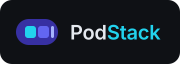

<p align="center">
  
</p>

<p align="center">
  
  &nbsp;&nbsp;&nbsp;
  
</p>

<h1 align="center">PodStack</h1>

<p align="center">
  <a href="https://github.com/marcos2872/podstack/actions/workflows/ci.yml">
    
  </a>
</p>

<p align="center">
  <strong>Containers, Compose, VMs Linux, Kubernetes e domínios locais em um único app — sobre o Podman Engine nativo.</strong><br>
  Alternativa Linux ao OrbStack, com Qt 6/QML, daemon de usuário e CLI scriptable.
</p>

> **Status:** **M3 concluído** — Compose (detecção por labels, up/down/restart/stop/start, logs por serviço/agregados), builds via Libpod com histórico SQLite e eventos globais em toasts. Somam-se ao M2 (imagens, volumes, redes e pods) e ao M1 (containers, logs, stats, files, terminal, batch, health e rootful). **7 testes**, cobertura **80,7%** (gate 80%). Próximo: M4 (machines).
> **Ressalvas M1:** terminal abre em janela nativa (embutir no inspector fica no M2); upload de arquivos e seleção múltipla fina também ficam no M2.
> **Plataforma:** Linux desktop — Fedora 43+ (Wayland/X11), Podman ≥ 5.8, Qt ≥ 6.10.
> **Identidade:** projeto independente, sem afiliação com a Orbital Labs. Nenhum asset, ícone ou código proprietário do OrbStack é reutilizado (ver [`docs/constitution.md`](docs/constitution.md)).

---

## O que é

O PodStack reúne, em uma única experiência desktop:

- **Containers**: ciclo de vida, logs, terminal, arquivos, estatísticas e inspect.
- **Imagens, volumes, redes e pods** com gestão visual.
- **Compose**: projetos agrupados, logs por serviço, up/down.
- **Machines**: VMs Linux (Ubuntu, Debian, Fedora, Arch, Alpine e outras) com cloud-init, SSH, virtiofs e port forwarding.
- **Kubernetes local** integrado, com contextos e kubectl.
- **Domínios locais** (`*.localhost`/`*.podstack.local`) e HTTPS automático.
- **CLI `podstack`** com paridade com a GUI, para automação e CI.
- **Rootless por padrão**, com helper privilegiado mínimo e opt-in.

**Arquitetura em uma frase:** GUI Qt Quick + CLI + `podstackd` conversando por JSON-RPC em Unix socket; o daemon fala com o `podman.socket` via Libpod REST, com QEMU/KVM para machines, Caddy para HTTPS e k3s para Kubernetes.

---

## Documentação

A documentação é a **fonte de verdade** e segue **SDD (Spec-Driven Development)**: constituição → PRD → spec → plan → tasks.

### Núcleo SDD

| Documento | O que responde |
|---|---|
| [`docs/README.md`](docs/README.md) | Índice geral, convenções e mapa SDD |
| [`docs/constitution.md`](docs/constitution.md) | Princípios inegociáveis (clean-room, rootless, segurança, qualidade) |
| [`docs/PRD.md`](docs/PRD.md) | PRD completo: problema, personas, 127 requisitos funcionais, 32 NFRs, métricas, riscos e critérios de release |
| [`docs/spec.md`](docs/spec.md) | Comportamento detalhado, fluxos, máquinas de estado e casos de borda |
| [`docs/plan.md`](docs/plan.md) | Plano técnico: stack, componentes, concorrência, persistência e riscos |
| [`docs/tasks.md`](docs/tasks.md) | 133 tarefas em M0–M8, com dependências e definição de pronto |
| [`docs/testing.md`](docs/testing.md) | Pirâmide de testes, matriz de compatibilidade, CI e performance |

### Engenharia e produto

| Documento | Conteúdo |
|---|---|
| [`docs/architecture.md`](docs/architecture.md) | C4, sequências (exec, logs, machines, domínios, K8s), threads e erros |
| [`docs/data-model.md`](docs/data-model.md) | Entidades, esquema SQLite, `config.json`, `meta.json` e migrações |
| [`docs/api-rpc.md`](docs/api-rpc.md) | Contrato JSON-RPC completo do `podstackd` |
| [`docs/ui-map.md`](docs/ui-map.md) | Telas, sidebar, inspector, componentes QML, design tokens e atalhos |
| [`docs/branding.md`](docs/branding.md) | Logo, paleta, tipografia e regras de uso dos assets |
| [`docs/cli-parity.md`](docs/cli-parity.md) | Mapa `orb` → `podstack`, flags, exit codes e exemplos |
| [`docs/settings.md`](docs/settings.md) | Todas as chaves, defaults, validação e migração |
| [`docs/security.md`](docs/security.md) | Threat model, helper/polkit, socket, segredos e SELinux |
| [`docs/packaging.md`](docs/packaging.md) | RPM, systemd, polkit, SELinux, AppImage e avaliação de Flatpak |
| [`docs/roadmap.md`](docs/roadmap.md) | Marcos, estimativas, caminho crítico e versões |

### Decisões arquiteturais (ADRs)

| ADR | Decisão |
|---|---|
| [`0001 — Daemon JSON-RPC`](docs/adr/0001-daemon-json-rpc.md) | Daemon de usuário com JSON-RPC sobre Unix socket |
| [`0002 — Libpod + libcurl`](docs/adr/0002-libpod-libcurl.md) | Libpod REST e libcurl para streams/hijack |
| [`0003 — Machines QEMU/KVM`](docs/adr/0003-machines-qemu-kvm.md) | QEMU/KVM direto + cloud-init + virtiofs |
| [`0004 — Domínios`](docs/adr/0004-domains-localhost-helper.md) | `*.localhost` no v1; `*.podstack.local` via helper |
| [`0005 — Terminal`](docs/adr/0005-terminal-backend.md) | QTermWidget (GPL-2.0-or-later, compatível com GPL-3.0-or-later) |
| [`0006 — RPM primeiro`](docs/adr/0006-rpm-first.md) | RPM como formato primário |
| [`0007 — Compose`](docs/adr/0007-compose-provider.md) | Provider Docker Compose + estado por labels |

### Referência (baseline OrbStack 2.2.5)

| Documento | Conteúdo |
|---|---|
| [`docs/reference/orbstack-2.2.5.md`](docs/reference/orbstack-2.2.5.md) | Inventário estático do DMG: arquitetura, UI, CLI e settings |
| [`docs/reference/orbstack-2.2.5-official-notes.md`](docs/reference/orbstack-2.2.5-official-notes.md) | Correções e detalhes da documentação oficial |
| [`docs/reference/cli-tree.json`](docs/reference/cli-tree.json) | Árvore completa do CLI (51 nós, flags) |
| [`docs/reference/cli-tree.md`](docs/reference/cli-tree.md) | Versão legível da árvore |
| [`docs/reference/swift-files.txt`](docs/reference/swift-files.txt) | 29 arquivos de tela/modelo Swift identificados |
| [`docs/reference/settings-keys.txt`](docs/reference/settings-keys.txt) | Chaves de settings observadas |

---

## Assets e marca

**Marca aprovada:** **cápsula** (símbolo principal) + **camadas** (símbolo secundário). O monograma P não foi aprovado.

| Asset | Descrição |
|---|---|
| [`assets/podstack-logo.svg`](assets/podstack-logo.svg) | Lockup horizontal (cápsula + wordmark) |
| [`assets/podstack-capsule.svg`](assets/podstack-capsule.svg) | Símbolo principal (cápsula) |
| [`assets/podstack-layers.svg`](assets/podstack-layers.svg) | Símbolo secundário (camadas) |
| [`assets/podstack-capsule-small.svg`](assets/podstack-capsule-small.svg) | Cápsula compacta para 16–24 px |
| [`assets/podstack-icon.svg`](assets/podstack-icon.svg) | Ícone do app (256×256) |
| [`assets/png/`](assets/png/) | Ícones PNG 16–512 e bandeja 16/22/24/32 |
| [`assets/favicon.ico`](assets/favicon.ico) / [`favicon-32.png`](assets/favicon-32.png) | Favicon multi-size e PNG 32×32 |
| [`assets/og-image.png`](assets/og-image.png) / [`og-image.svg`](assets/og-image.svg) | Open Graph 1200×630 |
| [`assets/podstack_logo_concepts.svg`](assets/podstack_logo_concepts.svg) | Folha histórica de conceitos |
| [`assets/logo.md`](assets/logo.md) | Racional original dos conceitos |

Paleta: índigo `#3730A3`, acento `#6366F1`, ciano `#22D3EE`. Regras de uso, tamanhos mínimos e o que evitar estão em [`docs/branding.md`](docs/branding.md).

---

## Estrutura do repositório

```
.
├── README.md              # este arquivo
├── AGENTS.md              # instruções para agentes/devs iniciando no projeto
├── LICENSE                # GPL-3.0-or-later
├── NOTICE                 # aviso de copyright/licença
├── assets/                # marca aprovada (cápsula + camadas)
│   ├── podstack-logo.svg
│   ├── podstack-capsule.svg
│   ├── podstack-layers.svg
│   ├── podstack-capsule-small.svg
│   ├── podstack-icon.svg
│   ├── podstack_logo_concepts.svg
│   ├── favicon.ico
│   ├── favicon-32.png
│   ├── og-image.svg
│   ├── og-image.png
│   ├── png/
│   │   ├── podstack-icon-{16,24,32,48,64,128,256,512}.png
│   │   └── tray/
│   └── logo.md
├── docs/                  # especificação, PRD, arquitetura, ADRs e referência
    ├── README.md
    ├── constitution.md
    ├── PRD.md
    ├── spec.md
    ├── plan.md
    ├── tasks.md
    ├── architecture.md
    ├── data-model.md
    ├── api-rpc.md
    ├── ui-map.md
    ├── branding.md
    ├── cli-parity.md
    ├── settings.md
    ├── security.md
    ├── testing.md
    ├── packaging.md
    ├── roadmap.md
    ├── adr/
    └── reference/
├── CMakeLists.txt
├── CMakePresets.json
├── src/
│   ├── core/
│   ├── podman/
│   ├── daemon/
│   ├── cli/
│   └── gui/
├── tests/
├── packaging/
├── scripts/
└── .github/workflows/
```

---

## Roadmap resumido

| Marco | Entrega |
|---|---|
| **M0** | Scaffold, daemon, cliente Podman, CLI base, shell QML |
| **M1** | Containers: ciclo de vida, logs, terminal, stats |
| **M2** | Imagens, volumes, redes, pods |
| **M3** | Compose, builds, eventos |
| **M4** | Machines (QEMU/KVM, cloud-init, SSH, virtiofs) |
| **M5** | Kubernetes (k3s) |
| **M6** | Domínios, HTTPS, port forwarding |
| **M7** | Tray, settings, updates, v1.0 |
| **M8** | USB/serial, X11/áudio, migração (pós-v1) |

Detalhes e critérios de saída em [`docs/roadmap.md`](docs/roadmap.md).

---

## Começando (desenvolvimento)

```bash
# dependências (Fedora)
sudo dnf install cmake ninja-build gcc-c++ \
  qt6-qtbase-devel qt6-qtdeclarative-devel qt6-qtwayland-devel \
  qtermwidget-devel libarchive-devel libcurl-devel sqlite-devel

# provider Compose (runtime, para projetos Compose)
sudo dnf install docker-compose

# build
cmake --preset dev
cmake --build --preset dev
ctest --preset dev

# rodar daemon + GUI (build incremental)
./scripts/dev.sh

# depois do primeiro build, sem recompilar:
PODSTACK_SKIP_BUILD=1 ./scripts/dev.sh
```

O `scripts/dev.sh` usa `$XDG_RUNTIME_DIR/podstack/control.sock`, inicia o daemon se necessário e reaproveita um daemon já ativo. Para isolar do daemon do sistema, defina `PODSTACK_CONTROL_SOCKET`:

```bash
PODSTACK_CONTROL_SOCKET=/tmp/podstack-dev.sock PODSTACK_SKIP_BUILD=1 ./scripts/dev.sh
```

O CLI também pode ser usado separadamente:

```bash
./build/dev/podstackd &          # daemon
./build/dev/podstack status
./build/dev/podstack ps --all
./build/dev/podstack exec <container> -- /bin/echo hello
```

Leia [`AGENTS.md`](AGENTS.md) antes de contribuir. Ele define ordem de leitura, regras de clean-room, convenções de código, fluxo de tarefas e critérios de verificação.

---

## Licença

**GPL-3.0-or-later** — texto completo em [`LICENSE`](LICENSE) e aviso em [`NOTICE`](NOTICE).

Copyright (C) 2026 PodStack contributors.

This program is free software: you can redistribute it and/or modify it under the terms of the GNU General Public License as published by the Free Software Foundation, either version 3 of the License, or (at your option) any later version.

This program is distributed in the hope that it will be useful, but WITHOUT ANY WARRANTY; without even the implied warranty of MERCHANTABILITY or FITNESS FOR A PARTICULAR PURPOSE. See the GNU General Public License for more details.

A documentação e os assets também são licenciados sob GPL-3.0-or-later, salvo indicação em contrário. O terminal embutido usa **QTermWidget** (GPL-2.0-or-later, compatível com GPL-3.0-or-later).

---

## Agradecimentos

O PodStack é inspirado no fluxo de trabalho e na organização visual do OrbStack, sem reutilizar seu código, assets ou marca. OrbStack é marca da Orbital Labs; PodStack é um projeto independente.
