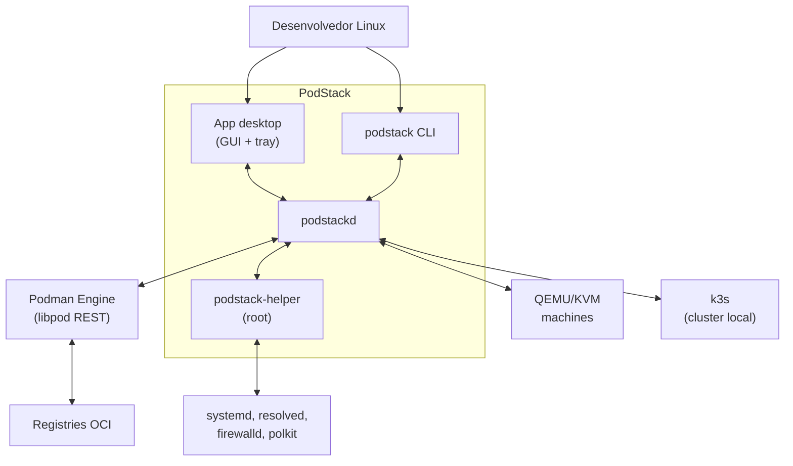
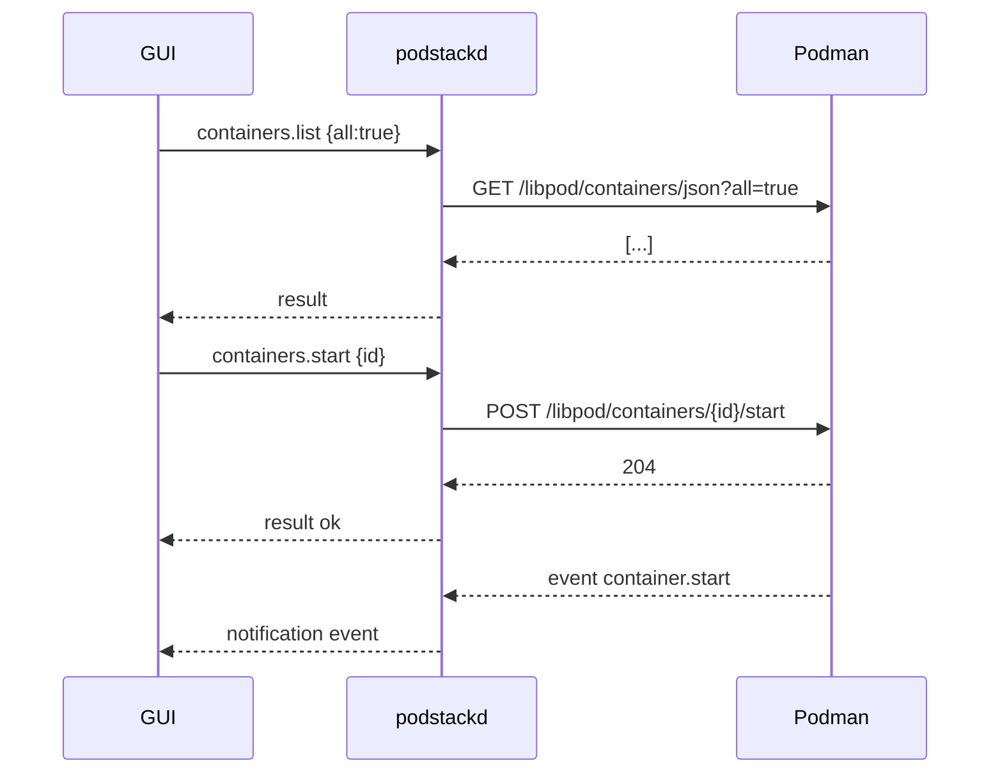
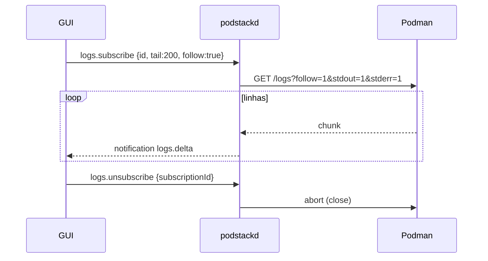
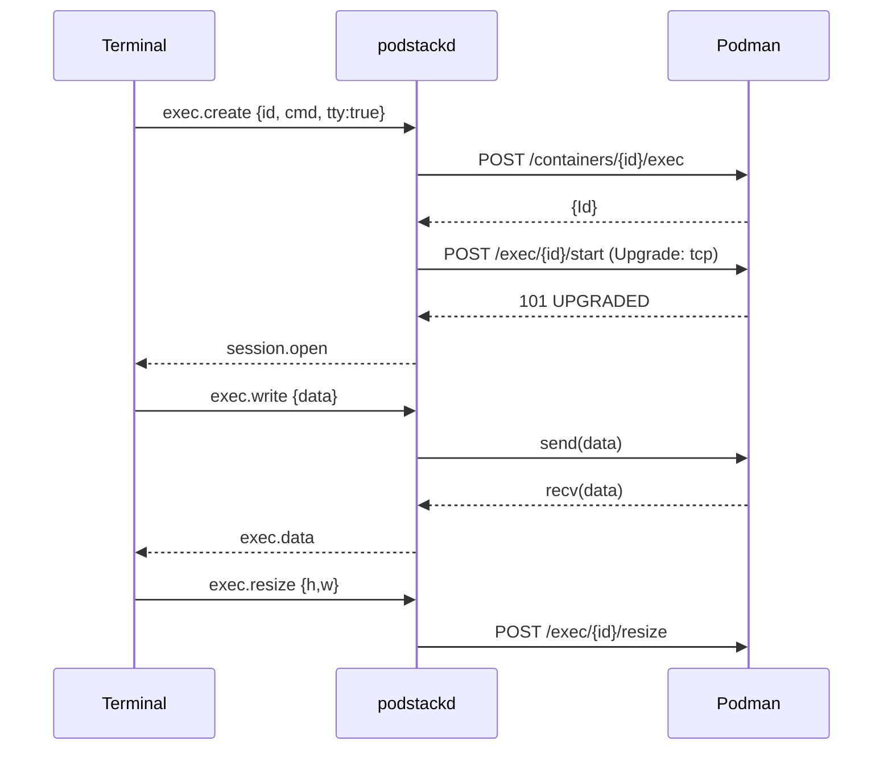
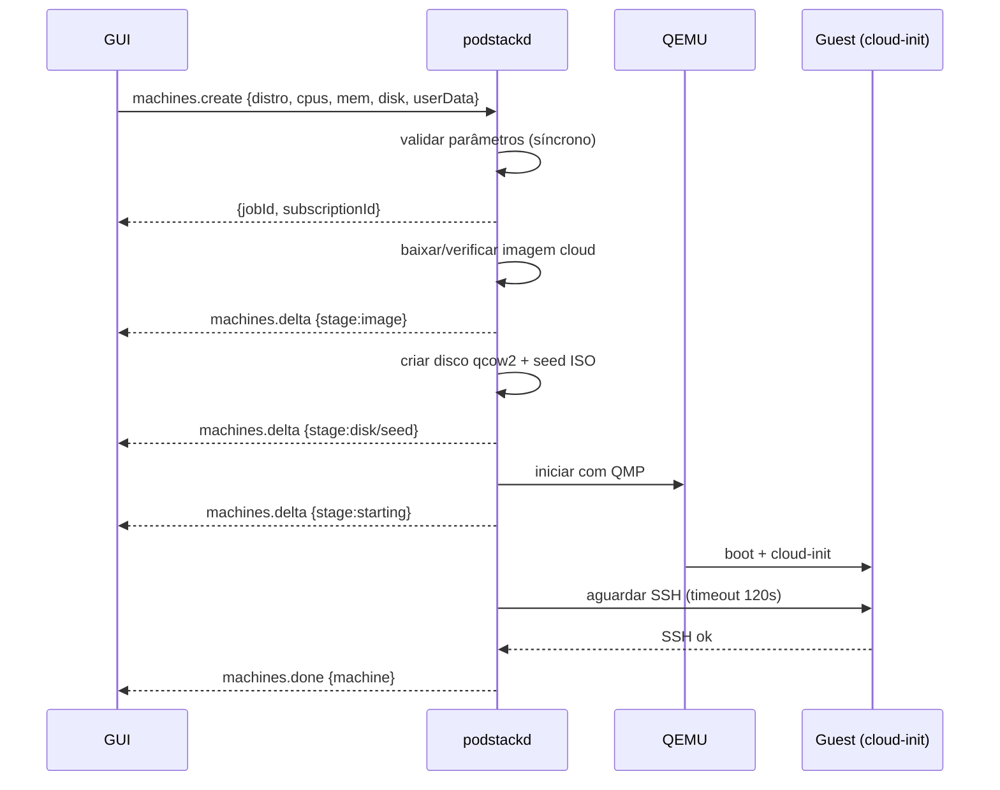
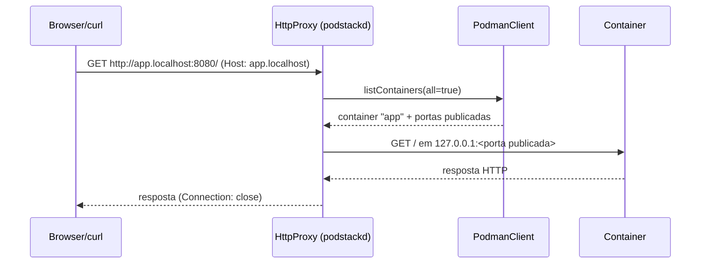
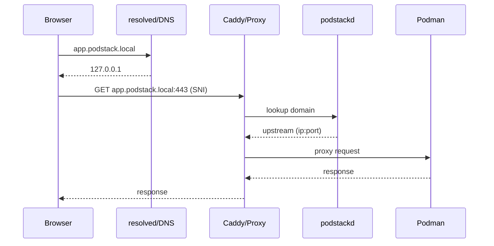
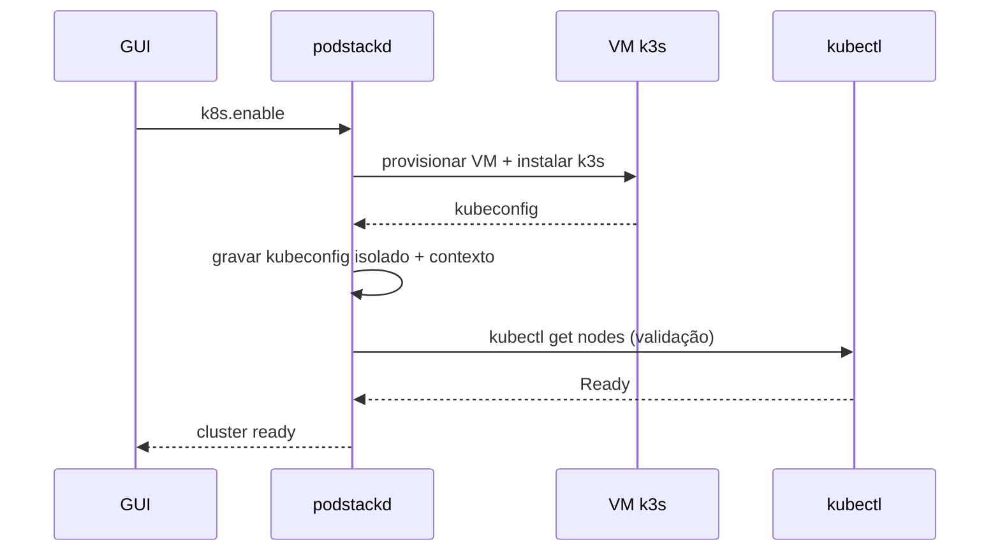
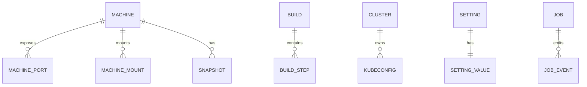

# Arquitetura — PodStack

> Visão técnica detalhada. Complementa [`plan.md`](plan.md) e os ADRs.

---

## 1. Contexto (C4 nível 1)



**Atores externos:** registries OCI, imagens cloud (download), servidores de update.

---

## 2. Containers (C4 nível 2)

```mermaid
flowchart LR
  subgraph GUI["podstack-gui (Qt Quick)"]
    QML["QML views"]
    Models["List/Inspector models"]
    Term["Terminal widget"]
  end
  subgraph Daemon["podstackd"]
    RPC["RPC server<br/>JSON-RPC 2.0"]
    State["State store<br/>(cache + SQLite)"]
    PC["PodmanClient<br/>(libcurl)"]
    Streams["StreamHub<br/>(logs/stats/events)"]
    Jobs["JobManager"]
    Mach["MachineManager"]
    Kube["K8sManager"]
    Proxy["ProxyManager<br/>(Caddy/DNS)"]
    HttpProxy["HttpProxy<br/>(*.localhost)"]
    Cfg["Settings"]
    Diag["Diagnostics"]
  end
  subgraph System["Sistema"]
    PSock["podman.socket"]
    QMP["QEMU/QMP"]
    Helper["podstack-helper"]
    Resolved["systemd-resolved"]
  end
  QML --> Models --> RPC
  Term --> RPC
  RPC --> State
  RPC --> Jobs
  State --> PC
  PC --> PSock
  PC --> Streams --> RPC
  Jobs --> PC
  Jobs --> Mach --> QMP
  Kube --> QMP
  Proxy --> Helper
  HttpProxy --> PC
  Helper --> Resolved
  Cfg --> State
  Diag --> RPC
```



### 2.1 Responsabilidades por componente

| Componente | Faz | Não faz |
|---|---|---|
| **RPC server** | aceita conexões, valida UID, despacha métodos, assina streams | lógica de negócio pesada |
| **State store** | cache reconciliado, índices, persistência SQLite | falar com Podman diretamente |
| **PodmanClient** | HTTP/libcurl, parsing, erros, streams | decidir UI |
| **StreamHub** | fan-out de logs/stats/events, backpressure | armazenar histórico longo |
| **JobManager** | jobs longos, progresso, cancelamento, retomada | bloquear RPC |
| **MachineManager** | ciclo de vida QEMU, cloud-init, SSH, virtiofs, QMP | containers |
| **K8sManager** | provisionar/gerenciar k3s, kubeconfig, watch | proxy de domínios |
| **ProxyManager** | DNS userspace, Caddy, detecção de porta, certs | lógica de containers |
| **HttpProxy** | proxy HTTP de entrada para `*.localhost` em loopback; resolve container e porta publicada | DNS, TLS/Caddy (T6), regras de negócio |
| **Settings** | schema, validação, migração, defaults | UI |
| **Diagnostics** | checks, report, redaction | enviar sem consentimento |
| **SetupManager** | detecção read-only, ações de setup via helper, jobs com progresso/cancelamento | executar shell/sudo, remover Docker por padrão |

### 2.2 Setup e primeira execução

- **`SetupManager`** (daemon) detecta Podman, Docker, QEMU/KVM, `/dev/kvm`, OVMF, virtiofsd, systemd de usuário, SQLite, Caddy e k3s; expõe `setup.status/check/apply/removeDocker/cancel/complete/subscribe/validate`.
- Ações são **jobs** internos com progresso/log/cancelamento e eventos `setup.delta`/`setup.done`; o job continua se a janela fechar e pode ser retomado por `setup.subscribe`.
- Ações privilegiadas (pacotes, remoção do Docker) passam pelo **`podstack-helper`** (`dev.podstack.Helper1`, polkit, allowlist); a GUI nunca executa `sudo`/shell. O socket do Podman de usuário é ativado pelo daemon.
- **`Backend`** (GUI) expõe `setupCompleted/setupPending/setupChecks/setupProgress/setupLog/setupMandatoryOk` e os invokables `setupRefresh/setupCheck/setupValidate/setupApply/setupComplete`; **`SetupWindow.qml`** é um overlay modal dentro da `MainWindow` que conduz as 7 etapas e bloqueia o app enquanto `setup.completed=false`. A conclusão é recusada no `Backend` se os checks obrigatórios não estiverem `ok` (`core/SetupPolicy.h`).
- O estado é persistido em `setup.completed`/`completedAt`/`dockerPolicy`/`lastValidation`; `app.showOnboarding=false` registra que o usuário optou por continuar depois.
- Docker e Podman coexistem; a remoção do Docker é opt-in e não faz parte do fluxo principal.

### 2.3 Bandeja, ciclo de vida e notificações

- **`TrayController`** (`src/gui/Tray.cpp`) expõe `QSystemTrayIcon` + `QMenu` (SNI/DBusMenu). É uma
  view: recebe o snapshot de `Backend` (`containersChanged`, `composeProjectsChanged`,
  `stateChanged`, `setupChanged`, `actionStateChanged`) e emite intenções; o `main.cpp` traduz em
  `Backend::lifecycle`/`composeStart|Stop|Restart` e o QML em navegação. O menu é reconstruído a
  cada mudança e reexportado com `setContextMenu` (o SNI não emite `aboutToShow`).
- **`SingleInstance`** (`src/gui/SingleInstance.cpp`) escuta em
  `$XDG_RUNTIME_DIR/podstack/gui.sock` (dir `0700`, socket `0600`, `SO_PEERCRED`); a segunda
  instância envia `show`/`quit` e sai. `--hidden` inicia na bandeja; `--quit` encerra a instância.
- **`Autostart`** cria/remove o `.desktop` em `~/.config/autostart` com `--hidden` e reconcilia
  `app.startAtLogin` no startup.
- **`NotificationService`** usa `org.freedesktop.Notifications` (fallback: balão do tray) para
  `die` com código ≠ 0, `oom` e `health_status=unhealthy`, com cooldown por container/ação.
- **Activity Monitor**: `system.stats.subscribe` agrega no daemon CPU/mem/rede/disco do host
  (`/proc`) e stats de todos os containers (uma chamada Libpod), emitindo `system.stats.delta` a
  cada 2 s; `ActivityMonitorWindow.qml` desenha totais, sparklines e a tabela por container.

---

## 3. Fluxos (sequência)

### 3.1 Listar e iniciar container



### 3.2 Logs em streaming



### 3.3 Exec/terminal (hijack)



### 3.4 Criar máquina



O `machines.create` roda em `QtConcurrent` e devolve `{jobId, subscriptionId}`; a validação
(`MachineManager::validate`) acontece antes de iniciar o job, então nome, distro, CPUs,
memória e disco inválidos retornam `PODSTACK_INVALID_PARAMS` na própria resposta RPC. O
progresso é publicado em `machines.delta` e o resultado em `machines.done` (com `machine` ou
`error`). `machines.cancel` marca o `Subscription::cancel`, observado pelo download, pela
criação do disco/seed e pelo início do QEMU, e o job termina com `PODSTACK_CANCELLED`. A
subscription e o mapa `jobId → subscriptionId` são limpos ao final; a senha nunca entra em
log ou notificação.

### 3.5 Controle por QMP

O `QmpClient` (`src/machines/QmpClient.{h,cpp}`) fala QMP sobre socket Unix em
**NDJSON**: uma mensagem JSON compacta por linha, com limite de 1 MiB por linha.
Ao conectar, lê a saudação `{"QMP": {...}}` e envia `qmp_capabilities`; as
respostas são casadas pelo `id` incremental. Eventos assíncronos
(`{"event": ...}`) que chegam antes da resposta são ignorados. Erros QMP
(`{"error": {"class", "desc"}}`) viram `PODSTACK_INTERNAL` com o detalhe;
timeout vira `PODSTACK_TIMEOUT` e socket fechado/erro vira `PODSTACK_IO_ERROR`.
Os timeouts padrão são 5 s para conexão e 2 s por comando. No `quit`, o QEMU
responde com o evento `SHUTDOWN` e pode fechar o socket; o cliente trata o
fechamento após o envio como sucesso, desde que nenhum erro tenha sido
recebido. A montagem da linha de comando fica em `QemuCommand`
(`src/machines/QemuCommand.{h,cpp}`), que valida arquitetura, CPUs, memória,
caminhos absolutos e o pareamento OVMF code/vars sem tocar no filesystem.

#### Runtime e ciclo de vida

O `QemuProcessRuntime` (`src/machines/QemuRuntime.{h,cpp}`) inicia o binário
resolvido por `QStandardPaths::findExecutable` com `QProcess::startDetached` e
`-daemonize`, sem shell. A execução é considerada viva quando há um pidfile
(limite de 64 bytes) cujo PID existe em `/proc/<pid>/cmdline` com o marcador
`podstack:<machineId>`; isso evita aceitar um PID reciclado. Se o pidfile sumir
ou ficar inválido, o runtime varre `/proc` e usa o processo do mesmo uid cujo
argv contém exatamente `podstack:<machineId>`; assim `isRunning`, `status`,
`stop` e o `start` continuam funcionando sem pidfile e sem lançar um QEMU
duplicado. O start espera o pidfile e o socket QMP por até 5 s cada e valida
`query-status`. O stop usa `system_powerdown` e aguarda até 60 s; depois tenta
`quit` (5 s), `SIGTERM` (2 s) e, por fim, `SIGKILL`. O modo forçado vai direto
para `quit` e, se necessário, para os sinais. `isRunning` e `pid` repetem a
validação de `/proc` e caem no fallback por cmdline.

No start do daemon, `MachineManager::reconcile` compara o store com os
processos vivos: adota como `running` (e preenche `lastBootAt`) quem tem
processo, marca `stopped` quem está em `running`/`starting`/`stopping` sem
processo e encerra processos com `podstack:<id>` sem machine no store, desde
que pertençam ao `machinesRoot` desta instalação (SIGTERM, espera curta,
SIGKILL). O filtro por uid e diretório impede que um daemon de teste ou outra
instalação do usuário mate QEMUs alheios.

O `MachineManager` (`src/machines/MachineManager.{h,cpp}`) orquestra o
provisionamento: valida nome RFC 1123 (1..63, `[a-z0-9-]`), CPUs (1..256),
memória e disco (≥ 1 GiB), resolve a distro pelo `DistroRegistry` (injetável
para testes), garante a imagem no `CloudImageCache`, cria o qcow2 com
`qemu-img` (`-f qcow2 -F qcow2 -b <cache>`), copia o `OVMF_VARS.fd` para o
diretório da machine em `0600`, grava o seed NoCloud e escolhe a primeira
porta SSH livre a partir de `sshPortStart` (bind em `127.0.0.1`, até 20
tentativas, ignorando portas já registradas). Os estados seguem
`provisioning → starting → running → stopping → stopped`; qualquer falha
persiste `error` no `meta.json` e no SQLite, e o create remove disco, seed e
OVMF vars parciais, mantendo o diretório com `meta.json`/`console.log` para
diagnóstico.

Cada transição grava `meta.json` (0600 em diretório 0700) e o índice SQLite.
`meta.json` é a fonte de verdade recuperável; `machines`/`machine_ports`/
`machine_mounts` são o índice de listagem. Sem `/dev/kvm` legível a machine
sobe em TCG (`-accel tcg -cpu max`) com a lentidão esperada; sem OVMF para
amd64 (ou AAVMF para arm64) o create falha com `PODSTACK_UNSUPPORTED` e a
remediação de instalação do firmware. A remoção valida o caminho canônico
dentro de `machinesRoot`, rejeita symlink/`..`, encerra o runtime e apaga o
diretório e a linha do índice.

### 3.6 Proxy `*.localhost` (T6-01)



- Escuta só em loopback na `network.httpPort`; `network.bridge=false` desliga.
- Host/nome inválido, container inexistente ou sem porta TCP publicada → 404 HTML.
- Adiciona `X-Forwarded-For/Proto/Host`; não reescreve `Location`.
- `http://localhost:<porta>/` serve a página de índice (T6-02) e os 404 de
  container desconhecido/sem porta reaproveitam a lista. Detecção/cache de porta
  (T6-03) e HTTPS/Caddy (T6-06) seguem pendentes.

### 3.7 Requisição de domínio



### 3.8 Habilitar Kubernetes



---

## 4. Concorrência e threads

| Contexto | Thread | Regras |
|---|---|---|
| Qt event loop (GUI/daemon) | principal | nunca bloquear > 16 ms |
| RPC handlers | principal | operações rápidas; jobs em pool |
| Jobs (pull/build/export/create) | `QThreadPool` | progresso via sinal; cancelável |
| Streams libcurl | thread por stream (pool) | entrega via fila; backpressure |
| SQLite | thread do job / pool | conexão por thread; WAL |
| QMP | thread por máquina | comandos serializados; timeout |
| DNS/proxy | thread dedicada / event loop | non-blocking |

**Backpressure:** cada assinatura tem fila limitada (ex.: 10k linhas ou 1 MB). Ao encher, descarta linhas antigas e envia `logs.dropped {count}`.

**Cancelamento:** `QAtomicInt`/`std::stop_token` verificado em callbacks do libcurl (`CURLOPT_XFERINFOFUNCTION`).

---

## 5. Persistência



- **Fonte de verdade:** Podman para containers/imagens/volumes/redes/pods; `meta.json` + SQLite para machines/builds/clusters/settings/jobs.
- **Machines:** `~/.local/share/podstack/machines/<id>/meta.json` é a fonte de verdade recuperável da machine (formato em `data-model.md` §6), gravado de forma atômica com permissão `0600` em diretório `0700`. O SQLite mantém `machines`, `machine_ports` e `machine_mounts` como índice para listagem/consulta; se o índice faltar ou divergir, pode ser reconstruído a partir dos `meta.json`.
- **SQLite (WAL):** tabelas `machines`, `machine_ports`, `machine_mounts`, `builds`, `build_steps`, `clusters`, `jobs`, `job_events`, `settings`, `domains`.
- **Migrações:** `user_version` + scripts idempotentes; backup `.bak` antes.
- **Config:** `config.json` com `schemaVersion`; leitura tolerante a campos desconhecidos.

Detalhes em [`data-model.md`](data-model.md).

---

## 6. Tratamento de erros

- **Camadas:** libcurl → `PodmanError` (HTTP status + body) → `PodstackError` (código estável) → RPC error → UI.
- **Classificação:** `invalid_input`, `not_found`, `conflict`, `permission`, `unavailable`, `timeout`, `cancelled`, `internal`.
- **Retry:** apenas GET idempotente; mutações exigem idempotency key quando aplicável.
- **Mensagens:** curta (usuário), detalhe (técnico), remediação (ação).
- **Correlação:** cada RPC tem `traceId`; logs incluem.

---

## 7. Observabilidade

- Logs JSON em `~/.local/state/podstack/logs/podstackd.log` (rotação 10 MB × 5).
- Níveis: `error`, `warn`, `info`, `debug`, `trace` (runtime via settings).
- Redaction: env, tokens, `Authorization`, chaves SSH, senhas.
- `podstack doctor` checks:
  1. socket do daemon
  2. socket do Podman + versão
  3. permissões de `/dev/kvm` (se machines habilitado)
  4. `virtiofsd`, `qemu-img`, `cloud-localds`
  5. DNS (`*.localhost`/`*.podstack.local`)
  6. portas 80/443/8080/8443
  7. kubeconfig/contexto
  8. espaço em disco
- `podstack report`: tar.gz com logs, config redigida, `podman info`, versões; prévia e consentimento.

---

## 8. Implantação (unidades)

```
/usr/bin/podstack              # CLI
/usr/bin/podstack-gui          # GUI (ou podstack --gui)
/usr/libexec/podstack/podstackd
/usr/libexec/podstack/podstack-helper
/usr/lib/systemd/user/podstack.socket
/usr/lib/systemd/user/podstack.service
/usr/lib/systemd/system/podstack-helper.service
/usr/share/polkit-1/actions/dev.podstack.helper.policy
/usr/share/podstack/qml/...
/usr/share/icons/hicolor/.../apps/dev.podstack.PodStack.png
/usr/share/applications/dev.podstack.PodStack.desktop
/usr/share/metainfo/dev.podstack.PodStack.appdata.xml
```

**Ativação:** `systemctl --global enable podstack.socket` no `%post`; GUI conecta no socket; daemon sobe sob demanda.

---

## 9. Segurança em arquitetura

- GUI/CLI nunca falam com Podman diretamente; apenas com o daemon.
- Daemon roda como usuário; helper é o único root.
- Helper expõe D-Bus com métodos declarativos; polkit por ação; rate limit.
- Socket de controle com `SO_PEERCRED`; sem TCP.
- Proxy/DNS só escutam em loopback por padrão; LAN é opt-in.
- CA e chaves com 0600; keyring quando disponível.
- SELinux: tipos para helper, portas, dummy link e CA.

Detalhes em [`security.md`](security.md).

---

## 10. Decisões e trade-offs

| Decisão | Alternativa | Motivo |
|---|---|---|
| JSON-RPC sobre Unix socket | gRPC/protobuf | simplicidade, debug, sem codegen |
| libcurl para Libpod | QNetworkAccessManager/CLI | hijack e streams |
| QEMU/KVM direto | libvirt/podman machine | controle, cloud-init, distros arbitrárias |
| `*.localhost` no v1 | mDNS/`/etc/hosts` | zero privilégio, sem conflito |
| Caddy para HTTPS | proxy próprio | CA e TLS maduros |
| SQLite | arquivos JSON | consultas, histórico, migração |
| RPM primeiro | Flatpak (não no v1) | integração systemd/helper/SELinux |

ADRs: [`adr/`](adr/).
