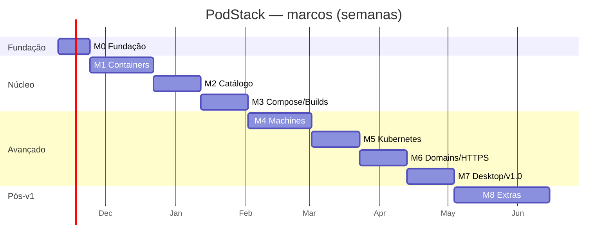

# Roadmap — PodStack

> Marcos, entregáveis e critérios de saída. Estimativas para **2–3 engenheiros** familiarizados com C++/Qt e Linux; ajustar após M0. A ordem prioriza valor cedo (containers) e reduz risco técnico (hijack, QEMU, domínios) antes de investir em polish.

---

## 1. Visão geral



**Duração estimada:** ~25 semanas (≈ 6 meses) até v1.0; M8 em paralelo/after.

---

## 2. Marcos

### M0 — Fundação (2 semanas)

**Status:** **concluído em 2026-11-08** (build, testes e E2E verdes).

**Objetivo:** provar a arquitetura e destravar os riscos técnicos.

**Entregáveis:**

- Repositório, CMake, CI, presets.
- `podstackd` com JSON-RPC + socket seguro.
- `PodmanClient` com ping/list + streams de logs/eventos.
- PoC de **hijack/exec** com TTY e resize.
- GUI shell (sidebar/lista/inspector) listando containers.
- CLI `version`/`status`/`ps`.
- ADR-0005 (licença/terminal) e ADR-0001/0002 revisados.

**Critério de saída:**

- [ ] `podstack ps` lista containers reais.
- [ ] GUI abre em ≤ 1,5 s e lista containers.
- [ ] Exec interativo funciona (Ctrl+C/D, resize).
- [ ] Testes unit/contract verdes; CI verde.
- [ ] Nenhum bloqueio técnico desconhecido.

**Riscos:** hijack, permissões de socket, Qt/QML no ambiente.

---

### M1 — Containers (4 semanas)

**Status:** **concluído com ressalvas** — lifecycle, create, logs, stats, files, terminal nativo, batch, health, rename/duplicate e rootful. Terminal embutido, upload e seleção fina ficam no M2.

**Objetivo:** paridade de ciclo de vida e inspeção.

**Entregáveis:**

- CRUD completo, ações em lote, confirmações.
- Logs (follow, busca, wrap, timestamps), terminal, stats, info.
- Create container com validação.
- Models QML + ações de toolbar/contexto.

**Critério de saída:**

- [ ] E2E: criar → start → logs → terminal → stop → remove.
- [ ] Primeira linha de log ≤ 500 ms.
- [ ] Stats consistente com `podman stats`.
- [ ] Nenhuma sessão/processo órfão.
- [ ] Cobertura core ≥ 70%.

---

### M2 — Catálogo (3 semanas)

**Status:** **concluído com ressalvas** — catálogo navegável, pull/push/tag/untag, remove/prune, history/digest, CRUD de volumes e redes, clone e export/import `.tar.zst`, import do host, pods e `system.df`. Pendências para o M3: LAN toggle, proxy global, seletor visual de plataforma e prévia detalhada de prune.

**Objetivo:** imagens, volumes, redes e pods.

**Critério de saída:**

- [ ] Pull de 500 MB com progresso e cancelamento.
- [ ] Volume export/import íntegro (checksum).
- [ ] DNS interno resolve nome/alias.
- [ ] Nenhum recurso do usuário tocado nos testes.

---

### M3 — Compose e builds (3 semanas)

**Status:** **concluído com ressalvas** — Compose, builds com histórico SQLite, manifest list multi-plataforma via CLI do Podman e eventos globais em toasts. Pendência para o M4: Supabase.

**Objetivo:** fluxo de projeto completo (J1).

**Entregáveis:**

- Detecção/agrupamento Compose; up/down/restart; logs por serviço.
- Build via Libpod com steps/logs; histórico em SQLite.
- Eventos na UI; notificações básicas.
- Abrir YAML/diretório.

**Critério de saída:**

- [ ] `podstack compose up -d` + serviço acessível.
- [ ] Logs por serviço sem mistura.
- [ ] Build com cache e histórico.
- [ ] J1 completo em ≤ 2 min.

---

### M4 — Machines (4 semanas)

**Status:** **em andamento** — T4-01 (registry/cache de imagens), T4-02 (seed cloud-init)
e T4-03 (qcow2/QEMU/QMP + RPC/CLI + ciclo de vida) concluídas em 2026-11-09. SSH, logs,
virtiofs, arquivos, export/import e clones seguem nas tarefas seguintes.

**Objetivo:** VMs Linux integradas (J2).

**Entregáveis:**

- QEMU/KVM + cloud-init + QMP; criação ≤ 60 s.
- SSH (chave, config, comando), ciclo de vida, logs.
- virtiofs, pull/push, file manager.
- Export/import, clone, rename, default.
- Limites, port forwarding, agent forwarding, isolamento.

**Critério de saída:**

- [ ] Ubuntu/Debian/Fedora criadas e acessíveis por SSH.
- [ ] Sem QEMU órfão após crash/stop.
- [ ] Export/import restaura máquina funcional.
- [ ] virtiofs com permissões corretas.
- [ ] J2 completo em ≤ 60 s (create + ssh).

---

### M5 — Kubernetes (3 semanas)

**Objetivo:** cluster local gerenciado (J3).

**Entregáveis:**

- k3s em VM; kubeconfig isolado/contexto; `podstack kube env`.
- Watch de Pods/Services; logs; delete; port-forward.
- Enable/disable/reset idempotente.

**Critério de saída:**

- [ ] Cluster Ready ≤ 90 s.
- [ ] `kubectl get pods -A` funciona.
- [ ] UI reflete pods/services em ≤ 2 s.
- [ ] Disable remove tudo sem resíduo.
- [ ] J3 completo.

---

### M6 — Domains e HTTPS (3 semanas)

**Status (2026-11-10): concluído no código.** T6-01..T6-09 implementadas
(proxy `*.localhost`/`*.podstack.local`, índice, detecção de porta, DNS
userspace, socket activation :80/:443, Caddy/CA interna, confiança na CA,
labels e exposição LAN). A T6-10 (portas não publicadas) fica adiada pela
limitação rootless, documentada em `spec.md` §11.7.

**Objetivo:** acesso por domínio sem configuração (G4).

**Entregáveis:**

- `*.localhost` + proxy por Host + página de índice.
- Detecção automática de porta + labels.
- Helper: DNS `*.podstack.local`, portas 80/443 (opt-in).
- Caddy + CA local + HTTPS on-the-fly.
- Exposição LAN.

**Critério de saída:**

- [x] `curl app.localhost:8080` funciona sem root.
- [x] `*.podstack.local` instala/remove de forma idempotente.
- [x] HTTPS válido com a CA local; CA confiável/removível via helper.
- [ ] 404 para host desconhecido.
- [ ] Sem resíduo em `/etc/hosts`/resolved.

---

### M7 — Desktop e v1.0 (3 semanas)

**Status:** **concluído no código em 2026-11-11** (settings, tema, tray, notificações, updates
assinados, setup/onboarding, report, coexistência Docker, restauração de UI e atalhos).
Pendências externas: validação em máquina limpa e benchmarks/auditoria de release.

**Objetivo:** experiência completa e release.

**Entregáveis:**

- Settings GUI/CLI completo, tema, escala, atalhos, acessibilidade.
- Tray SNI, Activity Monitor, notificações.
- Updates assinados, **onboarding/setup** (detecção, Podman, coexistência Docker, QEMU/KVM, componentes, validação), diagnóstico/report.
- RPM + systemd + polkit + SELinux; documentação de usuário.
- Matriz de compatibilidade e performance.

**Critério de saída:**

- [ ] Critérios de release do PRD (§14) atendidos.
- [ ] `podstack doctor` verde em instalação limpa. *(pendente de máquina limpa)*
- [x] Docker presente não bloqueia o setup; a remoção é opt-in e confirmada.
- [x] Setup reexecutável com jobs persistentes e validação de obrigatórios/opcionais.
- [ ] Benchmarks dentro das metas. *(TX-09)*
- [ ] Auditoria de segurança concluída. *(TX-08)*
- [ ] Pacote RPM assinado instalável em Fedora 43/44. *(TX-07)*

---

### M8 — Extras (pós-v1, 6+ semanas)

- USB/serial, áudio, X11/Wayland.
- Snapshots de máquina.
- CRIU/gVisor.
- Migração **opcional** de dados de Docker/Podman.
- Licença/conta opcional (o v1 é offline e não exige conta).
- Avaliar Flatpak sob demanda (não no v1).
- Empacotamento **RPM + DEB + Flatpak** entregue na T8-06 (Flatpak como cliente; daemon/helper no host).
- i18n adicional, temas, plugins (avaliar).

---

## 3. Versões

| Versão | Conteúdo | Critério |
|---|---|---|
| **0.1 (alpha)** | M0–M1 | uso interno; containers |
| **0.2 (alpha)** | M2 | catálogo |
| **0.3 (beta)** | M3 | Compose/builds |
| **0.4 (beta)** | M4 | machines |
| **0.5 (beta)** | M5–M6 | K8s/domains |
| **1.0 (stable)** | M7 | critérios do PRD |
| **1.1** | M8 parcial | USB/serial, snapshots |
| **1.2** | M8 restante | X11/áudio, migração |

---

## 4. Dependências e caminho crítico

```
M0 (hijack/exec) ─► M1 ─► M2 ─► M3
                         └► M4 ─► M5
M1 ─► M6
M3/M4/M6 ─► M7
```

- **Caminho crítico:** M0 (hijack) → M1 (containers) → M4 (QEMU) → M7.
- M6 pode começar em paralelo a M4 (proxy/DNS independente).
- M5 depende de M4 (VM do k3s).

---

## 5. Riscos de cronograma

| Risco | Impacto | Buffer |
|---|---|---|
| Hijack/exec instável | +2 semanas | PoC no M0; fallback terminal externo |
| virtiofs/SELinux | +2 semanas | Fallback 9p; testes cedo |
| QTermWidget/licença | Resolvido | GPL-3.0-or-later + QTermWidget compatível |
| Compose provider | +1 semana | Fallback podman-compose |
| Rootless portas/domínios | +1 semana | `*.localhost` já cobre v1 |
| Escopo P1 | +2 semanas | P1 pode escorregar para 1.1 |

**Buffer total recomendado:** 15–20% (≈ 4–5 semanas).

---

## 6. Equipe sugerida

| Papel | FTE | Foco |
|---|---|---|
| Tech lead / arquiteto | 0,5 | decisões, RPC, segurança |
| Backend C++/Qt | 1,0 | daemon, Podman, machines |
| Frontend QML | 1,0 | UI, modelos, acessibilidade |
| Infra/QA | 0,5 | CI, testes, empacotamento |
| Design (parcial) | 0,2 | tokens, ícones, UX |

Com 2 FTE, multiplicar prazos por ~1,6.

---

## 7. Métricas de acompanhamento

- Burndown por marco; tarefas P0 primeiro.
- Cobertura de testes e flaky rate.
- Latência de startup/memória a cada marco.
- Número de bugs P0/P1 abertos.
- Tempo de criação de máquina e cluster.
- Feedback de beta testers (NPS, issues).

---

## 8. Definição de sucesso do v1.0

1. Um dev Fedora consegue instalar com `dnf`, rodar containers, Compose, uma VM e K8s sem abrir o terminal.
2. O CLI cobre os mesmos fluxos em CI.
3. Nada quebra ao reiniciar o host.
4. Segurança rootless validada; helper só quando necessário.
5. Performance percebida superior ao Docker Desktop.
6. Documentação permite resolver os 10 problemas mais comuns sem suporte.
