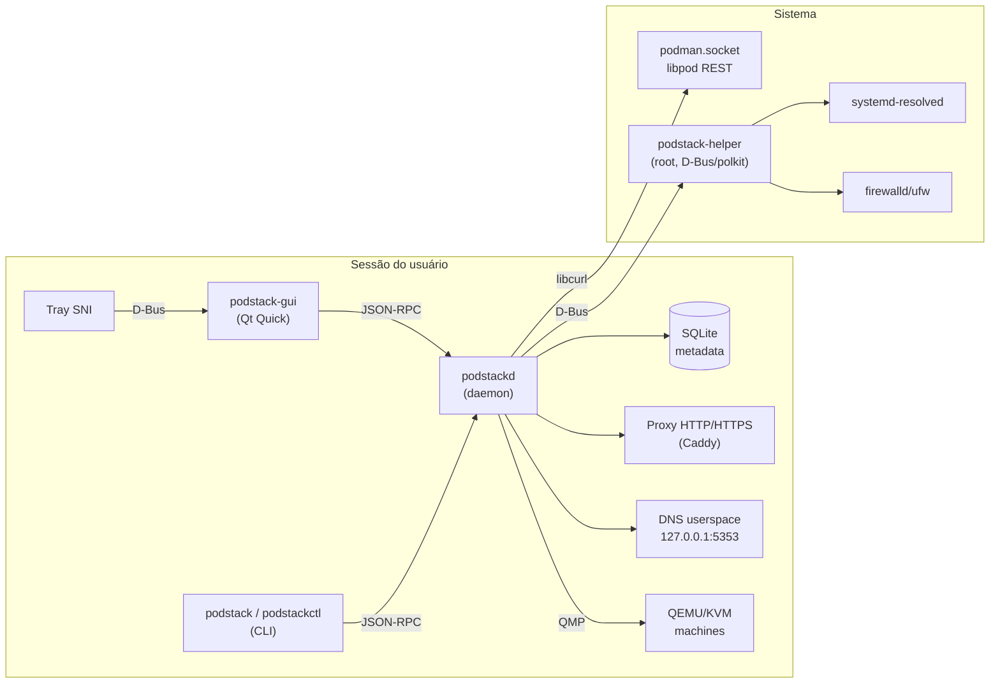

# Plano técnico — PodStack

> Derivado do [`PRD.md`](PRD.md) e da [`spec.md`](spec.md). Define stack, componentes, contratos, concorrência, persistência, build e riscos. Decisões em [`adr/`](../adr).

---

## 1. Restrições e princípios técnicos

- **Podman é o engine**; não reimplementamos runtime, rede ou storage.
- **Rootless por padrão**; rootful opt-in.
- **GUI, daemon e CLI separados**; estado no daemon, não na GUI.
- **Qt 6 + QML** para UI; **C++20** para core/daemon/CLI.
- **Streams via libcurl**; RPC via JSON-RPC sobre Unix socket.
- **QEMU/KVM direto** para machines; sem libvirt no v1.
- **RPM primeiro**; Flatpak não previsto no v1 (reavaliar sob demanda).

---

## 2. Stack

| Camada | Tecnologia | Versão mínima | Observação |
|---|---|---|---|
| Linguagem | C++ | C++20 | GCC 14+/Clang 18+ |
| UI | Qt Quick / QML + Qt Widgets (embed) | Qt 6.4 | Fedora 43: 6.10.3; F44: 6.11.2; Ubuntu 24.04: 6.4.2 |
| Build | CMake + Ninja | 3.24 / 1.11 | `CMakePresets.json` |
| HTTP/streams | libcurl | 8.x | Unix socket + hijack |
| Updates (Ed25519) | OpenSSL (libcrypto) | 3.0 | verificação do manifesto/minisign; `openssl-devel` no build |
| RPC | JSON-RPC 2.0 | — | `QLocalSocket` + `QJsonDocument` |
| Persistência | SQLite (WAL) | 3.45 | metadados de machines/builds/config |
| VM | QEMU/KVM + `qemu-img` + QMP | QEMU 9+ | `virtiofsd` 1.13+ |
| Kubernetes | k3s | 1.30+ | dentro de VM PodStack |
| Proxy/HTTPS | Caddy | 2.10+ | CA interna, reverse proxy |
| DNS | systemd-resolved + DNS userspace | systemd 257 | `*.localhost` no v1 |
| Terminal | QTermWidget | 2.0.0 vendorizado (DEB) / 2.4+ (RPM) | GPL-2.0-or-later, compatível com GPL-3.0-or-later (ADR-0005/0010) |
| Tray | QSystemTrayIcon (SNI) | Qt 6.4+ | KStatusNotifierItem opcional |
| Empacotamento | RPM + DEB + systemd + polkit | Fedora 43+ / Ubuntu 24.04+ | SELinux no RPM; DEB com qtermwidget vendorizado |

---

## 3. Arquitetura de componentes



### 3.1 Processos

| Processo | Usuário | Responsabilidade | Ciclo de vida |
|---|---|---|---|
| `podstack-gui` | usuário | UI, tray, notificações, janelas | enquanto o app está aberto |
| `podstackd` | usuário | estado, RPC, streams, proxy, DNS, VMs, jobs | systemd --user, sempre ativo |
| `podstack` | usuário | CLI (cliente RPC) | por invocação |
| `podstack-helper` | root | operações privilegiadas declarativas | systemd system, sob demanda |
| `caddy` | usuário | proxy/HTTPS | filho do daemon |
| `qemu-system-*` | usuário | machines | por máquina |
| `k3s` | usuário (guest) | cluster | por cluster |

---

## 4. Cliente Podman (Libpod)

### 4.1 Descoberta

- Ordem: `PODSTACK_PODMAN_SOCKET` → `$XDG_RUNTIME_DIR/podman/podman.sock` → `/run/podman/podman.sock`.
- `GET /_ping` retorna `Libpod-Api-Version` (ex.: 5.8.9) e `Api-Version` (compat, ex.: 1.44).
- URLs: `http://d/v<libpod-version>/libpod/...`.
- Sem autenticação; autorização pelo modo/dono do socket.

### 4.2 Transporte

- **Requisições simples:** libcurl com `CURLOPT_UNIX_SOCKET_PATH`, `CURLOPT_HTTP_VERSION_1_1`.
- **Streams (logs, stats, events, pull/build NDJSON):** `CURLOPT_WRITEFUNCTION` + `CURLOPT_XFERINFOFUNCTION`; cancelamento via `CURLOPT_XFERINFOFUNCTION` retornando non-zero.
- **Hijack (exec/attach):** `CURLOPT_CONNECT_ONLY=2` + `curl_easy_send/recv`; handshake HTTP manual com `Upgrade: tcp`.
- **Multiplexação:** quando `Tty=false`, frames de 8 bytes (`stream type` + `uint32` big-endian length) em `application/vnd.docker.multiplexed-stream`; desserializar no cliente.
- **Pool:** 1 easy handle por stream; worker thread dedicada; limite de streams simultâneos (ex.: 32) com fila.

### 4.3 Camada de domínio

```
PodmanClient
├── ping() / version()
├── containers(): list/get/create/start/stop/restart/pause/unpause/kill/remove
│   ├── logs(id) -> LogStream
│   ├── stats(ids) -> StatsStream
│   ├── exec(id, cmd) -> ExecSession (hijack)
│   └── archive(id, path)
├── images(): list/pull(stream)/push/tag/untag/remove/prune/load/export
├── volumes(): list/create/remove/prune/export/import
├── networks(): list/create/remove/connect/disconnect
├── pods(): list/create/start/stop/restart/remove
├── events() -> EventStream
├── build(context, opts) -> BuildStream
└── system(): df/info
```

- Erros do Libpod são mapeados para `PodstackError` com código estável.
- Timeouts e retries: idempotentes apenas (GET); mutações sem retry automático.

### 4.4 Compat API

- Usada **apenas** como fallback para ferramentas externas/Compose.
- Nunca para operações do PodStack (evita regressões e falta de recursos).
- Se usada, fixar `Api-Version` descoberta; não hardcode 1.44.

---

## 5. Daemon

### 5.1 Responsabilidades

- Conexão e reconexão com Podman.
- Cache de estado + reconciliação.
- RPC para GUI/CLI.
- Jobs longos (pull, build, export, create machine).
- Streams (logs/stats/events) e fan-out para múltiplos clientes.
- Proxy HTTP/HTTPS e DNS userspace.
- Orquestração de QEMU/KVM e k3s.
- Setup/detecção do ambiente (Podman, Docker, QEMU/KVM, componentes) e jobs de setup.
- Settings, SQLite, logs, diagnóstico.

### 5.2 Estrutura de código

```
src/
├── core/            # modelos, erros, util, config
├── podman/          # cliente libpod + streams
├── daemon/          # main, rpc server, services, jobs, state
├── cli/             # main, comandos, formatters
├── gui/             # main, models, qml/
├── machines/        # qemu, cloud-init, qmp, ssh
├── k8s/             # k3s provider, kubeconfig
├── proxy/           # caddy/dns, domains, port forwarding
├── platform/        # systemd, polkit, xdg, tray
└── tests/
```

### 5.3 Concorrência

- **Thread principal:** event loop Qt (daemon e GUI).
- **RPC:** `QLocalServer` no thread principal; handlers rápidos; jobs em `QThreadPool`.
- **Streams libcurl:** thread dedicada por stream (ou pool com `curl_multi`); entrega via sinais/fila para o thread principal.
- **SQLite:** conexão por thread; WAL; escritas curtas.
- **QEMU/QMP:** thread por máquina para leitura do socket QMP; comandos serializados.
- **Backpressure:** filas limitadas por assinatura; drop de logs antigos com aviso.

### 5.4 Estado

- Fonte de verdade de containers/imagens/volumes/redes: Podman.
- Cache em memória reconciliado por eventos + poll de segurança (60 s).
- SQLite: machines, builds, settings history, jobs, clusters, domínios custom.
- Arquivos: `~/.local/state/podstack/` (runtime), `~/.config/podstack/` (config), `~/.local/share/podstack/` (dados).

---

## 6. GUI (Qt Quick)

### 6.1 Estrutura

- `QGuiApplication` + `QQmlApplicationEngine`.
- `QAbstractListModel` por entidade (containers, images, ...), com roles e `sort/filter` via `QSortFilterProxyModel`.
- `InspectorController` expõe seleção + abas.
- `TerminalView` embute QTermWidget via `QQuickWidget` (ADR-0005).
- Tema: `PodStackTheme` singleton (cores, spacing, tipografia) com dark/light.
- Ícones: conjunto próprio (SVG), nunca assets do OrbStack.

### 6.2 Modelo de dados da UI

- `AppState` (conexão, engine, modo, licença).
- `NavModel` (seções, contadores, seleção).
- `ContainerListModel`, `ImageListModel`, `VolumeListModel`, `NetworkListModel`, `MachineListModel`, `PodListModel`, `ServiceListModel`, `BuildListModel`.
- `LogModel` (ring buffer + filtro), `StatsModel` (séries temporais), `FileModel`.
- `SetupModel` (checks, etapa, progresso, logs do setup).

### 6.3 QML

- `MainWindow.qml`: `SplitView` (Sidebar | List | Inspector), toolbar, status bar.
- `Sidebar.qml`, `ListView.qml`, `Inspector.qml`, `LogsView.qml`, `TerminalView.qml`, `FilesView.qml`, `StatsView.qml`.
- `SettingsWindow.qml`, `CreateContainerDialog.qml`, `CreateMachineDialog.qml`, `Setup/SetupWindow.qml` (+ `SetupRail`, `SetupCheckRow`, `SetupProgress`, `SetupLog`).
- `Theme.qml`, `Components/` (Button, Badge, StatusDot, EmptyState, Toast).
- `qt_add_qml_module` + `qmllint`; sem lógica de negócio em QML.

---

## 7. Machines (QEMU/KVM)

### 7.1 Provisionamento

- Imagens cloud (qcow2) por distro/versão; cache em `~/.cache/podstack/images/`.
- Registry **pinado no código** (ubuntu 24.04, debian 12 e fedora 44, amd64) com URL HTTPS e
  checksum SHA-256/SHA-512 verificados; sem fetch de manifesto em runtime. O cache usa
  `<distro>-<version>-<arch>-<checksum[0..12]>.qcow2` + sidecar `.json`, lock por imagem,
  `.part` e rename atômico. Ubuntu/Debian não publicam tamanho fixo; o sidecar registra o
  tamanho real após o download.
- seed ISO **NoCloud** gerada com **libarchive** (formato ISO9660, label `cidata`, Rock Ridge
  `strict` + Joliet), contendo `meta-data`, `user-data` e `network-config` na raiz. Motivo: não
  depender do `cloud-localds`/`genisoimage` no host; libarchive já é usada pelo projeto e é a
  única dependência adicional. Os arquivos entram como `0600` (preservados pelo Rock Ridge
  `strict`), a ISO final é publicada por rename atômico e fica `0600`.
- QEMU:

```bash
qemu-system-x86_64 \
  -accel kvm -M q35 -cpu host -smp "$CPUS" -m "$MEM" \
  -drive file=disk.qcow2,if=virtio,cache=writeback,discard=unmap \
  -drive file=seed.iso,format=raw,if=virtio,readonly=on \
  -netdev user,id=n0,hostfwd=tcp:127.0.0.1:$SSHPORT-:22 \
  -device virtio-net-pci,netdev=n0 \
  -chardev socket,id=qmp,path=qmp.sock,server=on,wait=off \
  -mon chardev=qmp,mode=control \
  -display none -serial file:console.log
```

- virtiofs (se mounts): um `virtiofsd` por mount com
  `--shared-dir <source> --socket-path <machineDir>/virtiofs-<tag>.sock --tag <tag>
  --cache=auto --xattr` (+ `--readonly`), usando `--sandbox=chroot` como root e
  `--sandbox=namespace` no rootless; socket absoluto dentro do diretório da machine.
  QEMU recebe `-chardev socket,id=vfs<N>,path=...` + `-device
  vhost-user-fs-pci,chardev=vfs<N>,tag=<tag>`. Limite de 8 mounts e tags
  `[a-z0-9-]{1,32}` únicas (default `host<N>`).
- Controle por QMP: `system_powerdown`, `quit`, `query-status`, `human-monitor-command`.
- Windows (M9 — Fase 1): `-M q35,smm=on`, `-global driver=cfi.pflash01,property=secure,value=on`,
  NVRAM `nvram.fd`, SPICE em socket Unix, `virtio-vga`/`usb-tablet` e `-tpmdev`/`tpm-tis,tpmdev=tpm0` com
  `swtpm` por machine. O modelo completo está em
  [`docs/specs/001-apps-remotos-vm/plan.md`](../specs/001-apps-remotos-vm/plan.md) §3.

### 7.2 Estado e metadados

- `~/.local/share/podstack/machines/<id>/`: `disk.qcow2`, `seed.iso`, `meta.json`, `console.log`, `qmp.sock`, `id_ed25519`; em Windows, também `nvram.fd`, `spice.sock`, `swtpm.sock` e `tpm/`.
- `meta.json`: provisioner (`linux`/`windows`), distro, versão, arch, recursos, portas, mounts, isolamento, criação, último boot.
- SQLite indexa para listagem rápida; `meta.json` é a fonte de verdade recuperável.

### 7.3 Guest Windows (M9)

- `provisioner` e os campos Windows (`windowsSsh`, `windowsEdition`, `installPending`,
  `installerIso`, `virtioWinIso`) são persistidos em `meta.json` e no índice SQLite, com
  migração aditiva por `PRAGMA table_info` + `ALTER TABLE`.
- A criação Windows usa **ISO local** do Windows; o ISO do virtio-win pode ser local ou
  baixado do manifesto embutido (HTTPS + SHA-256, cache `0600`; T9-08). Gera
  `autounattend.xml`+`autounattend.iso` (`0600`), valida mínimos 2 vCPU/4 GiB/64 GiB e não
  usa cloud-init/seed. `installPending` controla as mídias de instalação; o primeiro
  stop limpa as mídias e o flag. `windowsEdition` (default `Windows 11 Pro`) escolhe
  `/IMAGE/NAME`; `answerFile` próprio substitui o XML gerado.
- Secure Boot: NVRAM por machine em `nvram.fd` (`0600`), CODE/VARS `secboot` descobertos por
  candidatos Fedora/Ubuntu; Linux mantém `OVMF_VARS.fd`. Par incompatível retorna
  `PODSTACK_VALIDATION`. O `-cpu host` recebe `hv_relaxed,hv_vpindex,hv_time,hv_synic,hv_stimer,
  hv_reset,hv_frequencies`.
- Console SPICE em socket Unix por machine; `machines.console.spice` devolve o spec e a GUI
  lança o `remote-viewer` (sem `spice-gtk` no build).
- TPM 2.0: `SwtpmProcess` (mesmo modelo do `VirtiofsdProcess`) sobe antes do QEMU, é adotado
  por `cmdline` após restart do daemon e encerrado no stop/delete. `tpm/` é `0700` e os
  arquivos de estado são `0600`.
- Limitações desta rodada: sem `guest-ping`/`guestOs` (T9-05), export Windows retorna
  `PODSTACK_UNSUPPORTED` e mounts/agent forwarding são recusados.

### 7.4 Limitações

- Sem `/dev/kvm`: TCG lento (avisar; permitir desabilitar).
- Sem snapshot no v1 (P2).
- Console gráfico apenas para Windows via SPICE (`remote-viewer`); Linux usa o console
  serial. VNC não é suportado.

---

## 8. Kubernetes

- **Decisão:** k3s em VM PodStack (PRD Q2; ADR-0003 para a VM), não kind rootless.
- VM dedicada com 2 CPU/4 GB/20 GB (configurável).
- k3s server sem Traefik? Manter Traefik desabilitado no v1 para evitar conflito de portas; usar Caddy do PodStack para Services? (Decisão pendente; documentar.)
- kubeconfig isolado; contexto `podstack-<cluster>`; `KUBECONFIG` via `podstack kube env`.
- Watch de pods/services via API server (`/api/v1/...?watch=1`) com token do kubeconfig.
- Exposição: NodePort em localhost; LoadBalancer/Ingress via `*.k8s.podstack.local` (P2).

---

## 9. Domínios, proxy e portas

### 9.1 v1 sem privilégio

- `*.localhost` (RFC 6761) → 127.0.0.1/::1.
- Proxy do daemon em `127.0.0.1:8080` (HTTP) e `8443` (HTTPS), mapeando `Host` → container/porta.
- Página de índice em `http://localhost:8080` listando serviços.
- Sem alterar `/etc/hosts`, sem root.

### 9.2 v1.1 com helper

- `*.podstack.local` via DNS userspace 5353 + drop-in no resolved.
- Portas 80/443 via socket activation do helper → socket do daemon.
- Caddy para HTTPS/CA.
- Tudo opt-in e reversível.

### 9.3 Detecção de porta

- Probe concorrente com timeout 300 ms nas portas expostas + comuns.
- Cache por container/config digest; invalidar em eventos.
- Override por label.

---

## 10. Persistência e caminhos

| Caminho | Conteúdo | Permissão |
|---|---|---|
| `~/.config/podstack/config.json` | settings | 0600 |
| `~/.config/podstack/polkit/` | políticas (se aplicável) | 0644 |
| `~/.local/share/podstack/podstack.db` | SQLite (machines, builds, jobs) | 0600 |
| `~/.local/share/podstack/machines/<id>/` | discos, seed, chaves, logs | 0700 |
| `~/.local/share/podstack/kubeconfigs/` | kubeconfigs | 0600 |
| `~/.local/share/podstack/ca/` | CA/chaves | 0600 |
| `~/.cache/podstack/images/` | imagens cloud | 0700 |
| `~/.local/state/podstack/logs/` | logs rotacionados | 0700 |
| `~/.local/state/podstack/ui-state.json` | geometria, seção e abas da UI | 0600 |
| `$XDG_RUNTIME_DIR/podstack/` | sockets, PID, locks | 0700 |

---

## 11. Build e CI

- CMake presets: `dev`, `release`, `asan`, `tsan`.
- `-Wall -Wextra -Werror` no CI; `clang-tidy` e `clang-format` check.
- Testes: `ctest` com Qt Test; integração com Podman real; QML Test; golden tests de CLI.
- CI em Fedora 43/44 e Ubuntu 24.04 (containers), rootless; job rootful opcional.
- Cache de ccache; artefatos RPM + AppImage.

---

## 12. Empacotamento

- RPM: `podstack`, `podstack-helper`, `podstack-selinux`.
- systemd user: `podstack.socket`, `podstack.service`; system: `podstack-helper.service`.
- polkit: ações `dev.podstack.helper.*`.
- AppStream + `.desktop` + ícones.
- Flatpak: não previsto no v1; reavaliar sob demanda (ADR-0006).

---

## 13. Riscos técnicos e mitigação

| Risco | Mitigação |
|---|---|
| Hijack/exec | PoC no M0 com libcurl; testes com TTY/resize; fallback "abrir terminal externo" |
| virtiofs/SELinux | PoC no M4; fallback 9p; testes em enforcing |
| Rootless sem IP direto | `*.localhost` + portas publicadas; helper opt-in |
| QTermWidget GPL | Resolvido: projeto GPL-3.0-or-later; QTermWidget é compatível (ADR-0005) |
| Compose provider ausente | Detectar e empacotar dependência; fallback com aviso |
| Podman 6.x | Camada de adaptação + testes 5.8/6.x |
| Escopo | Marcos com critérios de saída; P2 fora do v1 |
| SELinux | Política desde M0; testes |

---

## 14. Marcos

| Marco | Entrega técnica | Critério de saída |
|---|---|---|
| M0 | Scaffold, CMake, daemon, cliente Podman, CLI `version/ps`, shell QML | build + `podstack ps` + GUI lista containers |
| M1 | Containers completos, logs, exec, stats | E2E de ciclo de vida + terminal |
| M2 | Imagens, volumes, redes, pods | CRUD + integração |
| M3 | Compose, builds, eventos | Projeto sobe/desce pela GUI |
| M4 | Machines QEMU/KVM | create/ssh/export/import |
| M5 | Kubernetes | cluster + kubectl + UI |
| M6 | Domains/HTTPS | `*.localhost` + proxy + CA |
| M7 | Tray, settings, updates, notificações | paridade de desktop |
| M8 | USB/serial/X11/áudio, migração, i18n | P2 |

Detalhamento em [`tasks.md`](tasks.md) e [`roadmap.md`](roadmap.md).
