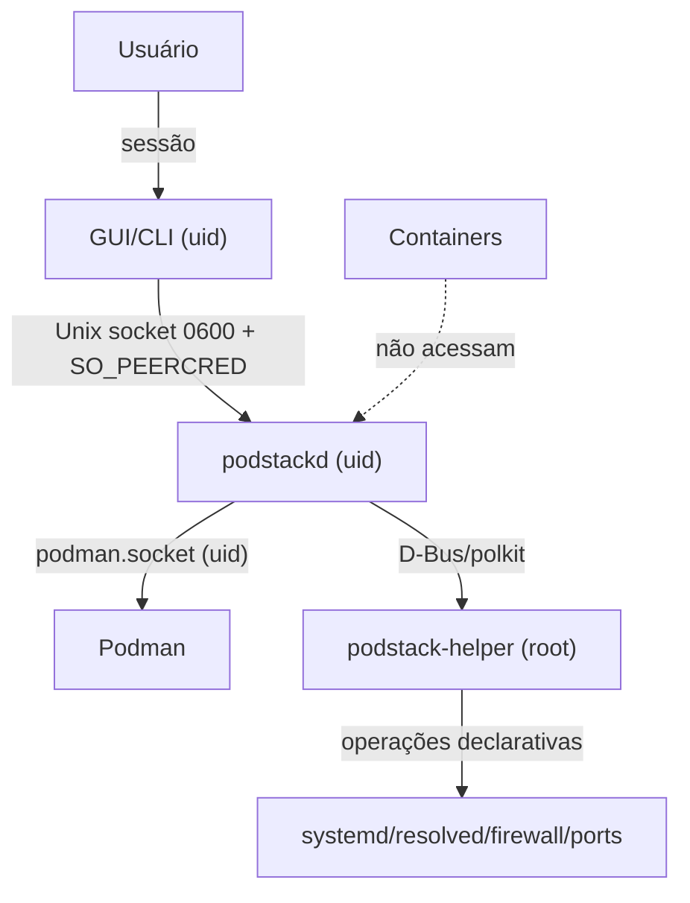

# Segurança — PodStack

> Modelo de ameaças, fronteiras de confiança, privilégios e controles. O PodStack roda no desktop do usuário e conversa com um engine que, por definição, executa código — a segurança é sobre **limitar o que o PodStack pode fazer além do que o usuário já pode**.

---

## 1. Ativos

| Ativo | Sensibilidade |
|---|---|
| Containers, imagens e volumes do usuário | Alta (dados/código) |
| Chaves SSH e `~/.ssh/config` | Alta |
| Credenciais de registry | Alta |
| CA local e chave privada | Alta |
| Configurações e histórico | Média |
| Logs/diagnóstico | Média (podem conter dados) |
| Socket do Podman | Crítica (equivale a root no host em muitos casos) |
| Helper privilegiado | Crítica |

---

## 2. Fronteiras de confiança

**Regras:**

- Nada fora da sessão do usuário fala com o daemon.
- Containers **não** recebem o socket do PodStack nem do Podman.
- O helper é a única fronteira root; sua API é fechada.

---

## 3. Modelo de ameaças

| # | Ameaça | Vetor | Impacto | Mitigação |
|---|---|---|---|---|
| T1 | Processo local malicioso conecta ao socket | Socket previsível | Controlar containers | `0600` + `SO_PEERCRED` (uid) + dir `0700` |
| T2 | Container escapa e acessa socket do host | Bind mount do socket | Root no host | Nunca montar sockets do PodStack/Podman; docs de risco |
| T3 | Container acessa domínios/CA de outros | Proxy/DNS compartilhado | Vazamento/lateral | Escopo por label; CA opt-out; isolamento de rede |
| T4 | Helper abusado para executar comandos | API genérica | Root | API declarativa, sem shell, validação estrita, polkit |
| T5 | Path traversal em files/import/export | `..`, symlinks | Ler/escrever fora do escopo | Canonicalização, `openat2`/`O_NOFOLLOW`, allowlist |
| T6 | Segredos em logs/diagnóstico | env, tokens, chaves | Vazamento | Redaction, revisão antes de enviar, nunca logar Authorization |
| T7 | Update trojanizado | Canal/rede | RCE | Assinatura (minisign/Ed25519), TLS, verificação antes de aplicar |
| T8 | DNS hijack/`podstack.local` falso | Resolver local | Phishing/local | DNS userspace autenticado no loopback; não usar `.local` mDNS por padrão |
| T9 | CA local comprometida | Chave privada | MITM | Chave 0600/keyring; rotação; remoção fácil |
| T10 | Registry malicioso / imagem | Pull | Código arbitrário | Avisos, verificação de digest, política de registry |
| T11 | DoS local (fork bomb, disco) | Containers/VMs | Indisponibilidade | Limites cgroup, quotas de disco, alertas |
| T12 | Rootful acidental | Config | Escopo ampliado | Opt-in explícito, aviso, badge |
| T13 | SELinux bloqueando/contornando | Política | Falha/abertura | Política mínima e testes em enforcing |
| T14 | Supply chain de dependências | Qt/libcurl/Caddy | RCE | Dependências pinadas, SBOM, builds reproduzíveis |

---

## 4. Privilégios e separação

### 4.1 Processos

| Processo | UID | Capabilities | Root? |
|---|---|---|---|
| `podstack-gui` | usuário | nenhuma | não |
| `podstackd` | usuário | nenhuma | não |
| `podstack` (CLI) | usuário | nenhuma | não |
| `podstack-helper` | root | `CAP_NET_BIND_SERVICE`, `CAP_DAC_OVERRIDE` mínimo | sim (systemd) |
| QEMU | usuário | `/dev/kvm` | não |
| Caddy | usuário | bind em portas altas ou socket activation | não |

### 4.2 Helper

- systemd system unit com `NoNewPrivileges=yes`, `ProtectSystem=strict`, `ProtectHome=read-only`, `PrivateTmp=yes`, `RestrictAddressFamilies=AF_UNIX`, `MemoryDenyWriteExecute=yes`, `SystemCallFilter=@system-service`.
- D-Bus system bus, serviço `dev.podstack.Helper1`.
- Polkit: cada método tem ação `dev.podstack.helper.<method>` com `auth_admin`/`auth_self`.
- Rate limit: 10 req/min por uid por método.
- Auditoria: journal com uid, método, parâmetros (sem segredos) e resultado.

**Métodos permitidos (API fechada):**

| Método | Params | Efeito |
|---|---|---|
| `BindPorts` | `{ports:[80,443], socketPath}` | Socket activation para o daemon |
| `InstallDnsZone` | `{zone:"podstack.local", upstream:"127.0.0.1:5353"}` | Drop-in no resolved + reload |
| `RemoveDnsZone` | `{zone}` | Remove drop-in |
| `TrustCa` | `{certPath, fingerprint}` | Copia CA para trust store + `update-ca-trust` |
| `UntrustCa` | `{fingerprint}` | Remove CA |
| `AddUdevRule` | `{vid,pid,action}` | Regra para USB (P2) |
| `SetSysctl` | `{key,value}` | Apenas allowlist (`ip_unprivileged_port_start`) |
| `InstallPackages` | `{packages:[...], reason}` | Instala pacotes **allowlisted** (podman, qemu-kvm, virtiofsd, …) |
| `RemovePackages` | `{packages:[...], reason}` | Remove pacotes **allowlisted** (ex.: docker-ce) |

**Proibido:** `Exec`, `Shell`, caminho arbitrário, escrita fora de paths allowlisted; instalação/remoção de pacotes só via `InstallPackages`/`RemovePackages`, com allowlist e consentimento.

> `podman.socket` é habilitado no **systemd do usuário** pelo daemon; não requer root nem helper.

### 4.3 Rootful

- Modo rootful usa o socket `/run/podman/podman.sock`; o usuário precisa estar no grupo com acesso.
- **Suportado no v1** com paridade de features, como opt-in explícito.
- A GUI mostra badge "rootful" e aviso na primeira ativação.
- O daemon **não** escala privilégios; apenas usa o socket que o usuário já pode acessar.

### 4.4 Setup e coexistência com o Docker

- A detecção do setup é **read-only** (`podman --version`, `podman info`, socket, `/dev/kvm`, binários); não altera o sistema.
- Instalar/atualizar Podman, instalar QEMU/KVM/componentes e remover Docker passam pelo helper allowlisted; **nunca** `sudo`/shell na GUI.
- Remover o Docker é **opt-in**: exige `confirm: true`, lista containers/imagens/redes/volumes afetados e avisa que não há migração automática. O padrão é coexistência (`dockerPolicy: keep`).
- `DOCKER_HOST` apontando para o socket do Podman é uma configuração do usuário, não uma operação privilegiada; não confundir com remoção.
- Logs do setup não incluem tokens/senhas; a auditoria registra uid, método, parâmetros allowlisted e resultado.

---

## 5. Socket de controle

- Caminho: `$XDG_RUNTIME_DIR/podstack/control.sock`.
- Dir `0700`, socket `0600`, criado com `umask 077`.
- `SO_PEERCRED`: uid do cliente == uid do daemon; caso contrário, fecha.
- Sem TCP, sem abstract socket, sem herança para containers.
- Limite de conexões (32) e de mensagens (8 MiB).
- Timeout de inatividade (5 min) para clientes ociosos.
- Log de conexões rejeitadas (uid, pid quando disponível).

**Socket da GUI (instância única):** `$XDG_RUNTIME_DIR/podstack/gui.sock`, dir `0700`, socket
`0600`, `SO_PEERCRED` (uid) e comandos allowlisted `show`/`quit`. Não é um canal RPC: só ativa ou
encerra a janela da instância já em execução.

---

## 6. Segredos

| Segredo | Armazenamento | Acesso |
|---|---|---|
| Credenciais de registry | `~/.config/containers/auth.json` (0600) ou keyring | Podman/daemon |
| Chaves SSH das máquinas | `~/.local/share/podstack/machines/<id>/id_ed25519` (0600) | daemon, `ssh` |
| Chave da CA | `~/.local/share/podstack/ca/key.pem` (0600) | Caddy/daemon |
| Tokens de update | keyring | daemon |
| Senhas de máquina | cloud-init seed (apagada após boot) / keyring | daemon |

- Nunca em `config.json`, logs, relatório ou argv (visível em `ps`).
- Redaction: chaves que casam `(?i)(token|password|secret|authorization|key)` em env/labels são mascaradas.
- `podstack report` mostra prévia e exige confirmação.

### 6.1 Telemetria (opt-in por categoria)

- Desligada por padrão; cada categoria (crash, uso, performance, erros) exige consentimento explícito.
- Sem dados sensíveis: nunca env, caminhos de projeto, nomes de containers/máquinas, IPs, comandos ou conteúdo de arquivos.
- Payload mínimo, anônimo e com endpoint TLS; retenção documentada.
- O usuário pode desligar a qualquer momento; a mudança vale imediatamente.
- `podstack report` é separado da telemetria e sempre exige revisão/consentimento.

---

## 7. Rede, DNS e proxy

- Proxy/DNS escutam **somente loopback** por padrão.
- Exposição LAN é opt-in, com aviso e firewall (firewalld/ufw).
- `*.localhost` não requer privilégio e não altera o sistema.
- `*.podstack.local` via helper: drop-in gerenciado, reversível, com backup.
- Não usar mDNS/Avahi por padrão (conflito na LAN e spoofing).
- HTTPS: CA local com chave protegida; certificados on-the-fly; remoção fácil.
- Containers recebem a CA apenas se opt-in; documentar implicações.

---

## 8. Operações de arquivo

- Paths resolvidos com `realpath` e confinados ao escopo (container/volume/máquina).
- Rejeitar `..`, paths absolutos em archives, symlinks que escapam, hardlinks.
- Uploads: validar tamanho, tipo e destino; gravar em tmp e mover atomicamente.
- Downloads: gerar em tmp com nome seguro; nunca sobrescrever sem confirmação.
- Import de máquina/volume: validar manifest/checksum; extrair em dir temporário e mover.
- `O_NOFOLLOW`/`openat2(RESOLVE_BENEATH)` quando disponível.

---

## 9. Atualizações e supply chain

- Pacotes RPM assinados (GPG) pelo repositório.
- AppImage/atualizador próprio: assinatura Ed25519 + TLS + verificação antes de executar.
- Nunca auto-update silencioso em modo headless.
- SBOM (CycloneDX) por release; dependências pinadas.
- Builds reproduzíveis quando possível; `SOURCE_DATE_EPOCH`.
- Revisão de dependências novas (Qt, Caddy, k3s, QEMU).

---

## 10. SELinux / AppArmor

- Objetivo: política mínima para o helper (portas, resolved, CA, udev).
- Tipos sugeridos: `podstack_helper_t`, `podstack_helper_exec_t`, portas `http_port_t`/custom.
- Testar em Fedora com `selinux=enforcing`.
- AppArmor (Ubuntu): perfil para `podstack-helper` e `podstackd`.
- Documentar que containers continuam sob a política do Podman.

---

## 11. Auditoria e resposta

- Log de ações privilegiadas: quem (uid), o quê (método), quando, resultado.
- Log de mudanças de settings sensíveis (rootful, helper, DNS, CA).
- `podstack doctor` detecta:
  - socket com permissões erradas;
  - helper habilitado sem necessidade;
  - CA instalada e não usada;
  - portas expostas na LAN;
  - containers com `--privileged`.
- Incidente: `podstack reset --yes` + remoção de CA/DNS + rotação de chaves documentada.

---

## 12. Checklist de release de segurança

- [ ] Socket `0600`, dir `0700`, `SO_PEERCRED` testado.
- [ ] Helper sem `Exec`/shell; métodos allowlisted; polkit testado.
- [ ] Redaction validada com fixtures contendo tokens.
- [ ] Path traversal testado (files, import/export).
- [ ] CA/DNS install/remove idempotentes e reversíveis.
- [ ] Update com assinatura inválida rejeitado.
- [ ] SELinux enforcing sem AVC inesperado.
- [ ] Dependências auditadas (SBOM + CVEs).
- [ ] Threat model revisado.
