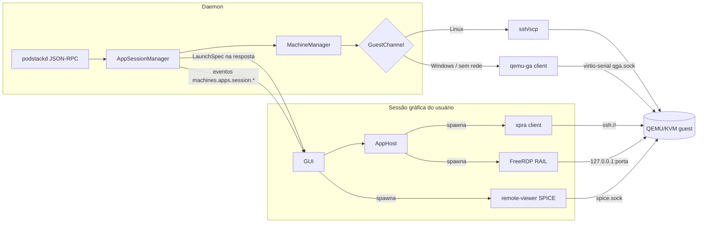

# Plano técnico — 001 Apps remotos da VM

> Derivado de [`spec.md`](spec.md) (rev. 3). Não altera `docs/sdd/plan.md`; é o delta proposto.
> Escopo: **M9** (guest Windows, pré-requisito de RAIL) e **M10** (apps remotos: T10-00…T10-03).
> **Prioridade:** **P1 (v1.x, alvo 1.1+), não bloqueia v1.0** — `docs/README.md` define P1 como v1 desejável/v1.x.

---

## 1. Arquitetura



**Dono das sessões.** Sessões pertencem ao **daemon** (`AppSessionManager`: estado, idempotência, TTL, reconciliação e eventos). A GUI (`AppHost`) é apenas o **host do cliente local de apps** (xpra/FreeRDP), sem estado de sessão; o console SPICE é lançado pela GUI fora do `AppHost`. O daemon nunca abre display e nunca chama a GUI: a resposta síncrona de `machines.apps.launch` entrega o `LaunchSpec`, e `machines.apps.subscribe` entrega os eventos de ciclo de vida (a GUI reconcilia no restart do daemon).

**Por que a GUI lança os clientes.** `packaging/systemd/podstack.service:16-18` usa `PrivateTmp=yes`, `ProtectSystem=strict` e `ProtectHome=read-only`. O daemon **consegue ler** `~/.ssh` (é o que `machines.stats` já faz), mas **não pode escrever** no home, não vê `/tmp/.X11-unix` por causa do `PrivateTmp` e a unit não importa `DISPLAY`/`WAYLAND_DISPLAY`. A conclusão continua: cliente gráfico nasce na sessão gráfica do usuário, via `AppHost`, e o daemon só entrega o `LaunchSpec`.

| Componente | Onde roda | Responsabilidade |
|---|---|---|
| `GuestChannel` | daemon | canais `ssh`/`agent`, ping, osinfo, exec interno, arquivos pequenos, IP |
| `AppSessionManager` | daemon | dono das sessões, `launch/stop/detach`, lock por `(machineId, appId)`, TTL, reconciliação e `subscribe` |
| `MachineManager` | daemon | estado, portas, credenciais, catálogo em cache, `LaunchSpec` |
| `AppHost` | GUI (processo com sessão gráfica) | spawn/supervisão de xpra e FreeRDP; env de display; kill no stop/detach |
| CLI | terminal do usuário | delega o launch à GUI via instância única; sem GUI → `PODSTACK_GUI_REQUIRED` |

```cpp
// src/machines/AppSessionManager.h (daemon)
struct AppSession {
  QString sessionId, machineId, appId, backend;   // backend: x11 | xpra | rail
  QString state;                                  // starting | running | stopping | failed
  int sshPort = 0;
  qint64 guestPid = -1;
  QString xpraDisplay;
  QDateTime createdAt, lastSeenAt;
};

struct LaunchSpec {
  QString backend;                   // xpra | x11 | rail
  QString program;                   // xpra | xfreerdp
  QStringList args;
  QProcessEnvironment env;
  QString knownHostsPath;            // <state>/machines/<id>/known_hosts (0600), opcional
  int sshPort = 0;
  QString display;                   // opcional (xpra)
  QString xpraVersion;               // opcional
  QString rdpFile;                   // arquivo .rdp temporário, sem senha, opcional
  QString rdpSecretPath;             // machineDir/sessions/<sessionId>/rdp.secret (0600), opcional
  QString certFingerprint;           // SHA-256 (TOFU), opcional
};

class AppSessionManager {
public:
  AppSession launch(const QString &machineId, const QString &appId,
                    const QString &backend, bool consent,
                    LaunchSpec *spec, Error *error);   // idempotente por (machineId, appId)
  bool stop(const QString &machineId, const QString &sessionId, bool force, Error *error);
  bool detach(const QString &machineId, const QString &sessionId, Error *error);
  QList<AppSession> sessions(const QString &machineId) const;
  void reconcile();                                    // start do daemon e stop/delete da machine
};

// src/gui/AppHost.h (sessão gráfica)
class AppHost {
public:
  virtual void start(const QString &sessionId, const LaunchSpec &spec) = 0;
  virtual void stopLocal(const QString &sessionId) = 0; // SIGTERM → SIGKILL
  virtual void shutdownAll() = 0;                       // queda do RPC/daemon: mata todos os clientes
  // connectionLost() → shutdownAll() + aviso na UI; reconexão reconcilia via machines.apps.list
  // clientExited(sessionId) → chama machines.apps.detach
  // clientFailed(sessionId, error) → mostra erro e chama detach
};
```

Regra: **nenhum cliente remoto é embutido no QML**; xpra e FreeRDP criam janelas nativas e são supervisionados pelo `AppHost`; o `remote-viewer` do console é lançado pela GUI (T9-01). O `AppHost` não mantém `sessions()`: a lista vem de `machines.apps.list`. O `AppHost` monitora o socket RPC: ao detectar queda do daemon **sem restart**, executa `shutdownAll()` e encerra todos os clientes locais; na reconexão, reconcilia a lista de sessões com o daemon.

## 2. Canal de guest — T10-01

### 2.1 Modelo primário + fallback

`MachineMeta.guestChannels` é uma **lista**, não um campo único:

```json
[
  {"channel":"ssh",   "role":"primary",  "version":"", "lastSeenAt":""},
  {"channel":"agent", "role":"fallback", "version":"", "lastSeenAt":""}
]
```

Resolução de `auto` (sem setting nova; é política interna):

| Guest | Primário | Fallback | `provisioning` → `running` | Observação |
|---|---|---|---|---|
| Linux | `ssh` (banner + auth) | `agent` se `guest-ping` responder; chardev sempre provisionado | quando o SSH autentica; 300 s sem SSH → `error`/`reason=provisioning_timeout` | cloud images sem qemu-ga não quebram; timeout só em máquinas iniciadas após a mudança |
| Windows | `agent` (`guest-ping`) | `ssh` só com `windowsSsh:true` (OpenSSH instalado no provisionamento) | quando o agente responde; 10 min sem resposta → `error`/`reason=guest_unreachable` | console SPICE não depende de canal |
| Linux existente | `ssh` | `agent` (chardev no próximo start) | inalterado | sem migração de estado; a machine rodando não muda até restart |

- `guestReady` é derivado: `true` quando o primário respondeu ao menos uma vez e a machine está `running`.
- `guestChannels` expõe `channel`, `role`, `version` e `lastSeenAt` em `machines.get`.
- Fallback não é silencioso: o canal usado aparece em `guestChannels`, e a UI mostra o motivo quando o primário falha.
- `machines.stats`/`machines.stats.subscribe` incluem `origin` (`ssh` | `agent`).
- `guest.exec` e `guest.info` são **API interna** do `GuestChannel`, não contrato público (FR-MAC-122).

### 2.2 QEMU

```
-device virtio-serial-pci,id=virtserial0
-chardev socket,id=qga,path=<machineDir>/qga.sock,server=on,wait=off
-device virtserialport,id=qga0,chardev=qga,name=org.qemu.guest_agent.0
```

- Todo device tem `id`: o `virtserialport` é `qga0` (o chardev é `qga`).
- `machineDir` já é `0700` (`MachineManager.cpp:170-177,2045`); é esse o limite de proteção. **Não prometer `chmod 0600` atômico** — a criação do socket pelo QEMU não é interceptável; o teste verifica diretório e dono.
- O chardev é adicionado para **toda** machine cujo `guestChannels` resolvido inclua `agent` — inclusive o fallback de `auto` no Linux. Máquinas existentes ganham o device no próximo start; máquinas rodando não mudam até restart. Não há setting nem RPC para habilitar o canal.
- Nome do port `org.qemu.guest_agent.0` (default do MSI Windows e do `qemu-ga` Linux) — confirmar no spike com o MSI real.

### 2.3 Cliente

`GuestAgentClient` em `src/machines/`, JSON delimitado por `\n`, `guest-sync-delimited` (prefixo `0xFF`) na reconexão.

| Operação | Uso |
|---|---|
| `guest-ping` | liveness; dirige `provisioning` → `running` no Windows/`agent` |
| `guest-get-osinfo` | detectar Windows/Linux, versão e **ProductName** (Home/Pro) |
| `guest-info` | confirmar `guest-exec` |
| `guest-exec` / `guest-exec-status` | scripts de setup e consultas (interno) |
| `guest-network-get-interfaces` | IP sem SSH |
| `guest-file-open/read/write/close` | **≤ 1 MiB** |

Transferência de usuário continua em `scp` (Linux) e virtiofs/WinFsp (Windows). O protocolo de arquivo do qemu-ga usa chunks base64 em JSON e perde uma ordem de grandeza — usá-lo para transferência seria regressão.

### 2.4 Reconexão

1. Reconectar ao socket com backoff (1 s → 30 s).
2. Se o chardev morreu: `device_del qga0` → `chardev-remove qga` → `chardev-add qga` → `device_add qga0`, **nesta ordem** (só `chardev-remove` falha com device em uso).
3. Falha persistente → `guestChannels` marca o `agent` como indisponível, fallback classificado, sem exceção atravessando a UI.

Sequência coberta por teste no `MockQmpServer` (T10-01) e validada no spike com QEMU real (`PODSTACK_QEMU_INTEGRATION`).

### 2.5 Segurança

`guest-exec` é execução arbitrária no guest: exposto só pelo socket `0600` + `SO_PEERCRED` do daemon, nunca por TCP; timeout duro (30 s, sem parâmetro público acima do teto); saída passa pelo redaction; scripts temporários apagados após uso.

## 3. M9 — guest Windows (T9-01…T9-08)

M9 não entrega apps: entrega console, firmware, TPM, provisionamento, drivers/agente, áudio e dependências de host. RAIL (T10-03) depende de T9-05.

### 3.1 Console SPICE (T9-01)

- QEMU Windows ganha `-spice unix=on,addr=<machineDir>/spice.sock,disable-ticketing=on` e `-device virtio-vga` (fallback `virtio-gpu-pci`), `-device qemu-xhci -device usb-tablet` e `-display none` por padrão.
- `spice.sock` fica em `machineDir` (`0700`); não há SPICE em TCP. `disable-ticketing=on` é aceitável porque o socket só é acessível pelo mesmo UID; o teste verifica diretório/dono.
- Viewer único: **`remote-viewer`** (`virt-viewer`), em janela própria, lançado pela **GUI** com o spec de console devolvido por `machines.console.spice`; **sem `AppHost`** e sem `spice-gtk` como dependência de build.
- `machines.console.spice {id}` → `{program:"remote-viewer", args:["spice+unix://<machineDir>/spice.sock"], socket:"<machineDir>/spice.sock"}`.
- Viewer ausente → `PODSTACK_DEPENDENCY_MISSING` (`reason=backend_missing`) com o pacote da distro; console off → `PODSTACK_UNSUPPORTED`.
- Reversão do adiamento P2 declarada em ADR-0003, `sdd/spec.md` §7, `sdd/plan.md` e `api-rpc.md` (FR-MAC-111).

### 3.2 OVMF Secure Boot (T9-02)

- `-machine q35,smm=on`, `-global driver=cfi.pflash01,property=secure,value=on`, CODE read-only e VARS por VM.
- NVRAM em `<state>/machines/<id>/nvram.fd` (`0600`), copiada do template VARS na criação e nunca compartilhada entre machines.
- Descoberta por candidatos (spec §11.1), nunca por caminho fixo:

| Distro | CODE | VARS |
|---|---|---|
| Fedora | `/usr/share/edk2/ovmf/OVMF_CODE.secboot.fd` | `/usr/share/edk2/ovmf/OVMF_VARS.secboot.fd` |
| Ubuntu | `/usr/share/OVMF/OVMF_CODE_4M.secboot.fd` | `/usr/share/OVMF/OVMF_VARS_4M.ms.fd` |

- Validar o par CODE/VARS no create; par incompatível → `PODSTACK_VALIDATION` com remediação. Machines Linux mantêm o `OVMF_VARS.fd` atual; só Windows usa `nvram.fd` por machine.
- Testes: argv Windows vs. Linux, arquivo `nvram.fd` `0600`, `OVMF_VARS.fd` preservado no Linux, boot com `Confirm-SecureBootUEFI` em E2E.

### 3.3 TPM 2.0 (T9-03)

- `swtpm socket --tpm2 --tpmstate dir=<machineDir>/tpm --ctrl type=unixio,path=<machineDir>/swtpm.sock --mode 0600`.
- QEMU: `-chardev socket,id=chrtpm,path=<machineDir>/swtpm.sock`, `-tpmdev emulator,id=tpm0,chardev=chrtpm`, `-device tpm-crb`.
- Estado em `<machineDir>/tpm/` (`0700`); **arquivos de estado do TPM são `0600`**; `swtpm` sobe antes do QEMU e é encerrado depois.
- `clone` cria diretório novo e TPM novo; `export` não inclui `tpm/` nem `swtpm.sock`; `import` cria TPM vazio (o guest pode exigir reativação — documentado).
- Testes: argv, modos, restart preserva estado, clone/export/import não transportam estado (FR-MAC-113).

### 3.4 Provisioner Windows (T9-04 e T9-04a)

**Contrato.** `machines.create` ganha `provisioner:"linux"|"windows"` (default `linux`), `installerIso` (caminho absoluto, legível, ISO do usuário), `answerFile?` (XML do usuário), `windowsSsh?` (bool, default `false`, parâmetro de criação, não setting) e `password?` opcional. Para `provisioner:"windows"`, `distro` é **opcional/ausente** (ou `"windows"`) e valem:

- `installerIso` é obrigatório; o PodStack **nunca** distribui ISO Windows.
- Defaults validados no backend, não em setting global: `cpus >= 2`, `memoryBytes >= 4 GiB`, `diskBytes >= 64 GiB`. Valores omitidos usam esses mínimos; valores menores → `PODSTACK_VALIDATION`. O default global `machines.diskBytes` (20 GiB) não muda.
- `password` é o valor fornecido pelo cliente; se ausente, é gerado (20+ caracteres) e usado apenas no `autounattend.xml` (`0600`). Nunca em `meta.json`, log ou argv.
- `autounattend.xml` é gerado em `machineDir` (`0600`) com conta local, OOBE, fuso, `DriverPaths` para `virtio-win.iso`, `FirstLogonCommands` para `virtio-win-guest-tools`/qemu-ga (e OpenSSH quando `windowsSsh:true`) e é **apagado após a instalação**; fica **fora do export**. `answerFile` do usuário é copiado para `machineDir` com `0600`, validado como XML e apagado após uso.
- `virtio-win.iso` vem do cache de T9-08; o instalador é anexado como CD USB (`usb-storage` + `bootindex=0`) porque o OVMF não inicializa o El Torito desse ISO pelo CD IDE/AHCI; o virtio-win e o answer file ficam em CD-ROMs IDE read-only. O daemon responde ao prompt "Press any key to boot from CD or DVD" com `send-key` via QMP.
- Enlightenments `hv_*` (relaxed, vpindex, synic, stimer, reset, frequencies) no mesmo argv.
- Sem cloud-init/seed; `seedPath` não é usado.

**UI/CLI (T9-04a).** Diálogo de criação Windows (ISO, senha/gerar, vCPU/RAM/disco com mínimos, `answerFile` opcional, checkbox `windowsSsh`, aviso de licença) e `podstack machine create <name> --provisioner windows --iso <arquivo> [--answer-file <xml>] [--windows-ssh] [--memory 4G --disk 64G]`. A UI valida os mínimos antes de chamar o RPC e mostra o erro de validação inline.

**Testes.** `machines.create` com defaults e com valores abaixo do mínimo, `distro` ausente/`"windows"` e `windowsSsh`; XML `0600` e removido; senha ausente de `meta.json`/argv; ISO fora do export; CLI e QML.

### 3.5 Drivers + agente (T9-05)

- `autounattend` instala `vioscsi`/`viostor`, `NetKVM`, `viogpudo`, `virtio-win-guest-tools` e o MSI do `qemu-guest-agent`; com `windowsSsh:true`, instala também o OpenSSH MSI e habilita o serviço. Reinicia o guest ao final.
- A machine Windows só sai de `provisioning` quando `guest-ping` responde; após 10 min → `error` com `reason=guest_unreachable` e remediação (console/ISO).
- `guest-get-osinfo` grava `guestOs` (`family`, `version`, `edition`, `productName`); `ProductName` com “Home” desabilita RAIL (FR-MAC-120).
- Se o usuário usar `answerFile` próprio sem agente, a instalação pode concluir e o console funciona, mas a machine **não sai de `provisioning`**: após 10 min vai para `error` com `reason=guest_unreachable`; `guestReady=false` e RAIL fica indisponível — a UI explica.
- Testes: disco/rede virtio sem `!`, `guest-ping`, transição de estado, timeout de 10 min, detecção Home/Pro.

### 3.6 Áudio (T9-06)

- Manter `intel-hda` duplex e `-audiodev pipewire,id=audio0`; nó PipeWire nomeado `podstack-<machine>` para identificar o stream.
- `machines.audio.set` vale para Windows; teste de playback e captura (microfone) no E2E.
- `machines.apps.audio` (setting de sessão) **não** controla o áudio do Windows; é só do xpra.

### 3.7 Limitações declaradas

- M9/RAIL são **amd64-only**; host aarch64 ou guest Windows ARM → `PODSTACK_UNSUPPORTED`/`reason=backend_unsupported` (NFR-MAC-008).
- Sem GPU/3D, VFIO ou anticheat; sem Windows ARM.
- Secure Boot/TPM exigem firmware e `swtpm` presentes; ausência → `PODSTACK_DEPENDENCY_MISSING` com pacote por distro.
- O `SetupManager` (T9-07) verifica QEMU, firmware, `swtpm`, módulos SPICE/áudio e os backends opcionais por candidatos de cada distro, sem sugerir pacote inexistente (NFR-MAC-006/007).

## 4. Apps Linux — xpra (T10-03)

### 4.1 Pré-requisitos opcionais

| Lado | Requisito | Checagem |
|---|---|---|
| Host Linux | binário `xpra` ≥ 4.0 para `auto`; 3.1.5 só com `backend=xpra` explícito | **opcional** (`Recommends`); `SetupManager` verifica e `PODSTACK_XPRA_BINARY` sobrescreve; `auto` ausente/<4.0 → `x11`; explícito 3.1.5 → warning `xpra_experimental` |
| Guest Linux | pacote `xpra` | instalação sob demanda com consentimento (FR-MAC-108) |
| Host | `remote-viewer` | opcional; afeta **apenas** o console SPICE (T9-01), nunca apps |
| Host Windows | FreeRDP (`xfreerdp`/`xfreerdp3`) | opcional; sem ele RAIL retorna `PODSTACK_DEPENDENCY_MISSING`, **nunca** `x11` |

Nomes de pacote e versões por distro ficam em [`spec.md`](spec.md) §11. Fedora 43/44 é o alvo suportado (6.5.4); Ubuntu 24.04 (3.1.5) é experimental e só é usada com `backend=xpra` explícito; Ubuntu 26.04 não tem pacote e `auto` degrada para `x11`.

### 4.2 Sessão

```
xpra seamless ssh://<user>@<host>:<port>/ \
  --ssh="ssh -i <key> -o IdentitiesOnly=yes -o UserKnownHostsFile=<known_hosts> -p <port>" \
  --start-child="<exec>" --exit-with-children \
  --clipboard=yes --notifications=yes --audio=<yes|no>
```

- Uma sessão por app; `--exit-with-children` encerra o servidor quando o filho sai.
- `known_hosts` é `<state>/machines/<id>/known_hosts` (`0600`) e vai no `LaunchSpec` como `knownHostsPath`; **não** depende de `machines.ssh` expor caminho. A porta SSH também vai no `LaunchSpec` (`sshPort`).
- `--audio` segue `machines.apps.audio` (default `true`), lido no launch; o HDA→PipeWire por VM permanece para Windows.
- **Limpeza (FR-MAC-124):** o daemon mantém a sessão com `lastSeenAt` e TTL de 60 s; no stop/delete/TTL executa `xpra stop ssh://…` e `logoff`/kill do processo no guest pelo canal disponível. No start, reconcilia sessões órfãs (`xpra list`/`xpra stop`) e emite `machines.apps.session.closed` para a GUI. O `AppHost` mata o cliente local quando recebe `machines.apps.session.closed` ou quando o cliente sai.
- Transporte: SSH existente (chave por machine); `known_hosts` do state evita escrever no home do daemon.

### 4.3 Catálogo e ícones

- `.desktop` em `/usr/share/applications` e `~/.local/share/applications` via canal; ignorar `NoDisplay=true`/`Terminal=true`; `Name`, `Exec` sem `%`-codes, `Icon`.
- Cache por machine com TTL de **5 min** e invalidação quando muda a mtime dos diretórios de `.desktop` (instalação/remoção de pacote). `machines.apps.list` devolve `cachedAt`.
- Ícone: resolver o nome do tema no guest e transferir o arquivo ≤ 1 MiB pelo canal (`guest-file-*`); se não resolver, usar o ícone genérico do app. Nunca usar o tema do host como substituto silencioso.
- `items[].desktopFile` aponta o `.desktop`; `Exec` vira `appId` estável.

### 4.4 RPC e UI

`machines.apps.list/launch/stop/detach/subscribe/unsubscribe/trust` (§7). A UI ganha "Abrir app da VM", busca, badge do backend, estado da sessão e diálogo de consentimento para instalar xpra no guest; a CLI `machine apps list/launch/stop` delega à instância única e retorna `PODSTACK_GUI_REQUIRED` sem GUI. Acessibilidade: `Accessible.name`/`description`, navegação por Tab/setas, foco visível e teste QML da tela/diálogo (T10-02).

### 4.5 X11 legado

`machine ssh --x11` e o RPC atual não mudam; doc marca como legado com ponteiro para xpra. Nenhum teste removido. `auto` só escolhe `x11` quando xpra está ausente/abaixo do mínimo ou quando o guest não é X11.

## 5. Apps Windows — RAIL (T10-03)

Bloqueado por **M9** (T9-05). Sem guest Windows com agente e RDP não há o que conectar.

### 5.1 Habilitar RDP (via `guest-exec` interno)

```powershell
Set-ItemProperty 'HKLM:\System\CurrentControlSet\Control\Terminal Server' -Name fDenyTSConnections -Value 0
Set-ItemProperty 'HKLM:\System\CurrentControlSet\Control\Terminal Server\WinStations\RDP-Tcp' -Name UserAuthentication -Value 1
Enable-NetFirewallRule -DisplayGroup 'Remote Desktop'
New-LocalUser -Name 'PodStack' -Password (ConvertTo-SecureString $pw -AsPlainText -Force) -PasswordNeverExpires
Add-LocalGroupMember -Group 'Remote Desktop Users' -Member 'PodStack'
```

**Segredo RDP.** Senha aleatória em `machineDir/sessions/<sessionId>/rdp.secret` (`0600`; diretório da sessão `0700`), escrita no guest por `guest-file-write` e usada no reset do usuário local. O caminho vai no `LaunchSpec.rdpSecretPath`; o `AppHost` lê o arquivo e o entrega ao FreeRDP por **stdin** (`/from-stdin`), nunca em argv. O arquivo é apagado no fim da sessão (stop/detach/TTL) e nunca entra em `meta.json`, log ou export. `export`/`import`/`clone` **regeneram** a senha e o reset no guest é feito via `guest-exec`; se o agente não responder, o RDP fica indisponível até reset pelo console e a UI informa.

### 5.2 Porta e confiança

- **Porta como `MachinePort`** (`MachineMeta.h:11-19`) com campo `kind:"user"|"internal"`; a RDP é `internal`, alocada por `findFreePort` (`MachineManager.cpp:399`) e concatenada ao **mesmo** `-netdev user,hostfwd=…` de `QemuCommand.cpp:204-213`; `exposeLan=false` obrigatório.
- `ports.set` **preserva** portas internas; `ports.list` as oculta, salvo `all:true` (CLI `machine port ls --all`). Teste cobre a preservação e a ocultação.
- `hostfwd=tcp:127.0.0.1:<porta>-:<guestPort>` — endereço explícito, nunca `0.0.0.0`; `guestPort` é a porta RDP do guest.
- **Binário:** `xfreerdp` no Fedora (`freerdp`) e **`xfreerdp3`** no Ubuntu (`freerdp3-x11`); resolver por candidatos/`PODSTACK_FREERDP_BINARY`, nunca por nome fixo.
- TOFU: SHA-256 em `MachineMeta.rdpCertFingerprint`; `/cert:ignore` proibido; NLA obrigatório.
- Mismatch de fingerprint → `PODSTACK_CERT_MISMATCH`/`reason=cert_mismatch`; a UI mostra o fingerprint antigo/novo e só `machines.apps.trust {id, fingerprint}` re-pina. Rotação legítima usa o mesmo fluxo.
- **Senha fora de argv:** `rdpSecretPath` (`0600`) é lido pelo `AppHost` e passado ao `xfreerdp /from-stdin` (validar no spike) ou ao helper por stdin; o caminho nunca usa `/p:` e o arquivo é apagado no fim da sessão.

### 5.3 Sessão única

Windows client aceita **uma** sessão interativa: duas invocações `/app:` colidem. Broker obrigatório:

- **Gate T10-03a:** provar com `xfreerdp` 3.x (uma sessão + `RAIL_EXEC`) e validar `/from-stdin`, o nome `org.qemu.guest_agent.0` e a detecção Home/Pro. Se não suportar, helper `podstack-rail` com `libfreerdp-client` (eventos JSON em stdout, comandos por stdin).
- **Sem fallback silencioso:** se o spike falhar e o helper não for viável, T10-03 fica bloqueada e é replanejada — não se abre "um app por vez" contra AC-5.

### 5.4 Catálogo e integrações

- Start Menu (`Get-StartApps` + `.lnk`) → `catalog.json` + `.ico` via `guest-file-*`; publicar `TSAppAllowList`; cache por machine (TTL 5 min); `.desktop` opcional.
- Clipboard `cliprdr`; áudio HDA→PipeWire com `rdpsnd` desligado; `/scale-desktop:100` + `/dynamic-resolution`; janelas via XWayland.
- **Drive redirect (opt-in):** `machines.apps.shareFolder` é string vazia por default (= desligado). Quando preenchida, exige caminho absoluto existente e legível, canonicalizado, montado **read-only** no guest; a UI pede consentimento e explica o escopo. Nunca redireciona `$HOME` inteiro por padrão. A pasta não é secreta, então pode ir no argv.
- Windows Home: `guestOs.edition`/`ProductName` detectado em T9-05; `machines.apps.list` ainda lista o catálogo, mas `launch` com `rail` retorna `PODSTACK_UNSUPPORTED`/`reason=backend_unsupported` e a UI mostra o texto explicativo (não esconde o botão sem contexto).
- **Limpeza RAIL (FR-MAC-124):** stop/delete/TTL encerram o `xfreerdp` local via `AppHost` e executam `logoff`/kill da sessão no guest pelo canal `agent`; se o guest estiver inacessível, a sessão local é encerrada e a remota expira no TTL.

## 6. Modelo de dados

`MachineMeta` (campos opcionais; `meta.json` tolera ausência):

```json
{
  "guestChannels": [
    {"channel": "ssh", "role": "primary", "version": "", "lastSeenAt": ""},
    {"channel": "agent", "role": "fallback", "version": "", "lastSeenAt": ""}
  ],
  "guestOs": {"family": "linux", "version": "", "edition": "", "productName": ""},
  "appBackend": null,               // null = segue machines.apps.backend; não persistir a resolução
  "rdpCertFingerprint": "",         // SHA-256 (TOFU), nunca exportado
  "appsCatalogUpdatedAt": ""        // cache do catálogo
}
```

Todos os campos novos são **opcionais** em `MachineMeta` e nos payloads RPC; ausência usa o default. `guestReady` é derivado (`running` + primário já respondeu) e não é persistido. `AppSession.backend` guarda o backend **resolvido** para a sessão e a UI o exibe; `MachineMeta.appBackend:null` nunca é substituído pela resolução. `AppSession` vive no `AppSessionManager` (memória do daemon; a lista é reconciliada no start, não sobrevive como estado durável). `MachinePort` ganha `kind` (`user` default).

| Operação | Política |
|---|---|
| `export`/`import` | **não** transporta fingerprint, segredo RDP, `tpm/`, `nvram.fd` nem `autounattend.xml`; TOFU é refeito e a senha/TPM são regenerados no primeiro boot |
| `clone` | limpa fingerprint, regenera segredo RDP, regenera TPM e NVRAM (FR-MAC-113) |
| machine existente | campos ausentes → `guestChannels:[ssh primary, agent fallback]`, `appBackend:null`; o chardev do agente entra no próximo start; sem migração de estado |
| machine Windows | `guestChannels:[agent primary]` (+ `ssh` se `windowsSsh:true`); `guestOs` preenchido por `guest-get-osinfo` |

Settings: **exatamente 3 chaves novas**, separando criação × sessão. A contagem do schema vai de **86 → 89** e os testes de contagem (`test_core`, `test_rpc`, `test_cli`, `test_gui`) precisam ser atualizados no mesmo PR.

| Chave | Tipo | Default | Escopo | Semântica |
|---|---|---|---|---|
| `machines.apps.backend` | select `auto\|x11\|xpra\|rail` | `auto` | criação | default quando `MachineMeta.appBackend` é `null`; a resolução (`AppSession.backend`) não é persistida |
| `machines.apps.audio` | bool | `true` | sessão | lido no `launch` do xpra; não altera `MachineMeta` nem o áudio HDA do Windows |
| `machines.apps.shareFolder` | string | `""` | sessão | pasta do host para drive redirect do RAIL; vazio = desligado; sempre read-only e opt-in |

`xpraAudio`/`railSound` **não** existem; `machines.guest.channel` também não — a resolução de `auto` é política interna (§2.1). Validação: `rail` só é aceito para `provisioner:"windows"` com edição Pro; `xpra`/`x11` só para guest Linux X11. `shareFolder` exige caminho absoluto, existente e legível no launch. Promover para `docs/engineering/settings.md` com tipo/default/validação/restart e a nota de contagem.

## 7. Contratos RPC

Delta para `docs/engineering/api-rpc.md` (campos novos são opcionais; nada removido).

| Método | Params | Retorno | Erros (`PODSTACK_*` + `reason`) |
|---|---|---|---|
| `machines.apps.list` | `{id, refresh?}` | `{items:[{appId,name,icon,categories,desktopFile,runningSessions}], sessions:[{sessionId,appId,backend,state,createdAt}], cachedAt}` | `NOT_FOUND`, `GUEST_UNREACHABLE/guest_unreachable` |
| `machines.apps.launch` | `{id, appId, backend?, consent?}` | `{sessionId, spec?, warnings?}` — `spec` vem na resposta quando o backend está pronto; quando há instalação no guest, `spec` chega em `machines.apps.session.started`; `warnings[].reason=xpra_experimental` para 3.1.5 explícito | `DEPENDENCY_MISSING/backend_missing`, `CONSENT_REQUIRED/consent_required`, `UNSUPPORTED/backend_unsupported`, `NOT_FOUND/app_not_found`, `GUEST_UNREACHABLE/guest_unreachable`, `CONFLICT/session_conflict`, `AUTH_FAILED/rdp_auth_failed`, `CERT_MISMATCH/cert_mismatch`, `GUI_REQUIRED/gui_required` |
| `machines.apps.stop` | `{id, sessionId, force?}` | `{stopped:true}` | `SESSION_NOT_FOUND/session_not_found`, `GUEST_UNREACHABLE/guest_unreachable` |
| `machines.apps.detach` | `{id, sessionId}` | `{detached:true}` (idempotente; sessão já ausente não é erro) | — |
| `machines.apps.subscribe` | `{id?}` | `{subscriptionId}`; eventos `machines.apps.session.started\|updated\|closed` com `AppSession` (e `spec` em `started`) | `NOT_FOUND` |
| `machines.apps.unsubscribe` | `{subscriptionId}` | `{subscriptionId, cancelled}` | `NOT_FOUND` |
| `machines.apps.trust` | `{id, fingerprint}` | `{trusted:true}` | `INVALID_PARAMS`, `NOT_FOUND` |
| `machines.console.spice` | `{id}` | `{program, args, socket}` | `DEPENDENCY_MISSING/backend_missing`, `UNSUPPORTED/backend_unsupported` |
| `machines.create` (alterado) | `{…, provisioner?, distro?, installerIso?, answerFile?, windowsSsh?}` | inalterado (`JobRef` + `Subscription`) | `VALIDATION` para Windows sem ISO/mínimos |
| `machines.get`/`list` (alterado) | inalterado | `Machine` + `guestReady?`, `guestChannels?`, `guestOs?`, `origin?`, `appBackend?` | inalterado |
| `machines.stats`/`subscribe` (alterado) | inalterado | `{…, origin}` | inalterado |
| `machines.ports.list` (alterado) | `{id, all?}` | `{items: MachinePort[]}`; `all=false` oculta `kind:"internal"` | inalterado |
| `machines.ports.set` (alterado) | `{id, ports}` | `Machine`; preserva internas | `INVALID_PARAMS`/`CONFLICT` |

`LaunchSpec` (resposta/evento): `{backend, program, args[], env{}, knownHostsPath?, sshPort, display?, xpraVersion?, rdpFile?, rdpSecretPath?, certFingerprint?}`. `AppSession`: `{sessionId, machineId, appId, backend, state, createdAt}` para eventos; o registro interno tem `sshPort`, `guestPid`, `xpraDisplay`, `lastSeenAt`.

**Idempotência e concorrência.** `launch` usa lock por `(machineId, appId)`; chamadas concorrentes reutilizam a sessão existente e retornam o mesmo `sessionId`. `stop`/`detach` são idempotentes. `ensureBackend` é fluxo interno do `launch` (job com consentimento/progresso, `machines.apps.delta`), **não** RPC público; `guest.exec`/`guest.info` são API interna do `GuestChannel`. O `LaunchSpec` nunca contém senha: o segredo RDP fica em `rdpSecretPath` (`0600`), o `AppHost` lê e passa por stdin; o arquivo é apagado no fim da sessão.

**Consentimento do backend no guest.** Sem `consent`, se o xpra do guest estiver ausente, `launch` retorna `PODSTACK_CONSENT_REQUIRED` (`reason=consent_required`, `detail` com pacote/comando). Com `consent:true`, o daemon cria a sessão em `starting`, executa a instalação como job interno (`machines.apps.delta` com progresso/cancelamento) e emite `machines.apps.session.started` com o `spec` ao concluir; a resposta pode voltar só com `sessionId` nesse caminho. Nenhum RPC público de instalação é exposto.

`machines.apps.delta` (notificação interna do job): `{sessionId, stage, progress}`; `stage` é `installing`, `starting` ou `ready`. O cancelamento do job usa `machines.apps.stop` com `force:true` na sessão em `starting`.

**`ErrorData` (delta).** Adicionar `reason?: string` ao tipo de `api-rpc.md` §3, com enum fechado: `backend_missing`, `dependency_missing`, `guest_unreachable`, `app_not_found`, `rdp_auth_failed`, `session_conflict`, `session_not_found`, `backend_unsupported`, `gui_required`, `cert_mismatch`, `consent_required`, `provisioning_timeout`. `provisioning_timeout` usa `PODSTACK_TIMEOUT`; `xpra_experimental` não faz parte deste enum — é warning de `launch` em `warnings[].reason`.

**Códigos novos** (promover à tabela §6 de `api-rpc.md`; os existentes `PODSTACK_UNSUPPORTED` e `PODSTACK_CONSENT_REQUIRED` são reutilizados):

| `data.code` | HTTP-like | Quando |
|---|---|---|
| `PODSTACK_DEPENDENCY_MISSING` | 424 | backend/pacote/binário ausente; `reason=backend_missing`/`dependency_missing` |
| `PODSTACK_GUI_REQUIRED` | 409 | operação exige sessão gráfica e não há GUI; `reason=gui_required` |
| `PODSTACK_AUTH_FAILED` | 401 | credencial RDP recusada; `reason=rdp_auth_failed` |
| `PODSTACK_GUEST_UNREACHABLE` | 503 | nenhum canal de guest responde; `reason=guest_unreachable` |
| `PODSTACK_SESSION_NOT_FOUND` | 404 | `sessionId` inexistente/expirado; `reason=session_not_found` |
| `PODSTACK_CERT_MISMATCH` | 409 | fingerprint TOFU divergente; `reason=cert_mismatch` |

## 8. Compatibilidade

Machine Linux existente: `ssh` primário + `x11`, comportamento idêntico em execução; no **próximo start** ganha o chardev `qga0` do fallback `agent` (sem mudar o estado nem o backend). Nenhum método removido; campos novos são opcionais. `machine ssh` e o bloco em `~/.ssh/config` permanecem. `auto` no Linux degrada para `x11` sem bloquear a machine (NFR-MAC-004); no Windows, ausência de FreeRDP é `DEPENDENCY_MISSING`, nunca `x11`. `machines.ports.set` continua aceitando o formato antigo (sem `kind`), assumindo `user`.

## 9. Riscos

| Risco | Prob. | Impacto | Mitigação |
|---|---|---|---|
| xpra ausente/antigo na distro | Média | backend Linux indisponível | opcional + detecção + `auto`→`x11`; Fedora é o alvo do E2E |
| xpra 3.1.5 no Ubuntu 24.04 | Média | comportamento diferente | `auto` exige ≥ 4.0 e usa `x11`; explícito aceita 3.1.5 com warning `xpra_experimental`; sem `Depends` |
| Windows sem FreeRDP | Média | RAIL indisponível | `PODSTACK_DEPENDENCY_MISSING`; nunca degradar para `x11` |
| chardev não reaceita após restart | Média | canal `agent` cai | sequência QMP com `device_del qga0`; teste `MockQmpServer` |
| OVMF/VARS incompatível ou NVRAM corrompida | Média | Windows não boota | candidatos por distro, validação do par, backup do NVRAM e recriação explícita |
| `swtpm` ausente/estado perdido | Média | Windows 11 recusa boot/ativação | dependência obrigatória, estado por machine, teste de restart e clone |
| `autounattend.xml`/senha vazam | Baixa | credencial exposta | `0600`, remoção após uso, fora do export, nunca em log/argv |
| ISO Windows/edição inadequada | Média | instalação falha | ISO do usuário, validação de arquivo, detecção Home/Pro e mensagem clara |
| Windows client = 1 sessão RDP | Alta | RAIL multi-app | gate T10-03a; helper `libfreerdp-client`; sem fallback silencioso |
| `/from-stdin` indisponível | Baixa | senha em argv | helper obrigatório; teste `/proc/<pid>/cmdline` |
| clone/export quebram TOFU/TPM | Média | RDP não conecta | limpar fingerprint, regenerar segredo/TPM/NVRAM e reset via agente |
| TOFU mismatch sem fluxo | Média | usuário bloqueado | `PODSTACK_CERT_MISMATCH` + `machines.apps.trust` com diálogo |
| xpra + HiDPI/Wayland | Média | tamanho errado | flags de scaling; E2E niri/GNOME |
| Áudio duplicado | Baixa | eco | `machines.apps.audio` default `true` só no xpra; `rdpsnd` off |
| `guest-exec` como superfície | Baixa | execução no guest | socket local, timeout 30 s, redaction, scripts apagados |
| Drive redirect amplo | Baixa | exposição de arquivos | default vazio, caminho canônico, read-only, consentimento |
| Code signing do agente Windows | Média | SmartScreen | setup via PowerShell/qemu-ga, sem MSI próprio |
| Download do virtio-win offline | Média | criação Windows falha | manifest/SHA-256, cache, erro claro e opção de ISO local (T9-08) |
| Host aarch64 | Baixa | tentativa de emular Windows | `PODSTACK_UNSUPPORTED` explícito (NFR-MAC-008) |
| Acessibilidade da nova UI | Baixa | regressão de UX | `Accessible.name`, teclado e teste QML |

## 10. Testes

| Nível | Cobertura |
|---|---|
| Unit | `AppSessionManager` (estado, idempotência, TTL, reconciliação), `GuestChannel`/`GuestAgentClient` (framing, `0xFF`, timeout), resolução de `auto`, chardev `agent` em Linux/Windows, timeout Linux de 300 s → `provisioning_timeout`, argv xpra, TOFU, `reason`, `AppHost` fake, settings |
| Contrato | `test_rpc`: shape de `items`/`sessions`/`cachedAt`, `LaunchSpec` exato (`backend, program, args[], env{}, knownHostsPath?, sshPort, display?, xpraVersion?, rdpFile?, rdpSecretPath?, certFingerprint?`), cada `reason`, `origin` em `stats` **e** `stats.subscribe`, `guestReady`/`guestChannels` em `get/list`, eventos `machines.apps.session.*`, `machines.apps.trust` |
| Integração | `MockGuestAgent`; `MockQmpServer` com `device_del qga0` e chardev em Linux `auto`; xpra/freerdp fake no `PATH`; restart do daemon e **kill sem restart** (AppHost encerra clientes); SPICE socket |
| M9 | OVMF/NVRAM `0600`, `OVMF_VARS.fd` no Linux, `swtpm` restart/clone com arquivos `0600`, `autounattend` `0600` e remoção, mínimos/`distro`/`windowsSsh` na criação Windows, detecção Home/Pro |
| Segurança | `/proc/<pid>/cmdline` sem senha; `rdpSecretPath` só em `machineDir/sessions/<sessionId>/rdp.secret` (`0600`) e apagado no fim; modo/dono de `machineDir`; `qga.sock`/`spice.sock`/`swtpm.sock`; segredo RDP fora de `meta.json`/export |
| Dados | roundtrip export→import e clone: fingerprint limpo, segredo/TPM/NVRAM regenerados, `autounattend` ausente; `appBackend:null` preservado |
| E2E | **Fedora 44** (xpra ≥ 4, ≤ 2 s); Windows 11 Pro (RAIL, 2 apps, console SPICE); Windows Home (erro); Ubuntu 26.04 sem xpra (`auto`→`x11`) e clean-install do `.deb`; Ubuntu 24.04 3.1.5 explícito com warning |
| QML | catálogo, diálogo de abertura e criação Windows: `qmllint`, `Accessible.name`, navegação por teclado |
| Regressão | 17 binários existentes; gate 80% |

## 11. Fases

1. **T9-07** (empacotamento) e **T10-00/T10-01** em paralelo: sem sessão e canal, o resto não tem contrato; sem dependências obrigatórias, M9 não sobe.
2. **T10-02** (AppHost + diálogo) sobre T10-00/T10-01.
3. **M9**: T9-01…T9-03 em paralelo, T9-08, T9-04 → T9-04a → T9-05 → T9-06.
4. **T10-03 — parte xpra** começa após **T10-02** (sem M9); a **parte RAIL** só começa após **T9-05** e do gate **T10-03a**, e a tarefa só fecha com as duas.
5. **T9-01** pode entrar em qualquer ponto antes de T9-04 (console necessário para instalar).
