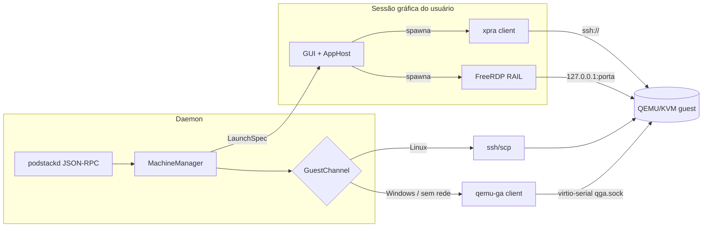

# Plano técnico — 001 Apps remotos da VM

> Derivado de [`spec.md`](spec.md) (rev. 2). Não altera `docs/sdd/plan.md`; é o delta proposto.
> Escopo: **M9** (guest Windows, pré-requisito) e **M10** (apps remotos, 3 tarefas).

---

## 1. Arquitetura



**Correção estrutural:** o daemon **não** lança clientes gráficos. `packaging/systemd/podstack.service:16-18` tem `PrivateTmp=yes`, `ProtectSystem=strict` e `ProtectHome=read-only`, e a unit não importa `DISPLAY`/`WAYLAND_DISPLAY` — o daemon não enxerga `/tmp/.X11-unix`, `~/.ssh` nem `~/.Xauthority`.

| Componente | Onde roda | Responsabilidade |
|---|---|---|
| `GuestChannel` | daemon | ping, osinfo, exec, arquivos pequenos, IP |
| `MachineManager` | daemon | estado, portas, credenciais, catálogo em cache, `LaunchSpec` |
| `AppHost` | GUI (processo com sessão gráfica) | spawn/supervisão de xpra e FreeRDP, env de display, kill no stop |
| CLI | terminal do usuário | delega o launch à GUI via instância única; sem GUI → `PODSTACK_GUI_REQUIRED` |

`AppHost` recebe do daemon um `LaunchSpec` (argv + env + segredo por fd/arquivo), nunca abre display sozinho. Precedente: `ExternalTerminal` já lança processos na sessão do usuário a partir da GUI.

```cpp
// src/machines/GuestChannel.h (daemon)
class GuestChannel {
public:
  virtual ~GuestChannel() = default;
  virtual QString name() const = 0;                    // "ssh" | "agent"
  virtual bool ping() = 0;
  virtual GuestOsInfo osInfo() = 0;
  virtual GuestExecResult exec(const QStringList &argv, int timeoutMs) = 0;
  virtual QByteArray readSmallFile(const QString &path, int maxBytes) = 0;  // <= 1 MiB
  virtual void writeSmallFile(const QString &path, const QByteArray &data) = 0;
  virtual QString primaryIp() = 0;
};

// src/gui/AppHost.h (sessão gráfica)
struct LaunchSpec { QString program; QStringList args; QProcessEnvironment env; int secretFd; };
class AppHost {
public:
  virtual ~AppHost() = default;
  virtual AppSession launch(const LaunchSpec &spec) = 0;
  virtual void stop(const QString &sessionId) = 0;
  virtual QList<AppSession> sessions() const = 0;
};
```

Regra: **nenhum cliente remoto é embutido no QML**; xpra e FreeRDP criam janelas nativas e são supervisionados pelo `AppHost`.

## 2. Canal de guest — qemu-ga (T10-01)

### 2.1 QEMU

```
-device virtio-serial-pci,id=virtserial0
-chardev socket,id=qga,path=<machineDir>/qga.sock,server=on,wait=off
-device virtserialport,chardev=qga,name=org.qemu.guest_agent.0
```

- `machineDir` já é `0700` (`MachineManager.cpp:170-177,2045`); é esse o limite de proteção. **Não prometer `chmod 0600` atômico** — a criação do socket pelo QEMU não é interceptável; o teste verifica diretório e dono.
- Nome do port `org.qemu.guest_agent.0` (default do MSI Windows e do `qemu-ga` Linux) — confirmar no spike com o MSI real.
- Sem vsock no v1: suporte do `qemu-ga` Windows a `vsock-listen` não é garantido.

### 2.2 Cliente

`GuestAgentClient` em `src/machines/`, JSON delimitado por `\n`, `guest-sync-delimited` (prefixo `0xFF`) na reconexão.

| Operação | Uso |
|---|---|
| `guest-ping` | liveness; dirige `provisioning` → `running` |
| `guest-get-osinfo` | detectar Windows/Linux e versão |
| `guest-info` | confirmar `guest-exec` |
| `guest-exec` / `guest-exec-status` | scripts de setup e consultas |
| `guest-network-get-interfaces` | IP sem SSH |
| `guest-file-open/read/write/close` | **≤ 1 MiB** |

Transferência de usuário continua em `scp` (Linux) e virtiofs/WinFsp (Windows). O protocolo de arquivo do qemu-ga usa chunks base64 em JSON e perde uma ordem de grandeza — usá-lo para transferência seria regressão.

### 2.3 Reconexão

1. Reconectar ao socket com backoff (1 s → 30 s).
2. Se o chardev morreu: `device_del` do `virtserialport` → `chardev-remove` → `chardev-add` → `device_add`, **nesta ordem** (só `chardev-remove` falha com device em uso).
3. Falha persistente → `guestChannel.agent=false`, fallback classificado, sem exceção atravessando a UI.

Sequência validada no spike de T10-01 com QEMU real (`PODSTACK_QEMU_INTEGRATION`).

### 2.4 Segurança

`guest-exec` é execução arbitrária no guest: exposto só pelo socket `0600` + `SO_PEERCRED` do daemon, nunca por TCP; timeout duro (30 s); saída passa pelo redaction; scripts temporários apagados após uso.

## 3. Apps Linux — xpra (T10-02)

### 3.1 Pré-requisitos de host e guest

| Lado | Requisito | Checagem |
|---|---|---|
| Host | binário `xpra` (cliente) | `SetupManager` + override `PODSTACK_XPRA_BINARY`; ausência → `PODSTACK_DEPENDENCY_MISSING` |
| Guest | pacote `xpra` | instalação sob demanda com consentimento |

| Distro | Comando | Observação |
|---|---|---|
| Ubuntu/Debian | `sudo apt-get install -y xpra` | `universe` nas imagens cloud |
| Fedora | `sudo dnf install -y xpra` | **validar disponibilidade**; se ausente, repo oficial do projeto |
| Arch/Alpine | fora do v1 | `reason=backend_missing` com instrução |

### 3.2 Sessão

```
xpra seamless ssh://<user>@<host>:<port>/ \
  --ssh="ssh -i <key> -o IdentitiesOnly=yes -o UserKnownHostsFile=<known_hosts>" \
  --start-child="<exec>" --exit-with-children \
  --clipboard=yes --notifications=yes --audio=no
```

- Uma sessão por app; `--exit-with-children` encerra o servidor quando o filho sai.
- **Limpeza (FR-MAC-124):** se o cliente morrer (crash do daemon/GUI), o `AppHost` roda `xpra stop ssh://…` e aplica TTL na sessão remota; stop/delete da machine encerra todas.
- Transporte: SSH existente (chave e `known_hosts` por machine).
- `--audio=yes` atrás de setting (D3); default mantém HDA→PipeWire.

### 3.3 Catálogo

`.desktop` em `/usr/share/applications` e `~/.local/share/applications` via canal; ignorar `NoDisplay=true`/`Terminal=true`; `Name`, `Exec` sem `%`-codes, `Icon`; ícone do tema do host ou genérico; cache por machine.

### 3.4 RPC e UI

`machines.apps.list` → `{backend, items[], total?}`; `launch` → `{sessionId}`; `stop` → `{ok}`. UI: botão "Abrir app da VM", busca, badge do backend.

### 3.5 X11 legado

`machine ssh --x11` e o RPC atual não mudam; doc marca como legado com ponteiro para xpra. Nenhum teste removido.

## 4. Apps Windows — RAIL (T10-03)

Bloqueado por **M9**. Sem guest Windows com agente e RDP não há o que conectar.

### 4.1 Habilitar RDP (via `guest-exec`)

```powershell
Set-ItemProperty 'HKLM:\System\CurrentControlSet\Control\Terminal Server' -Name fDenyTSConnections -Value 0
Set-ItemProperty 'HKLM:\System\CurrentControlSet\Control\Terminal Server\WinStations\RDP-Tcp' -Name UserAuthentication -Value 1
Enable-NetFirewallRule -DisplayGroup 'Remote Desktop'
New-LocalUser -Name 'PodStack' -Password (ConvertTo-SecureString $pw -AsPlainText -Force) -PasswordNeverExpires
Add-LocalGroupMember -Group 'Remote Desktop Users' -Member 'PodStack'
```

Senha aleatória em `machineDir/rdp.secret` (`0600`), passada por arquivo escrito com `guest-file-write` e apagada depois. Nunca em argv/log/`meta.json`.

### 4.2 Porta e confiança

- **Porta como `MachinePort`** (`MachineMeta.h:14`), alocada por `findFreePort` (`MachineManager.cpp:399`) e concatenada ao **mesmo** `-netdev user,hostfwd=…` de `QemuCommand.cpp:204-213`; `exposeLan=false` obrigatório, entrada marcada `internal` para não vazar na UI/CLI de portas.
- `hostfwd=tcp:127.0.0.1:<porta>-:3389` — endereço explícito, nunca `0.0.0.0`.
- TOFU: SHA-256 em `MachineMeta.rdpCertFingerprint`; `/cert:ignore` proibido; NLA obrigatório.
- **Senha fora de argv:** `xfreerdp /from-stdin` (validar no spike) ou helper com `--password-file`. O caminho nunca usa `/p:`.

### 4.3 Sessão única

Windows client aceita **uma** sessão interativa: duas invocações `/app:` colidem. Broker obrigatório:

- **Gate T10-03a:** provar com `xfreerdp` 3.x (uma sessão + `RAIL_EXEC`). Se não suportar, helper `podstack-rail` com `libfreerdp-client` (eventos JSON em stdout, comandos por stdin).
- **Sem fallback silencioso:** se o spike falhar e o helper não for viável, T10-03 fica bloqueada e é replanejada — não se abre "um app por vez" contra AC-5.

### 4.4 Catálogo e integrações

Start Menu (`Get-StartApps` + `.lnk`) → `catalog.json` + `.ico` via `guest-file-*`; publicar `TSAppAllowList`; cache por machine; `.desktop` opcional (P1).

Clipboard `cliprdr`; drive redirect `/drive:PodStack,<pasta>`; áudio HDA→PipeWire com `rdpsnd` desligado; `/scale-desktop:100` + `/dynamic-resolution`; janelas via XWayland.

## 5. Modelo de dados

`MachineMeta` (campos opcionais; `meta.json` tolera ausência):

```json
{
  "guestChannel": "ssh",           // ssh | agent
  "appBackend": "x11",             // x11 | xpra | rail
  "rdpCertFingerprint": "",        // SHA-256 (TOFU)
  "appsCatalogUpdatedAt": ""
}
```

| Operação | Política |
|---|---|
| `export`/`import` | **não** transporta fingerprint nem segredo RDP; TOFU é refeito e a senha regenerada no primeiro boot |
| `clone` | limpa fingerprint, regenera segredo, regenera TPM (FR-MAC-113) |
| machine existente | campos ausentes → `ssh`/`x11`; sem migração |

Settings são **defaults de criação**, não override global (precedência `MachineMeta` > setting, como `machines.cpus`); nenhuma exige restart de todas as VMs:

| Chave | Tipo | Default |
|---|---|---|
| `machines.apps.backend` | select `auto\|x11\|xpra\|rail` | `auto` |
| `machines.apps.xpraAudio` | bool | `false` |
| `machines.apps.railSound` | select `local\|rdp` | `local` |
| `machines.guest.channel` | select `auto\|ssh\|agent` | `auto` |

## 6. Contratos RPC

| Método | Params | Retorno | Erros (`PODSTACK_*` + `reason`) |
|---|---|---|---|
| `machines.apps.list` | `{id}` | `{backend, items[], total?}` | `NOT_FOUND` |
| `machines.apps.launch` | `{id, app, args?}` | `{sessionId}` | `DEPENDENCY_MISSING/backend_missing`, `NOT_FOUND/app_not_found`, `UNAVAILABLE/guest_unreachable`, `CONFLICT/session_conflict`, `AUTH_FAILED/rdp_auth_failed`, `GUI_REQUIRED/gui_required` |
| `machines.apps.stop` | `{id, sessionId}` | `{ok}` | `NOT_FOUND` |
| `machines.apps.ensureBackend` | `{id, backend}` | `{installed, command}` | `UNSUPPORTED/backend_unsupported` |
| `machines.guest.exec` | `{id, argv[], timeoutMs?}` | `{exitCode, stdout, stderr}` | `UNAVAILABLE`, `TIMEOUT` |
| `machines.guest.info` | `{id}` | `{os, version, ip, agentVersion}` | `UNAVAILABLE` |
| `machines.stats` (alterado) | `{id}` | `{…, origin}` | inalterado |

Códigos seguem `docs/engineering/api-rpc.md:83-89`; `reason` é enum fechado.

## 7. Compatibilidade

Machine Linux existente: `ssh` + `x11`, comportamento idêntico. Nenhum método removido. `machine ssh` e o bloco em `~/.ssh/config` permanecem. O argv só muda quando o campo novo existe.

## 8. Riscos

| Risco | Prob. | Impacto | Mitigação |
|---|---|---|---|
| `xpra` ausente no repo da distro | Média | T10-02 bloqueado nela | validar por distro; repo oficial; fallback X11 |
| `xpra`/`xfreerdp` ausentes no host | Média | backend inútil | setup + override + erro claro |
| chardev não reaceita após restart | Média | canal `agent` cai | sequência QMP `device_del`→`chardev-remove`→`chardev-add`→`device_add` |
| Windows client = 1 sessão RDP | Alta | RAIL multi-app | spike T10-03a; helper `libfreerdp-client` |
| `/from-stdin` indisponível | Baixa | senha em argv | helper obrigatório |
| clone/export quebram TOFU | Média | RDP não conecta | limpar fingerprint + regenerar segredo |
| xpra + HiDPI/Wayland | Média | tamanho errado | flags de scaling; E2E niri/GNOME |
| Áudio duplicado | Baixa | eco | `--audio=no` default; `rdpsnd` off |
| `guest-exec` como superfície | Baixa | execução no guest | socket local, timeout, redaction |
| Code signing do agente Windows | Média | SmartScreen | setup via PowerShell/qemu-ga, sem MSI próprio |

## 9. Testes

| Nível | Cobertura |
|---|---|
| Unit | `GuestAgentClient` (framing, `0xFF`, timeout), capability, argv xpra, TOFU, `reason`, `AppHost` fake |
| Integração | `MockGuestAgent`; xpra/freerdp fake no `PATH`; restart do daemon (QEMU real atrás de `PODSTACK_QEMU_INTEGRATION`) |
| Contrato | `test_rpc`: forma `items`, cada `reason`, `origin` em stats |
| Segurança | `/proc/<pid>/cmdline` sem senha; modo/dono de `machineDir` |
| Dados | roundtrip export→import e clone: fingerprint limpo, segredo regenerado |
| E2E | Ubuntu 24.04 (xpra), Windows 11 Pro (RAIL, 2 apps), Windows Home (erro) |
| Regressão | 17 binários existentes + `qmllint`; gate 80% |

## 10. Fases

1. **M9** (T9-01…T9-06): habilitação Windows. Bloqueia só T10-03.
2. **T10-01** e **T10-02** em paralelo com M9 — não dependem dele.
3. **T10-03a** (spike) → **T10-03**.

## Anexo — M9 (resumo)

Detalhe em [`tasks.md`](tasks.md): T9-01 console SPICE (reverte P2, atualiza ADR/spec), T9-02 OVMF secboot+SMM, T9-03 swtpm, T9-04 provisioner Windows, T9-05 drivers+agente, T9-06 áudio validado.
