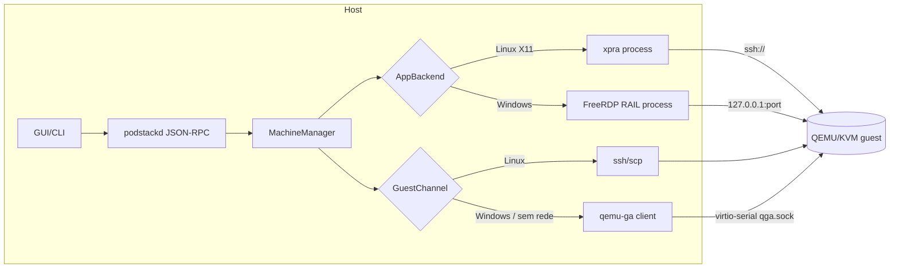

# Plano técnico — 001 Apps remotos da VM

> Derivado de [`spec.md`](spec.md). Este documento **não** altera `docs/sdd/plan.md`; é o delta proposto.
> Escopo: M9 (T9-01…T9-03) + pré-requisito M10 (Anexo A).

---

## 1. Arquitetura



Duas abstrações novas, ambas resolvidas por **capability** da machine:

```cpp
// src/machines/GuestChannel.h
class GuestChannel {
public:
  virtual ~GuestChannel() = default;
  virtual QString name() const = 0;                    // "ssh" | "agent"
  virtual bool ping() = 0;                              // liveness
  virtual GuestOsInfo osInfo() = 0;
  virtual GuestExecResult exec(const QStringList &argv, int timeoutMs) = 0;
  virtual QByteArray readSmallFile(const QString &path, int maxBytes) = 0;  // <= 1 MiB
  virtual void writeSmallFile(const QString &path, const QByteArray &data) = 0;
  virtual QString primaryIp() = 0;
};
```

```cpp
// src/machines/AppBackend.h
class AppBackend {
public:
  virtual ~AppBackend() = default;
  virtual QString name() const = 0;                     // "x11" | "xpra" | "rail"
  virtual bool available(QString *reason) const = 0;
  virtual QList<AppEntry> list() = 0;
  virtual AppSession launch(const QString &app, const QStringList &args) = 0;
  virtual void stop(const AppSession &session) = 0;
};
```

Regra de ouro: **nenhum cliente remoto é embutido no QML**. xpra e FreeRDP criam janelas nativas; o PodStack supervisiona o processo, como já faz com `ExternalTerminal`.

## 2. Canal de guest — qemu-ga (T9-01)

### 2.1 QEMU

Adicionar ao argv, apenas quando `guestChannel` inclui `agent`:

```
-device virtio-serial-pci,id=virtserial0
-chardev socket,id=qga,path=<machineDir>/qga.sock,server=on,wait=off
-device virtserialport,chardev=qga,name=org.qemu.guest_agent.0
```

- `qga.sock` fica em `machineDir` (já `0700`); aplicar `0600` após criar.
- Nome do port **precisa** ser `org.qemu.guest_agent.0` (default do MSI do Windows e do `qemu-ga` no Linux).
- Sem vsock no v1: o suporte do `qemu-ga` no Windows a `vsock-listen` não é garantido; virtio-serial é o denominador comum.

### 2.2 Cliente

`GuestAgentClient` em `src/machines/`, protocolo JSON delimitado por `\n`, com `guest-sync-delimited` (prefixo `0xFF`) na reconexão para descartar lixo de buffer.

Operações usadas (e só elas):

| Operação | Uso |
|---|---|
| `guest-ping` | liveness; usado no estado `installing` |
| `guest-get-osinfo` | detectar Windows/Linux e versão → capability |
| `guest-info` | confirmar `guest-exec` disponível |
| `guest-exec` / `guest-exec-status` | scripts de setup, consultas de catálogo |
| `guest-network-get-interfaces` | IP sem SSH |
| `guest-file-open/read/write/close` | **≤ 1 MiB**: scripts, JSON de catálogo, `.ico` |

Transferência de usuário **não** passa por aqui: no Linux continua `scp`; no Windows, virtiofs (WinFsp) ou o backend de arquivos fica desabilitado até lá. Motivo: o protocolo usa chunks base64 em JSON e perde uma ordem de grandeza em throughput.

### 2.3 Ciclo de vida e reconexão

- O daemon mantém **uma** conexão por machine, com backoff exponencial (1 s → 30 s).
- **Critério de aceite:** derrubar o daemon e subir de novo reconecta ao mesmo socket sem reiniciar a VM. Se o chardev do QEMU não reaceitar conexão (comportamento a validar no spike), a mitigação é reiniciar apenas o processo QEMU? **Não** — a mitigação aceitável é reabrir o `chardev` via QMP (`chardev-add`/`chardev-remove`) mantendo a VM viva. Validar antes de fechar o desenho.
- Falha do canal → `capabilities.guestChannel.agent = false`, fallback para SSH classificado, sem exceção atravessando a UI.

### 2.4 Segurança

- `guest-exec` é execução arbitrária no guest. Só é exposto via RPC no mesmo socket `0600` + `SO_PEERCRED` do daemon; nunca por TCP.
- Saída de comandos passa pelo redaction existente; nada de senha em argv (usar `guest-file-write` de um script temporário e apagar).
- Timeout duro por chamada (default 30 s, `guest-exec-status` em polling curto).

## 3. Apps Linux — xpra (T9-02)

### 3.1 Modelo de sessão

Uma sessão por app, processo supervisionado:

```
xpra seamless ssh://<user>@<host>:<port>/ \
  --ssh="ssh -i <key> -o IdentitiesOnly=yes -o UserKnownHostsFile=<known_hosts>" \
  --start-child="<exec>" \
  --exit-with-children \
  --clipboard=yes \
  --notifications=yes \
  --audio=no
```

- `seamless` = janelas nativas, sem desktop remoto; `--exit-with-children` garante que fechar a janela encerra o processo no guest.
- Transporte: SSH já existente (chave por machine, `known_hosts` isolado). Não há transporte novo.
- `--audio=yes` fica atrás de setting (D3): o áudio atual da VM é HDA→PipeWire, por VM; xpra daria áudio por app a custo de latência.

### 3.2 Pré-requisito no guest

`xpra` não está nas imagens base. Instalação sob demanda, com consentimento explícito:

| Distro | Comando | Observação |
|---|---|---|
| Ubuntu/Debian | `sudo apt-get install -y xpra` | `universe` habilitado nas imagens cloud |
| Fedora | `sudo dnf install -y xpra` | validar disponibilidade no repo oficial; se ausente, usar repo do projeto |
| Arch/Alpine | fora do v1 | erro `backend_missing` com instrução |

Fluxo: `machines.apps.ensureBackend` → mostra comando e tamanho estimado → usuário confirma → executa via canal (SSH ou agente) → revalida com `xpra --version`.

### 3.3 Catálogo

Ler `.desktop` em `/usr/share/applications` e `~/.local/share/applications` via canal; filtrar `NoDisplay=true`, `Terminal=true`; usar `Name`, `Exec` (removendo `%`-codes) e `Icon`. Ícone: tentar tema do host pelo nome; fallback ícone genérico. Cache por machine com invalidação manual.

### 3.4 RPC e UI

- `machines.apps.list` → `[{id, name, exec, icon, backend}]`
- `machines.apps.launch` `{machine, app, args?}` → `{sessionId, pid}`
- `machines.apps.stop` `{machine, sessionId}`
- UI: botão "Abrir app da VM" no inspetor, lista com busca; badge do backend usado.

### 3.5 X11 legado

`machine ssh --x11` e o RPC atual **não mudam**. A doc passa a marcar como legado, com ponteiro para xpra. Nenhum teste removido.

## 4. Apps Windows — RAIL (T9-03)

**Bloqueado por M10** (Anexo A). Sem console gráfico e provisionamento Windows não há guest para conectar.

### 4.1 Habilitar RDP no guest (via qemu-ga)

```powershell
Set-ItemProperty 'HKLM:\System\CurrentControlSet\Control\Terminal Server' -Name fDenyTSConnections -Value 0
Set-ItemProperty 'HKLM:\System\CurrentControlSet\Control\Terminal Server\WinStations\RDP-Tcp' -Name UserAuthentication -Value 1
New-ItemProperty 'HKLM:\System\CurrentControlSet\Control\Terminal Server\WinStations\RDP-Tcp' -Name SecurityLayer -Value 2 -PropertyType DWord -Force
Enable-NetFirewallRule -DisplayGroup 'Remote Desktop'
New-LocalUser -Name 'PodStack' -Password (ConvertTo-SecureString $pw -AsPlainText -Force) -PasswordNeverExpires
Add-LocalGroupMember -Group 'Remote Desktop Users' -Member 'PodStack'
```

Senha aleatória por machine, gravada em `machineDir/rdp.secret` (`0600`); nunca em argv, log ou `meta.json`. O script recebe a senha via arquivo temporário escrito com `guest-file-write` e apagado em seguida.

### 4.2 Transporte e confiança

- `-netdev user,...,hostfwd=tcp:127.0.0.1:<porta>-:3389` — endereço explícito, nunca `0.0.0.0`.
- RDP usa certificado autoassinado do Windows. Estratégia **TOFU**: na primeira conexão, capturar SHA-256 via `xfreerdp /cert:tofu` e gravar em `MachineMeta.rdpCertFingerprint`; nas seguintes, exigir match. `/cert:ignore` é proibido.
- NLA obrigatório (`UserAuthentication=1`). Sem NLA, RDP falha e o erro é classificado.

### 4.3 Sessão única (o ponto crítico)

Windows client (10/11 Pro) aceita **uma** sessão interativa. Duas invocações `xfreerdp /app:...` colidem — a segunda derruba a primeira. Portanto o desenho exige um broker:

- **Spike T9-03a:** validar se `xfreerdp` 3.x mantém uma sessão RAIL e permite lançar apps adicionais nela (canal `rail`, `RAIL_EXEC`) sem reconectar. Se não permitir, implementar helper próprio com `libfreerdp-client` (`freerdp_client_context_new`, canal `rail`, `RAIL_EXEC`), empacotado como binário interno `podstack-rail`.
- Contrato do helper: `podstack-rail --server 127.0.0.1:<porta> --user ... --password-file ... --trust-fingerprint <sha256>` emite eventos em JSON (janela aberta/fechada) e aceita comandos por stdin (`launch <app>`, `quit`).
- Fallback se o spike falhar e o helper não for viável no prazo: um app por vez, com aviso explícito na UI (não silencioso).

### 4.4 Catálogo RemoteApp

1. Agente enumera Start Menu (`.lnk` + UWP via `Get-StartApps`).
2. Para cada app: `TargetPath`, `IconLocation`; exporta `.ico` e monta `catalog.json`.
3. Publica no guest: `TSAppAllowList` com `fDisabledAllowList=1` (ou entradas por app).
4. Host recebe `catalog.json` + ícones por `guest-file-read` (pequenos) e cacheia por machine.
5. `.desktop` opcional no host para integração com o menu do sistema (P1).

### 4.5 Integrações

| Item | Decisão |
|---|---|
| Clipboard | `cliprdr` ligado (default do FreeRDP) |
| Drive | `/drive:PodStack,<pasta>` para abrir arquivo do host no app da VM |
| Áudio | HDA→PipeWire por VM; canal `rdpsnd` **desligado** por padrão (evita caminho duplo e latência) |
| HiDPI | `/scale-desktop:100` + `/dynamic-resolution`; documentar limitações em RAIL |
| Wayland | janelas RAIL chegam via XWayland; aceitável, testar em niri/GNOME |
| Notificações | fora do v1 (exigiria canal próprio) |

## 5. Modelo de dados

`MachineMeta` (campos novos, todos opcionais — machines existentes não migram):

```json
{
  "guestChannel": "ssh",              // ssh | agent
  "appBackend": "x11",                // x11 | xpra | rail
  "rdpPort": 0,                       // hostfwd alocado
  "rdpCertFingerprint": "",           // SHA-256 fixado por TOFU
  "appsCatalogUpdatedAt": ""
}
```

Capabilities derivadas (não persistidas): `guestChannel.ssh`, `guestChannel.agent`, `apps.x11`, `apps.xpra`, `apps.rail`.

Settings novas (atualizar `docs/engineering/settings.md` na implementação):

| Chave | Tipo | Default | Restart |
|---|---|---|---|
| `machines.apps.backend` | select `auto\|x11\|xpra\|rail` | `auto` | não |
| `machines.apps.xpraAudio` | bool | `false` | não |
| `machines.apps.railSound` | select `local\|rdp` | `local` | não |
| `machines.guest.channel` | select `auto\|ssh\|agent` | `auto` | sim (argv) |

## 6. Contratos RPC

Ver [`../../engineering/api-rpc.md`](../../engineering/api-rpc.md) para o padrão. Métodos novos, sem quebra dos existentes:

| Método | Params | Retorno | Erros |
|---|---|---|---|
| `machines.apps.list` | `{id}` | `{backend, apps[]}` | `machines.not_found`, `apps.unsupported` |
| `machines.apps.launch` | `{id, app, args?}` | `{sessionId}` | `apps.backend_missing`, `apps.app_not_found`, `apps.guest_unreachable` |
| `machines.apps.stop` | `{id, sessionId}` | `{ok}` | `apps.session_not_found` |
| `machines.apps.ensureBackend` | `{id, backend}` | `{installed, command}` | `apps.unsupported` |
| `machines.guest.exec` | `{id, argv[], timeoutMs?}` | `{exitCode, stdout, stderr}` | `guest.unavailable`, `guest.timeout` |
| `machines.guest.info` | `{id}` | `{os, version, ip, agentVersion}` | `guest.unavailable` |

`machines.guest.exec` é interno do daemon/GUI; a CLI expõe no máximo `podstack machine apps list|launch|stop`.

## 7. Compatibilidade

- Machine Linux existente: `guestChannel=ssh`, `appBackend=x11`, comportamento idêntico.
- Nenhum método RPC removido ou alterado.
- `machine ssh` e o bloco gerenciado em `~/.ssh/config` permanecem.
- O argv só muda quando `guestChannel=agent` (campo novo), então VMs antigas não ganham devices novos.

## 8. Riscos

| Risco | Prob. | Impacto | Mitigação |
|---|---|---|---|
| `xpra` indisponível no repo da distro | Média | T9-02 bloqueado naquela distro | validar por distro; documentar; fallback X11 |
| `chardev` do QEMU não reaceita conexão após restart do daemon | Média | canal `agent` cai até reiniciar a VM | spike de reconexão; `chardev-add/remove` via QMP |
| Windows client só permite uma sessão RDP | Alta | RAIL multi-app não funciona com `xfreerdp` puro | broker `libfreerdp-client` (spike T9-03a) |
| xpra + HiDPI/escala no Wayland | Média | janelas com tamanho errado | testar niri/GNOME; flags de scaling documentadas |
| xpra em Fedora fora do repo oficial | Média | instalação falha | checar repo oficial do projeto; senão, erro claro |
| Áudio duplicado (HDA + xpra) | Baixa | eco/volume duplo | default `--audio=no`; setting explícita |
| `guest-exec` vira superfície de ataque | Baixa | execução no guest | socket `0600`, sem TCP, redaction, timeout |
| Code signing do agente Windows | Média | SmartScreen | setup por PowerShell via qemu-ga, sem MSI próprio |

## 9. Testes

| Nível | Cobertura |
|---|---|
| Unit | `GuestAgentClient` (framing, `0xFF` sync, timeout, erro), resolução de capability, builder de argv do xpra, TOFU de fingerprint, classificação de erro |
| Integração | `MockGuestAgent` (socket Unix fake, como `MockPodmanServer`); `xpra` fake no `PATH`; restart do daemon reconectando |
| Contrato | `test_rpc` para os métodos novos (params inválidos, erros) |
| E2E (manual/VM real) | Ubuntu 24.04: xpra abre janela; Windows 11 Pro: RAIL com dois apps; Windows Home: erro claro |
| Regressão | suíte existente (15 binários) + `qmllint` |

Gate de cobertura de 80% permanece bloqueante.

## 10. Fases de entrega

1. **T9-01** (independente) — canal `agent`, capabilities, estado `installing`.
2. **T9-02** (independente) — xpra, catálogo Linux, RPC de apps, UI.
3. **M10** (Anexo A) — Windows: console, firmware/TPM, provisionamento, drivers, áudio validado.
4. **T9-03** — RAIL, após o spike T9-03a e o M10.

T9-01 e T9-02 podem ir em paralelo; T9-02 entrega valor visível antes do M10.

---

## Anexo A — Pré-requisitos Windows (M10)

Necessário para T9-03; **não** é entregável de apps, é habilitação de guest.

| ID | Tarefa | Conclusão |
|---|---|---|
| T10-01 | Console gráfico para instalação: SPICE com socket Unix + viewer em janela própria | VM Windows instalável e operável; QMP preservado |
| T10-02 | OVMF secboot (`-machine q35,smm=on`, `-global cfi.pflash01.secure=on`), variante `OVMF_CODE/VARS.secboot` | Windows 11 satisfaz Secure Boot |
| T10-03 | `swtpm` por VM (socket + estado persistido) | Windows 11 vê TPM 2.0 |
| T10-04 | Provisioner Windows: `installerIso`, `-cdrom`, ordem de boot, `autounattend.xml`, `virtio-win.iso`, default ≥4 GB/64 GB, enlightenments `hv_*` | instalação unattended até desktop |
| T10-05 | Drivers: vioscsi/NetKVM/viogpudo + `qemu-guest-agent` (MSI) | agente responde; disco/rede virtio funcionam |
| T10-06 | Áudio HDA validado no guest Windows (playback + captura) e nó PipeWire nomeado por VM | microfone e saída funcionam; toggle `machines.audio.set` vale para Windows |

Bloqueio duro: Windows Home não habilita `rail`; a UI deve explicar (FR-MAC-114).
