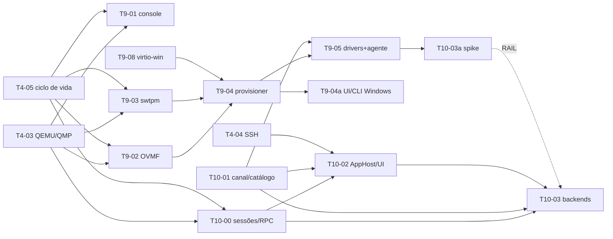

# Tarefas — 001 Apps remotos da VM

> Derivado de [`plan.md`](plan.md) (rev. 3). **Ainda não estão em [`../../sdd/tasks.md`](../../sdd/tasks.md)** — a promoção ocorre após aprovação (§Promoção).
> **Prioridade:** M9 e M10 são **P1 (v1.x, alvo 1.1+), não bloqueia v1.0** — `docs/README.md` define P1 como v1 desejável/v1.x.
> Legenda: `T<marco>-<NN>` · **P** = prioridade · **Dep** = dependências.

---

## M9 — Guest Windows (pré-requisito)

> **Objetivo:** tornar Windows um guest operável no PodStack — instalar, bootar com Secure Boot/TPM e ter agente, drivers e áudio. Não entrega apps.
> Bloqueia apenas **T10-03**; **T10-00** e **T10-01** correm em paralelo, e **T10-02** vem depois dos dois.

| ID | P | Tarefa | Dep | Conclusão |
|---|---|---|---|---|
| T9-01 | P1 | Console gráfico de instalação/emergência: SPICE em socket Unix (`-spice unix=on,addr=<dir>/spice.sock`) + viewer **`remote-viewer`** (virt-viewer) em janela própria, lançado pela **GUI** com o spec devolvido por `machines.console.spice` (nunca pelo daemon; sem `spice-gtk` como dependência de build). **Revisar** `adr/0003`, `sdd/spec.md` §7, `sdd/plan.md` e `engineering/api-rpc.md` para declarar a reversão do adiamento P2. | T4-03, T4-05 | instalação de SO gráfico operável; `-display none` quando o console está off; viewer ausente → `DEPENDENCY_MISSING/backend_missing`; ADR/spec/RPC atualizados (FR-MAC-111) |
| T9-02 | P1 | OVMF Secure Boot: `OVMF_CODE/VARS.secboot` por VM, `-machine q35,smm=on`, `-global driver=cfi.pflash01,property=secure,value=on`; NVRAM em `<state>/machines/<id>/nvram.fd` (`0600`), candidatos por distro (spec §11.1); Linux preserva `OVMF_VARS.fd`. | T4-03, T4-05 | Windows 11 reporta Secure Boot ativo (`Confirm-SecureBootUEFI`); machine Linux mantém `OVMF_VARS.fd` (FR-MAC-112) |
| T9-03 | P1 | `swtpm` por VM: chardev socket em `machineDir`, estado persistido, arquivos de estado `0600` (diretório `0700`), `-tpmdev emulator` + `tpm-tis`; política de clone/export. | T4-03, T4-05 | Windows 11 vê TPM 2.0; estado sobrevive a restart; clone regenera TPM e export não transporta estado (FR-MAC-113) |
| T9-04 | P1 | Provisioner Windows (backend): `provisioner: windows`, `distro` opcional/ausente (ou `"windows"`), `installerIso`, `answerFile?`, `windowsSsh?`, instalador em CD USB com `bootindex=0` + virtio-win/answer em IDE read-only, `autounattend.xml` (`0600`, removido após uso e fora do export), `DriverPaths` para `virtio-win.iso`, validação ≥ 2 vCPU/4 GiB/64 GiB, enlightenments `hv_*`; sem cloud-init nem seed. Senha fornecida/gerada usada só no XML, nunca em `meta.json`/argv/log. | T9-02, T9-03, T9-08 | instalação unattended até o desktop; ISO sai da ordem de boot após instalar; XML e senha não vazam; `windowsSsh` instala OpenSSH (FR-MAC-114) |
| T9-04a | P1 | UI/CLI de criação Windows: diálogo (ISO, senha/gerar, vCPU/RAM/disco com mínimos, `answerFile`, checkbox `windowsSsh`, aviso de licença) e `podstack machine create <name> --provisioner windows --iso <arquivo> [--answer-file <xml>] [--windows-ssh]`; validação inline e mensagens `qsTr`. | T9-04 | criar Windows pela GUI e pela CLI, com `distro` ausente; mínimos rejeitados com erro claro; docs `api-rpc.md`/`cli-parity.md`/`ui-map.md` (FR-MAC-114) |
| T9-05 | P1 | Drivers + agente: vioscsi/viostor, NetKVM, viogpudo, `virtio-win-guest-tools` e `qemu-guest-agent` (MSI) via `autounattend`; com `windowsSsh:true`, instala OpenSSH (MSI) e habilita o serviço; `provisioning` → `running` dirigido por `guest-ping` no canal `agent`, timeout de 10 min → `error`; `guest-get-osinfo` grava `guestOs` e detecta Home/Pro. | T9-04, T10-01 | disco/rede virtio sem `!`; `guest-ping` responde; `windowsSsh` funcional quando pedido; estado muda sem novo valor no enum `state`; timeout e Home/Pro testados (FR-MAC-115, FR-MAC-120) |
| T9-06 | P1 | Áudio Windows: validar `intel-hda` duplex (saída + microfone), nó PipeWire nomeado por VM; a validação usa o timeout interno de 30 s do `guest.exec` (sem chave nova); `machines.audio.set` vale para Windows. | T9-04 | playback e microfone funcionam; stream identificável no mixer (FR-MAC-116) |
| T9-07 | P1 | Dependências de host no empacotamento: `Requires`/`Depends` para QEMU x86/arm, utils, virtiofsd, firmware OVMF, módulos SPICE, áudio (`qemu-system-gui` no Ubuntu) e swtpm; backends gráficos (`xpra`, `freerdp`, `virt-viewer`) em `Recommends`/`Suggests` — **xpra nunca em `Depends`** (Ubuntu 26.04 não o empacota; 24.04 é `Recommends`). Incluir checks no `SetupManager` + `test_setup`, **estender `scripts/clean-install-check.sh` para DEB (hoje é Fedora-only)** e corrigir `qemuPackagesForManager()`, que usa `qemu-system-x86_64`/`qemu-system-aarch64` (nome de binário, não de pacote). | — | instalação limpa em Fedora 44, Ubuntu 24.04 e Ubuntu 26.04 sem check obrigatório em `missing`; `dnf`/`apt` resolvem todos os nomes; 26.04 instala sem xpra e `auto` usa `x11`; clean-install DEB executa (NFR-MAC-006/007) |
| T9-08 | P1 | ISO virtio-win: download por manifest com URL e SHA-256, job com progresso/cancelamento, cache `0600` em `~/.local/share/podstack/virtio-win/`, verificação de hash, falha offline com instrução de arquivo local e limpeza de cache antigo. | — | download/verificação/cache testados; hash inválido não é usado; offline retorna `DEPENDENCY_MISSING` com remediação (NFR-MAC-007) |

**Bloqueios duros:** Windows Home não habilita RAIL; GPU/3D exige VFIO (fora); Windows ARM e host aarch64 fora (M9/RAIL são x86_64-only, NFR-MAC-008).

> **Status T9-08 (2026-11-13):** ✅ código — manifesto embutido (0.1.302, URL HTTPS, SHA-256 e tamanho), cache `0700`/`0600` em `~/.local/share/podstack/virtio-win/`, progresso/cancelamento no job de criação, limpeza de versões antigas, fallback de ISO local e erros `PODSTACK_DEPENDENCY_MISSING`/`PODSTACK_DOWNLOAD_FAILED` testados. A criação Windows aceita `virtioWinIso` vazio na GUI, CLI e RPC.
>
> **Status T9-05/T9-07 (2026-11-13):** ✅ código — `GuestAgentClient`/`GuestChannel` (QGA sobre `qga.sock`, `guest-ping`, `guest-get-osinfo`, `guest-exec`, arquivos ≤ 1 MiB, rede), watcher de `provisioning` com timeout Linux 300 s/Windows 10 min (sem timeout durante `installPending`), `guestChannels`/`guestReady`/`guestOs`/`errorReason` em `meta.json`/SQLite/RPC, limpeza das mídias dirigida pelo agente, Home/Pro, reconexão QMP e checks/dependências de host (`swtpm`, SPICE, áudio) testados. **T10-01 parcial:** catálogo/ícones e `origin=agent` em stats continuam na M10.
>
> **Status T10-01 (2026-11-13):** ✅ código — catálogo Linux (`.desktop`) e Windows (Start Menu) com cache de 5 min, ícones base64 ≤ 256 KiB, `GuestAppCatalog`, `origin` em `machines.get/list` e fallback `agent` em `machines.stats`/`stats.subscribe`. **T10-00:** ✅ código — `AppSessionManager` com `launch/stop/detach`, idempotência por `(machineId, appId)`, TTL de 60 s, eventos `machines.apps.session.*`, `subscribe/unsubscribe/trust` e backend `x11` (LaunchSpec `ssh -X`). **Pendentes M10:** backend `xpra`/RAIL (T10-03), `AppHost`/UI/CLI (T10-02) e o spike T10-03a.
>
> **Pendências:** E2E Windows real (instalação/desktop/Secure Boot/TPM), T9-06 (áudio) e execução do `clean-install-check.sh --deb` em Ubuntu 24.04/26.04.

---

## M10 — Apps remotos (4 tarefas)

> **Objetivo:** abrir apps de machines na tela do host com backend plugável (xpra no Linux, RAIL no Windows) e um segundo canal de guest independente de rede. A GUI hospeda o cliente local; o daemon é dono das sessões.

| ID | P | Tarefa | Dep | Conclusão |
|---|---|---|---|---|
| T10-00 | P1 | `AppSessionManager` no daemon + contrato RPC `machines.apps.list/launch/stop/detach/subscribe/unsubscribe/trust`, eventos `machines.apps.session.*`, lock por `(machineId, appId)`, TTL de 60 s, reconciliação no start e em stop/delete, `reason`/códigos de erro. | T4-03, T4-05 | `list` devolve `items[]` + `sessions[]` (com `createdAt`) + `cachedAt`; launch idempotente; stop/detach idempotentes; eventos entregues à GUI; sem órfãos após restart (AC-1/AC-9, FR-MAC-121/122/124) |
| T10-01 | P1 | `GuestChannel` com `guestChannels` primário/fallback (`ssh`/`agent`), `GuestAgentClient` (framing, `0xFF`, timeout, reconexão), resolução de `auto` por SO, `guestReady`, `origin` em `get/list`/`stats`/`stats.subscribe`, catálogo com TTL de 5 min + ícones extraídos do guest. QEMU ganha `virtio-serial-pci` + `virtserialport id=qga0` + `chardev` em `qga.sock` para todo Linux/Windows com `agent` resolvido; reconexão `device_del qga0` → `chardev-remove` → `chardev-add` → `device_add`; timeout Linux de 300 s → `error`/`provisioning_timeout` (só máquinas iniciadas após a mudança, não retroativo). | T4-03, T4-05 | `test_machines`: argv com/sem agente; chardev no fallback Linux `auto`; `MockGuestAgent`; fallback ssh↔agent; stats com SSH bloqueado retorna `origin=agent`; `guestChannels`/`guestReady`; catálogo/cache; restart do daemon reconecta; timeout Linux (FR-MAC-101…106, 121 catálogo, 123) |
| T10-02 | P1 | `AppHost` na GUI (nunca no daemon): spawn/supervisão de xpra/FreeRDP a partir do `LaunchSpec`, `stopLocal`, `detach` ao sair, `subscribe` e reconciliação após restart; detecta **queda do RPC sem restart** e executa `shutdownAll()`; diálogo "Abrir app da VM" com busca, badge de backend e estado; CLI `machine apps list/launch/stop` delega à instância única (sem GUI → `PODSTACK_GUI_REQUIRED`); acessibilidade (`Accessible.name`, teclado). | T10-00, T10-01, T4-04 | cliente nasce na GUI; GUI não mantém estado de sessão; stop remoto/queda do daemon encerram clientes locais; CLI delega e falha com `GUI_REQUIRED` sem GUI; `Accessible.name` e teste QML do catálogo/diálogo (FR-MAC-110, 121; AC-9/10) |
| T10-03 | P1 | Backends **xpra** (Linux) e **RAIL** (Windows) + X11 legado: settings `machines.apps.backend/audio/shareFolder` (`MachineMeta.appBackend:null` segue a setting; a resolução fica só em `AppSession.backend` e na UI); xpra `auto` ≥ 4.0 ou `x11`, explícito 3.1.5 com warning `xpra_experimental`; `ensureBackend` interno do `launch` com consentimento/progresso; sessão xpra/`known_hosts` do state; RDP via `guest-exec` (NLA, usuário, segredo em `machineDir/sessions/<sessionId>/rdp.secret` e `rdpSecretPath`); porta `MachinePort` `kind:"internal"` preservada por `ports.set` e oculta em `ports.list`; TOFU + `machines.apps.trust` em mismatch; broker de **sessão única** (`T10-03a`); catálogo Start Menu + ícones; clipboard; drive redirect read-only opt-in; Home → `UNSUPPORTED/backend_unsupported`; limpeza (`xpra stop`/`logoff`/TTL). **Parte xpra** começa após T10-02; **parte RAIL** só após T9-05 e do gate T10-03a. | T10-00, T10-01, T10-02, T10-03a (só RAIL) | parte xpra abre em ≤ 2 s (Fedora) sem M9; Ubuntu 24.04 explícito com warning, `auto`→`x11`; Ubuntu 26.04 `auto`→`x11`; Windows sem FreeRDP → `DEPENDENCY_MISSING`, nunca `x11`; dois apps na **mesma** sessão RDP; fingerprint confere/rejeita/re-pina; `127.0.0.1` apenas; senha ausente de `/proc/<pid>/cmdline`; stop/delete sem órfãos; `machine ssh --x11` intacto (FR-MAC-107…110, 117…120, 122, 124; AC-5/6/8/9/12/14) |

### T10-03a — spike obrigatório (gate de T10-03)

1. Win11 Pro provisionado por M9, RDP habilitado.
2. `xfreerdp /app:…` com dois apps simultâneos + `quser` (provar a colisão).
3. Sessão persistente + `RAIL_EXEC` adicional, se o cliente expuser.
4. Validar `/from-stdin`, o nome do device `org.qemu.guest_agent.0` no MSI e a detecção Home/Pro por `guest-get-osinfo`.
5. **Saída:** decisão registrada (`xfreerdp` atende ou `podstack-rail` é necessário) anexada ao PR.

Sem o registro, T10-03 não começa. Se o broker não for viável, **T10-03 é replanejada** — não se degrada para "um app por vez" (contraria AC-5).

**Saída do M10:** `podstack machine apps launch <vm> <app>` abre janela nativa no Linux; canal `agent` responde sem rede; RAIL com duas janelas na mesma sessão; X11 legado intacto; sessões reconciliadas sem órfãos.

---

## Grafo de dependências

T10-03a é o gate da **parte RAIL** de T10-03; a **parte xpra** começa após T10-02 (sem M9). O grafo não torna T9-05 pré-requisito da tarefa inteira, apenas do subfluxo RAIL.

Caminho crítico para RAIL: **T4-03/T4-05 → T10-00 → T10-01 → T10-02 → T9-05 → T10-03a → parte RAIL de T10-03**, com **T9-02/T9-03/T9-08 → T9-04** antes de T9-05.
Caminho rápido para valor visível: **T10-00 → T10-01 → T10-02 → T10-03 (parte xpra)**, sem M9.

## Ordem recomendada

1. **T9-07** e **T10-00/T10-01** em paralelo.
2. **T10-02** (AppHost + diálogo + detecção de queda do RPC) sobre T10-00/T10-01.
3. **M9**: **T9-01/T9-02/T9-03/T9-08** em paralelo; **T9-04** → **T9-04a** → **T9-05** → **T9-06**.
4. **T10-03**: parte **xpra** após T10-02, sem M9; parte **RAIL** depois de T9-05/T10-03a.
5. **T9-01** pode entrar em qualquer ponto antes de T9-04.

## Definição de pronto (por tarefa)

1. Critério da tabela verificado e registrado (comando/saída).
2. Teste automatizado cobre o comportamento; E2E manual registrado quando exigir VM real.
3. Build sem warnings; `clang-format`/`clang-tidy`; `qmllint` no QML; teste QML/acessibilidade nas telas novas.
4. Doc afetada atualizada: `engineering/api-rpc.md`, `settings.md` (3 chaves novas, **86 → 89** e contagem nos 4 testes), `ui-map.md`, `data-model.md`, `cli-parity.md`, `security.md` (`guest-exec`, segredo RDP, drive redirect), `architecture.md` (`GuestChannel`/`AppHost`/`LaunchSpec`/canal de eventos), `packaging.md`, `testing.md`, `docs/user/` e strings `qsTr`/en-US.
5. Nenhum segredo em argv/log/`meta.json`; `machineDir` `0700`; `autounattend.xml`/`rdp.secret` `0600` e fora do export; `rdp.secret` só em `machineDir/sessions/<sessionId>/` e apagado no fim da sessão; RDP só em `127.0.0.1`.
6. Zero regressão nos **17** binários; gate de cobertura de 80%.

## Promoção (quando aprovado)

1. **FR-MAC-101…124** (todos: 101, 102, 103, 104, 105, 106, 107, 108, 109, 110, 111, 112, 113, 114, 115, 116, 117, 118, 119, 120, 121, 122, 123, 124) e **NFR-MAC-001…008** (todos: 001, 002, 003, 004, 005, 006, 007, 008) → `docs/sdd/PRD.md`; registrar a mudança de escopo (guest Windows + apps remotos) em **§3.1 e §3.2**, §6.2 e renomear §7.7 para “Machines — VMs Linux e Windows”; declarar que **FR-MAC-014 (console serial/VNC, P2) é substituído por FR-MAC-111** (SPICE/`remote-viewer`); manter a prioridade **P1 (v1.x, alvo 1.1+), não bloqueia v1.0**; nenhum requisito deste delta entra no v1.0.
2. Comportamento → `docs/sdd/spec.md` §7 (provisioning/canais, console SPICE, remoção de “VMs Linux”).
3. **T9-01…T9-08** (+ **T9-04a**) e **T10-00…T10-03** (+ **T10-03a**) → `docs/sdd/tasks.md` (M9 = Windows, M10 = apps), com o grafo de dependências corrigido.
4. Docs completos: `api-rpc.md` (métodos, `reason`, `origin`, `machines.create`, `MachinePort.kind`, códigos), `settings.md` (3 chaves e contagem), `ui-map.md` (catálogo, criação Windows, erros), `data-model.md` (`guestChannels`, `guestOs`, `appBackend`, TPM/segredo), `cli-parity.md` (`machine apps`, `machine create --provisioner`), `security.md`, `architecture.md`, `packaging.md`, `roadmap.md`, `testing.md`, `docs/user/` (abrir apps, instalar backend, criar VM Windows) e `docs/sdd/plan.md` (desenho de M9, D1–D4).
5. **ADR-0011** (`0011-apps-remotos-vm.md`): decisão estrutural de `AppHost`/`LaunchSpec`, dono das sessões (`AppSessionManager`), canal daemon↔GUI e escopo de **guest Windows**. Atualizar **ADR-0003** para a reversão do adiamento do console gráfico. **Não** usar ADR-0012 (reservado à spec 002).
6. Console SPICE (T9-01) atualiza ADR-0003 e a spec no mesmo PR.
7. Este diretório permanece como registro do delta.
