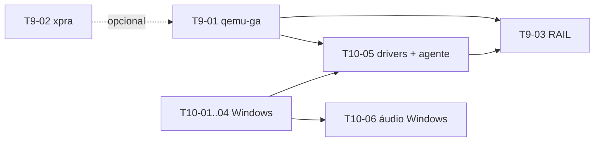

# Tarefas — 001 Apps remotos da VM

> Derivado de [`plan.md`](plan.md). **Estas tarefas ainda não estão em [`../../sdd/tasks.md`](../../sdd/tasks.md)** — a promoção acontece após aprovação (ver §Promoção).
> Legenda igual ao núcleo: `T<marco>-<NN>` · **P** = prioridade · **Dep** = dependências.

---

## M9 — Apps remotos e canal de guest

> **Objetivo do marco:** abrir apps de machines na tela do host com backend plugável (xpra no Linux, RAIL no Windows) e ter um segundo canal de guest independente de rede.
> T9-01 e T9-02 são independentes entre si e do M10. T9-03 depende do M10.

| ID | P | Tarefa | Dep | Conclusão |
|---|---|---|---|---|
| T9-01 | P0 | Canal de guest `agent` (qemu-ga sobre virtio-serial): `GuestChannel` com implementações `ssh` e `agent`, `GuestAgentClient` (framing, `guest-sync-delimited`, timeout, reconexão), capabilities por machine e estado `installing` → `ready` por `guest-ping`. QEMU ganha `virtio-serial-pci` + `virtserialport` + `chardev` em `qga.sock` (`0600`) só quando o canal é `agent`. | T4-01 (machines) | `test_machines` cobre: argv com/sem agente; cliente contra `MockGuestAgent`; capability resolvida por SO; VM sem rede responde `machines.guest.info`; restart do daemon reconecta sem reiniciar a VM (ou `chardev-add/remove` via QMP, se o spike exigir); erros classificados (`guest.unavailable`, `guest.timeout`) |
| T9-02 | P0 | Backend de apps Linux com **xpra**: `AppBackend` (`x11`, `xpra`), sessão por app (`xpra seamless ssh://… --start-child … --exit-with-children`), instalação sob demanda com consentimento (`machines.apps.ensureBackend`), catálogo de `.desktop` com ícones, RPC `machines.apps.list/launch/stop`, botão "Abrir app da VM" no inspetor e badge do backend. X11 forwarding permanece como legado, sem remoção. | T9-01 (opcional), T4-08 (SSH/arquivos) | app já instalado abre em ≤ 2 s em Ubuntu 24.04; fechar a janela encerra a sessão no guest; xpra ausente + recusa → `apps.backend_missing` com o comando; `machine ssh --x11` e testes existentes intactos; `qmllint` limpo |
| T9-03 | P1 | Backend **RAIL** para Windows: habilitar RDP via `guest-exec` (NLA, usuário `PodStack`, senha em arquivo `0600`), `hostfwd` só em `127.0.0.1`, TOFU do certificado (SHA-256 em `MachineMeta`), broker de **sessão única** (validar `xfreerdp` 3.x; se não suportar múltiplos apps na mesma sessão, helper `podstack-rail` com `libfreerdp-client` + `RAIL_EXEC`), catálogo Start Menu/`Get-StartApps` com ícones, clipboard e drive redirect. | T9-01, **M10** (Anexo A) | spike T9-03a registrado com evidência (xfreerdp 3.x em Win11 Pro); dois apps abertos na **mesma** sessão; fingerprint confere/rejeita; `127.0.0.1` apenas; Windows Home → `apps.backend_unsupported` explicando a licença |

### T9-03a — spike obrigatório (primeira etapa de T9-03)

Não é tarefa separada: é o **gate** de T9-03.

1. Provisão de Win11 Pro (via M10) com RDP habilitado.
2. Testar `xfreerdp /app:...` com dois apps simultâneos e observar sessões (`quser`).
3. Testar uma sessão persistente + `RAIL_EXEC` adicional (se o cliente expuser).
4. **Saída:** decisão registrada — `xfreerdp` atende ou `podstack-rail` é necessário — anexada ao PR de T9-03.

Sem esse registro, T9-03 não começa a implementação.

**Saída do M9:** `podstack machine apps launch <vm> <app>` abre janela nativa no Linux; o canal `agent` responde com a VM sem rede; RAIL desbloqueado após o M10; X11 legado intacto.

---

## Anexo A — M10 (pré-requisito de T9-03)

> Habilitação de guest Windows. Não entrega apps; entrega o guest que o RAIL exige.
> Esforço relativo: **G**.

| ID | P | Tarefa | Dep | Conclusão |
|---|---|---|---|---|
| T10-01 | P0 | Console gráfico para instalação/uso manual: SPICE com socket Unix (`-spice unix=on,addr=<dir>/spice.sock`) + viewer `spice-gtk` em **janela própria** (sem embutir GTK no QML). Revisar `adr/0003`, `spec.md` §7, `plan.md` e `api-rpc.md` (hoje excluem console gráfico/VNC). | — | instalação de SO gráfico operável; `-display none` preservado quando o console está desligado; ADR/spec atualizados com a nova decisão |
| T10-02 | P0 | OVMF Secure Boot: `OVMF_CODE.secboot`/`OVMF_VARS.secboot`, `-machine q35,smm=on` e `-global driver=cfi.pflash01,property=secure,value=on`; NVRAM por VM. | — | Windows 11 reporta Secure Boot ativo (msinfo32/`Confirm-SecureBootUEFI`) |
| T10-03 | P0 | `swtpm` por VM: chardev socket em `machineDir`, estado persistido, `-tpmdev emulator` + `tpm-tis`. | — | Windows 11 vê TPM 2.0; estado sobrevive a restart; clone/export decidem regenerar TPM (documentado) |
| T10-04 | P0 | Provisioner Windows: `provisioner: windows` no request, `installerIso` (usuário fornece), `-cdrom`, ordem de boot, `autounattend.xml` gerado (conta local, OOBE, RDP, `DriverPaths` para `virtio-win.iso`), default ≥ 4 GB RAM / 64 GB disco, enlightenments `hv_*`. | T10-02, T10-03 | instalação unattended até o desktop; sem cloud-init anexado; ISO removida da ordem de boot após instalar |
| T10-05 | P0 | Drivers e agente: vioscsi/viostor, NetKVM, viogpudo, `virtio-win-guest-tools` + `qemu-guest-agent` (MSI). | T10-04, T9-01 | disco/rede virtio sem `!` no Device Manager; `guest-ping` responde; `installing` → `ready` automático |
| T10-06 | P1 | Áudio Windows: validar HDA duplex (saída e microfone), nomear nó PipeWire por VM, setting de latência; toggle `machines.audio.set` passa a valer para Windows. | T10-04 | playback e microfone funcionam; stream identificável no mixer do host |

**Bloqueios duros do M10:** Windows Home não habilita RAIL; GPU/3D exige passthrough VFIO (fora do escopo); Windows ARM fora do escopo (machines arm64 não suportadas).

---

## Grafo de dependências

Caminho crítico para RAIL: **T10-02/03 → T10-04 → T10-05 → T9-03**.
Caminho rápido para valor visível: **T9-02** (xpra) sozinho.

## Ordem recomendada de execução

1. **T9-01** — desbloqueia M10/T10-05 e o diagnóstico sem rede.
2. **T9-02** — entrega apps Linux; independente do Windows.
3. **T10-01…T10-04** — habilitação Windows.
4. **T10-05** — drivers + agente (fecha `installing`).
5. **T9-03a** — spike RAIL (gate).
6. **T9-03** — RAIL.
7. **T10-06** — áudio Windows.

## Definição de pronto (por tarefa)

1. Critério de conclusão da tabela verificado e registrado com comando/saída.
2. Teste automatizado cobre o comportamento (unit + integração); E2E manual registrado quando exigir VM real.
3. Build sem warnings novos; `clang-format`/`clang-tidy`; `qmllint` no que tocar QML.
4. Doc afetada atualizada: se T9-01/T9-02/T9-03, também `docs/engineering/api-rpc.md`, `settings.md` e `ui-map.md`.
5. Nenhum segredo em argv/log/`meta.json`; sockets `0600`; RDP só em `127.0.0.1`.
6. Zero regressão nos binários de teste existentes; gate de cobertura de 80% mantido.

## Promoção (quando aprovado)

1. FR-MAC-101…116 → `docs/sdd/PRD.md` (domínio `FR-MAC`).
2. Comportamento → `docs/sdd/spec.md` §7 (machines).
3. T9-01…T9-03 e T10-01…T10-06 → `docs/sdd/tasks.md` (marco M9; M10 renumerado se necessário).
4. Riscos/decisões abertas D1…D4 → `docs/sdd/plan.md` ou ADR novo (`adr/0010-apps-remotos-vm.md`) se a decisão for estrutural.
5. Este diretório permanece como registro do delta; não é apagado.
