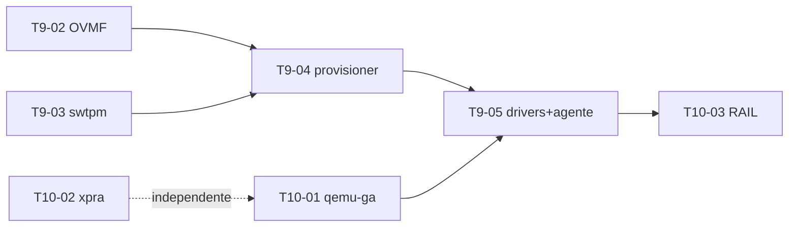

# Tarefas — 001 Apps remotos da VM

> Derivado de [`plan.md`](plan.md) (rev. 2). **Ainda não estão em [`../../sdd/tasks.md`](../../sdd/tasks.md)** — a promoção ocorre após aprovação (§Promoção).
> Legenda: `T<marco>-<NN>` · **P** = prioridade · **Dep** = dependências.

---

## M9 — Guest Windows (pré-requisito)

> **Objetivo:** tornar Windows um guest operável no PodStack — instalar, bootar com Secure Boot/TPM e ter agente, drivers e áudio. Não entrega apps.
> Bloqueia apenas **T10-03**; T10-01 e T10-02 correm em paralelo.

| ID | P | Tarefa | Dep | Conclusão |
|---|---|---|---|---|
| T9-01 | P0 | Console gráfico de instalação/emergência: SPICE em socket Unix (`-spice unix=on,addr=<dir>/spice.sock`) + viewer `spice-gtk` em janela própria, aberto pelo `AppHost` (nunca pelo daemon). **Revisar** `adr/0003`, `sdd/spec.md` §7, `sdd/plan.md` e `engineering/api-rpc.md` para declarar a reversão do adiamento P2. | — | instalação de SO gráfico operável; `-display none` quando o console está off; ADR/spec/RPC atualizados (FR-MAC-111) |
| T9-02 | P0 | OVMF Secure Boot: `OVMF_CODE/VARS.secboot` por VM, `-machine q35,smm=on`, `-global driver=cfi.pflash01,property=secure,value=on`; NVRAM persistida. | — | Windows 11 reporta Secure Boot ativo (`Confirm-SecureBootUEFI`); machine Linux não muda (FR-MAC-112) |
| T9-03 | P0 | `swtpm` por VM: chardev socket em `machineDir`, estado persistido, `-tpmdev emulator` + `tpm-tis`; política de clone/export. | — | Windows 11 vê TPM 2.0; estado sobrevive a restart; clone regenera TPM e export não transporta estado (FR-MAC-113) |
| T9-04 | P0 | Provisioner Windows: `provisioner: windows`, `installerIso`, `-cdrom`, ordem de boot, `autounattend.xml` (conta local, OOBE, RDP, `DriverPaths` para `virtio-win.iso`), default ≥ 4 GB/64 GB, enlightenments `hv_*`; sem cloud-init nem seed. | T9-02, T9-03 | instalação unattended até o desktop; ISO sai da ordem de boot após instalar (FR-MAC-114) |
| T9-05 | P0 | Drivers + agente: vioscsi/viostor, NetKVM, viogpudo, `virtio-win-guest-tools` e `qemu-guest-agent` (MSI) via `autounattend`; `provisioning` → `running` dirigido por `guest-ping`. | T9-04, T10-01 | disco/rede virtio sem `!`; `guest-ping` responde; estado muda sem novo valor de enum (FR-MAC-115) |
| T9-06 | P1 | Áudio Windows: validar `intel-hda` duplex (saída + microfone), nó PipeWire nomeado por VM, setting de latência; `machines.audio.set` vale para Windows. | T9-04 | playback e microfone funcionam; stream identificável no mixer (FR-MAC-116) |

**Bloqueios duros:** Windows Home não habilita RAIL; GPU/3D exige VFIO (fora); Windows ARM fora (machines arm64 não suportadas).

---

## M10 — Apps remotos (3 tarefas)

> **Objetivo:** abrir apps de machines na tela do host com backend plugável (xpra no Linux, RAIL no Windows) e um segundo canal de guest independente de rede.

| ID | P | Tarefa | Dep | Conclusão |
|---|---|---|---|---|
| T10-01 | P0 | Canal de guest `agent`: `GuestChannel` (`ssh` \| `agent`), `GuestAgentClient` (framing, `0xFF`, timeout, reconexão), capabilities, `provisioning`→`running` por `guest-ping`, `origin` em `machines.stats`/`guest.info`. QEMU ganha `virtio-serial-pci` + `virtserialport` + `chardev` em `qga.sock` **só** quando o canal é `agent`. | T4-01 | `test_machines`: argv com/sem agente; cliente contra `MockGuestAgent`; stats com SSH bloqueado retorna `origin=agent`; restart do daemon reconecta (ou reabre via `device_del`→`chardev-remove`→`chardev-add`→`device_add`); erros `PODSTACK_*` (FR-MAC-101…106, 123) |
| T10-02 | P0 | Backend Linux com **xpra**: `AppHost` na GUI (nunca no daemon), sessão por app (`xpra seamless … --start-child … --exit-with-children`), checagem do binário no host + `PODSTACK_XPRA_BINARY`, instalação no guest sob consentimento (`ensureBackend`), catálogo `.desktop` + ícones, RPC `machines.apps.list/launch/stop`, botão "Abrir app da VM", limpeza de sessão em stop/delete/crash (`xpra stop` + TTL). X11 permanece legado. | T4-08 | app abre em ≤ 2 s; fechar a janela encerra a sessão; xpra ausente → `DEPENDENCY_MISSING/backend_missing`; stop/delete sem órfãos; `machine ssh --x11` intacto (FR-MAC-107…110, 121, 124) |
| T10-03 | P1 | Backend **RAIL** para Windows: habilitação de RDP via `guest-exec` (NLA, usuário, senha em arquivo), porta como `MachinePort` interna com `exposeLan=false` no mesmo `-netdev`, TOFU do certificado, senha fora de argv (`/from-stdin` ou helper `podstack-rail`), broker de **sessão única**, catálogo Start Menu + ícones, clipboard e drive redirect. | T9-05, T10-01 | gate T10-03a registrado; dois apps na **mesma** sessão; fingerprint confere/rejeita; `127.0.0.1` apenas; senha ausente de `/proc/<pid>/cmdline`; Home → `UNSUPPORTED/backend_unsupported` (FR-MAC-117…122) |

### T10-03a — spike obrigatório (gate de T10-03)

1. Win11 Pro provisionado por M9, RDP habilitado.
2. `xfreerdp /app:…` com dois apps simultâneos + `quser` (provar a colisão).
3. Sessão persistente + `RAIL_EXEC` adicional, se o cliente expuser.
4. Validar `/from-stdin` e o nome do device `org.qemu.guest_agent.0` no MSI.
5. **Saída:** decisão registrada (`xfreerdp` atende ou `podstack-rail` é necessário) anexada ao PR.

Sem o registro, T10-03 não começa. Se o broker não for viável, **T10-03 é replanejada** — não se degrada para "um app por vez" (contraria AC-5).

**Saída do M10:** `podstack machine apps launch <vm> <app>` abre janela nativa no Linux; canal `agent` responde sem rede; RAIL com duas janelas na mesma sessão; X11 legado intacto.

---

## Grafo de dependências

Caminho crítico para RAIL: **T9-02/03 → T9-04 → T9-05 → T10-03a → T10-03**.
Caminho rápido para valor visível: **T10-02** (xpra), independente de tudo.

## Ordem recomendada

1. **T10-01** e **T9-02/T9-03** em paralelo.
2. **T10-02** (xpra) — valor visível sem Windows.
3. **T9-04** → **T9-05** → **T9-06**.
4. **T10-03a** → **T10-03**.
5. **T9-01** (console) pode entrar em qualquer ponto antes de T9-04.

## Definição de pronto (por tarefa)

1. Critério da tabela verificado e registrado (comando/saída).
2. Teste automatizado cobre o comportamento; E2E manual registrado quando exigir VM real.
3. Build sem warnings; `clang-format`/`clang-tidy`; `qmllint` no QML.
4. Doc afetada atualizada: `engineering/api-rpc.md`, `settings.md`, `ui-map.md`, `data-model.md`, `cli-parity.md` (há `machine apps`), `security.md` (`guest-exec`), `docs/user/` e strings `qsTr`/en-US.
5. Nenhum segredo em argv/log/`meta.json`; `machineDir` 0700; RDP só em `127.0.0.1`.
6. Zero regressão nos **17** binários; gate de cobertura de 80%.

## Promoção (quando aprovado)

1. FR-MAC-101…124 → `docs/sdd/PRD.md`.
2. Comportamento → `docs/sdd/spec.md` §7.
3. T9-01…T9-06 e T10-01…T10-03 → `docs/sdd/tasks.md` (M9 = Windows, M10 = apps).
4. Decisões D1…D4 → `docs/sdd/plan.md` ou **`docs/adr/0011-apps-remotos-vm.md`** (0010 já é o do qemu/DEB vendorizado).
5. Console SPICE (T9-01) atualiza ADR-0003 e a spec no mesmo PR.
6. Este diretório permanece como registro do delta.
