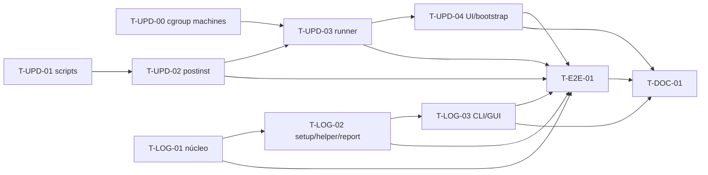

# Tarefas — 002 Atualização segura e logs de debug

> Derivado de [`plan.md`](plan.md). **Promovidas para [`../../sdd/tasks.md`](../../sdd/tasks.md)
> como TX-15/TX-16 em 2026-11-13**; este arquivo permanece como registro da proposta.
> Legenda: `T-<área>-<NN>` · **P** = prioridade · **Dep** = dependências.

---

## TX-15 — Atualização segura

> **Objetivo:** nenhum caminho de update deixa GUI/daemon/helper antigos ativos; o `apt` manual e o
> update assistido religam o app na versão nova, com o helper allowlisted como única fronteira root.

| ID | P | Tarefa | Dep | Conclusão |
|---|---|---|---|---|
| T-UPD-00 | P0 | Colocar QEMU/virtiofsd em **scope próprio** (`systemd-run --user --scope`, preferencial) para sair do cgroup do `podstack.service`; `KillMode=process` é apenas defesa (não move de cgroup). Cobrir a reconciliação de órfãos existente. | — | update com machine rodando: QEMU/virtiofsd vivos no scope, mounts virtiofs intactos; restart do daemon não mata a VM; teste unitário/e2e |
| T-UPD-01 | P0 | Inventariar os processos/units do app (`podstack-gui`, `podstackd`, `podstack.socket`, `podstack-helper`) e implementar os scripts de pacote: `preinst` (Debian) e `%pre` (RPM) param socket/service de **todos** os usuários logados, aplicam máscara runtime, encerram GUI/daemon/helper antes do unpack com SIGTERM + 3 s + SIGKILL e fallback `pkill -x podstackd` quando não há systemd **ou o user manager não responde**; instalam trap de limpeza que desfaz a máscara runtime e religa o helper dos uids já tocados antes de qualquer aborto; checam `is-active` do helper e abortam se não conseguirem parar; não tocam no runner `podstack` nem em containers/machines; `prerm`/`%preun` de remoção idem; declarar `procps`/`procps-ng`. | — | teste em container com processos falsos: PIDs antigos ausentes; runner vivo; helper parado; socket não reativa daemon antigo; containers/machines intactos; sem `podstack` órfão; caso sem systemd coberto |
| T-UPD-02 | P0 | Corrigir `postinst`/`%post`/`%posttrans` e adicionar `postrm` (Debian) e ajustar `%preun`/`%posttrans` (RPM): `daemon-reload`, `systemctl --global enable podstack.socket`, `unmask --runtime` com retry e remediação do socket, `systemctl enable podstack-helper.service` e **`systemctl restart podstack-helper.service`**; no Debian, `abort-upgrade`/`abort-install` restauram helper/socket; no RPM, ordem real `%pre` novo → `%preun` antigo → remoção dos arquivos antigos → `%post` novo → `%posttrans` novo, com `%posttrans` restaurando socket/helper via loop por usuário (`systemctl --machine user@<uid>.service --user unmask --runtime`), health check (`is-active` + versão) e exit não-zero só se não conseguir. Tratar falha sem `set -e` cego; não iniciar GUI/daemon de usuário. Adicionar handler de SIGTERM/SIGINT na GUI que salva `UiState`; helper novo carrega a allowlist 0.1.4. | T-UPD-01 | upgrade 0.1.3→0.1.4 com o app aberto: helper novo ativo, GUI nova reabre pelo usuário, `setup --validate` OVMF ok; falha injetada em unpack/`postinst` (Debian) e após `%pre` (RPM) restaura helper e socket; `kill -TERM` salva `UiState`; sem restart manual |
| T-UPD-03 | P0 | Implementar o runner assistido: `podstack update --install [--yes] [--json]` e flags ocultas `--runner`/`--manifest` (GUI grava `gui-was-open`, inicia com `setsid` e sai); `updates.check` retorna metadados e o runner grava `~/.cache/podstack/updates/manifest.json` `0600` (TTL 6 h), baixa/verifica artefato (timeouts 15/5/30 min); lock **na unidade transiente** (`flock /run/podstack/update.lock`) e estado do usuário em `~/.local/state/podstack/updates/` com `QSaveFile`/rename, `jobId`/`unit`/`stateDir`/`pid`/`boot_id`/timestamp e retomada via `GetUpdateStatus(jobId)` após `kill -9` do runner; helper `StageUpdate`/`InstallUpdate` com staging root-owned, chave de release embutida/root-owned, `updates.publicKey` customizada recusada (`PODSTACK_UPDATE_UNSUPPORTED`, `reason=custom_key`), `O_NOFOLLOW`, UID via `GetConnectionUnixUser`, recusa de unidade ativa, admissão serializada por `flock /run/podstack/update.admission.lock` e varredura de estado no start; wrapper `podstack-update-exec` grava logs/estado; `GetUpdateStatus` (`dev.podstack.helper.get-update-status`) com polling/backoff e sinais best-effort; exit codes do `--install` **0/1/2/6/8/9** (sem 3); religar socket/daemon/GUI; falha religa a versão instalada. | T-UPD-00, T-UPD-02, T7-06 | e2e 0.1.4→0.1.5: GUI fecha, helper instala em unidade transiente, reabre na versão nova; restart do helper no meio do `apt` e dois usuários cobertos; falha simulada restaura o app; assinatura/chave customizada/path/TOCTOU/identidade recusados; machine rodando intacta; golden exit codes/JSON |
| T-UPD-04 | P0 | Primeiro bootstrap e UI: o 0.1.3→0.1.4 é manual e coberto pelos scripts; a partir da 0.1.4 a GUI/CLI oferece atualizar, com notas, consentimento, progresso pós-saída por notificação nativa + `state.json`/`GetUpdateStatus`, “Ver log”, notificação, marcador `gui-was-open`/`--relaunch` e recusa de downgrade; ao reabrir, mostra o resultado e oferece retomar/limpar estado; detectar Flatpak/sem systemd e desabilitar o update assistido com caminho manual; `updates.mode=auto` só verifica/baixa. | T-UPD-03 | manual 0.1.3→0.1.4 validado nas VMs; GUI 0.1.4→0.1.5; mensagens de erro/exit codes estáveis; marcador/relaunch; retomada/limpeza; Flatpak/sem systemd com mensagem e caminho manual |

## TX-16 — Logs de debug e retenção

> **Objetivo:** logs locais assíncronos de daemon/GUI/CLI/QML/setup/update/helper/pacote, com debug,
> redaction incondicional e retenção de 7 dias; acesso por CLI/GUI/report.

| ID | P | Tarefa | Dep | Conclusão |
|---|---|---|---|---|
| T-LOG-01 | P0 | Núcleo de logging: `qInstallMessageHandler` assíncrono com writer thread, fila limitada/drop-oldest, JSON Lines, arquivo por processo (`podstackd.jsonl`, `podstack-gui-<pid>.jsonl`, `podstack-cli-<pid>.jsonl`), `O_APPEND`, flush 1 s/warn+, `LogWriter`/`LogRotation`, 0600/0700, rotação diária (`<processo>-YYYYMMDD.jsonl`) e por tamanho (`<processo>-YYYYMMDD-N.jsonl`), timer da meia-noite local + rotação no start, retenção 7 dias (1–30), limite por arquivo (`advanced.logMaxBytes` 10 MB) e teto 200 MB, `advanced.logLevel` exposto na GUI (info default, `restartRequired: false`, runtime), `PODSTACK_LOG_LEVEL`, redaction incondicional; aplicar em daemon/GUI/CLI/QML. | — | teste de rotação/retenção (8º dia removido, nomes/sequência, timer), JSON, redaction com `diagnostics.redact=false`, 0600, UI não bloqueada, nível em runtime/desligar debug, concorrência daemon+CLI e `kill -9`; settings/schema atualizados |
| T-LOG-02 | P0 | Persistir setup jobs no log do daemon; logs root por operação em `/var/log/podstack/jobs/<uid>/<jobId>.jsonl` (root, dir 0750, arquivo 0640, `uid`/`jobId` por linha/índice), escritos pelo wrapper `podstack-update-exec` com redaction; logs do helper também em `/var/log/podstack/helper-*`; scriptlets via `logger` estruturado com `JOB_ID`/`UID` exportados pelo wrapper (`PODSTACK_UPDATE_JOB_ID`/`PODSTACK_UPDATE_UID`), cobrindo `--component package/helper` por uid; `tmpfiles.d`, logrotate/timer e SELinux/AppArmor; `GetLogs {jobId?}` via D-Bus só para o uid do chamador (`GetConnectionUnixUser`/polkit, `auth_admin`, cap 1 MiB, rate limit, auditoria); app nunca lê root no filesystem; atualizar `system.report --include-logs` para os 7 dias via `GetLogs`, com caps (10.000 linhas/componente, 5 MB) e `diagnostics.includeLogs=false`; backend/limpeza do `--clear` (confirmação na superfície de T-LOG-03) e desligar debug sem restart; migrar/remover o legado `podstackd.log` (FR-LOG-009). | T-LOG-01 | após reiniciar o daemon, o erro do setup/helper continua em `podstack system logs`/report; permissões root; `GetLogs` uid A não vê B, negado e `jobId`; report vazio/volumetria; `--clear` backend funciona; token redigido; legado migrado/removido |
| T-LOG-03 | P0 | CLI `podstack system logs [--follow\|--since\|--level\|--component\|--json\|--export\|--clear]` (logs de container continuam no comando existente); página/diálogo de logs na GUI (filtro, follow, abrir pasta, exportar, limpar, “Exportar diagnóstico”); “Ver log” no erro de setup/update; leitura em worker/modelo virtualizado; i18n/`Accessible.name`. `--json` = `{api:1, lines:[{ts,level,component,message}], truncated, files}`, erro `{api:1, error:{code,message,detail}}`; `--clear` é a superfície CLI/GUI do backend de T-LOG-02. | T-LOG-01/02 | logs dos 7 dias acessíveis/filtráveis/exportáveis; `--export` 0600 com destino canonicalizado/sem symlink; `--json` schema/golden; filtro inválido 2; `--clear` CLI/GUI testado; “Ver log” abre o painel no erro; `qmllint`/testes; sem I/O no thread da UI |
| T-E2E-01 | P0 | Matriz de atualização/logs: Ubuntu 24.04/26.04 e Fedora; 0.1.3 (GUI/daemon/helper abertos, machine rodando)→0.1.4 manual; 0.1.4→0.1.5 assistido; falha em download/assinatura/unpack/`postinst` e após `%pre` RPM; restart do helper no meio do `apt`; dois usuários + lock; timeout 15/5/30; 7 dias/rotação; helper/pacote/setup/update; token redigido; chave customizada; `--json`/`--export`/`--clear`; uid A não vê B; marcador/relaunch; report vazio/volumetria; containers/machines intactos; SSH/Tuxee/Flatpak documentados. | T-UPD-00…04, T-LOG-01…03 | evidência por VM; PIDs antigos ausentes; OVMF; machine/containers intactos; logs e exit codes (install sem 3); cobertura ≥ 80% |
| T-DOC-01 | P0 | Atualizar `engineering/{packaging,settings,architecture,security,cli-parity,ui-map}.md`, `api-rpc.md` apenas para `system.report` (`GetLogs` em `security.md`/contrato do helper), `sdd/testing.md`, `docs/user/*`, `web` (`install`/`onboarding`/`troubleshooting` + versão), `translations/`, `docs/README.md`/`AGENTS.md` (índice de ADR, incluindo 0010), `CHANGELOG`, ADR-0012 e bump 0.1.3→0.1.4 (`CMakeLists.txt`, `web/_data/site.json`); promover FR/TX para `docs/sdd/*` após aprovação, incluindo PRD (IDs novos, FR-SYS-009, NFR-SEC-004, NFR-OBS-001/004). | T-UPD-04, T-LOG-03, T-E2E-01 | docs/web consistentes; `scripts/web_build.py --check`; ADR-0012; índice de ADR atualizado; promoção registrada |

---

## Grafo de dependências

## Ordem recomendada

1. **T-UPD-00** — machines fora do cgroup; pré-requisito do update assistido.
2. **T-UPD-01/02** — resolve o incidente do `apt` manual (0.1.3→0.1.4), o helper antigo e o SIGTERM.
3. **T-LOG-01** — base de logs assíncronos/retenção; o update usa esse caminho.
4. **T-UPD-03/04** — runner assistido/helper, bootstrap e UI.
5. **T-LOG-02/03** — setup/helper/update/report e acesso CLI/GUI.
6. **T-E2E-01** — matriz real.
7. **T-DOC-01** — docs/web/ADR/promoção.

## Definição de pronto (por tarefa)

1. Critério da tabela verificado e registrado (comando/saída/log).
2. Teste automatizado cobre o comportamento; E2E nas VMs quando exigir pacote/processo real;
   scriptlets root testados em container com justificativa em `testing.md`.
3. Build sem warnings; `clang-format`/`clang-tidy`; `qmllint` no QML; cobertura ≥ 80%.
4. Docs afetadas: spec/plan/api/settings/packaging/security/cli/ui-map/web/CHANGELOG.
5. Nenhum segredo em log/argv; logs 0600/0640; helper é a única fronteira root; redaction
   incondicional; assinatura/SHA do artefato validados no helper com chave de release; `updates.publicKey`
   customizada recusada no install.
6. Containers/machines intactos no update (QEMU/virtiofsd vivos no scope); `pgrep` sem PIDs antigos;
   helper/socket novos; socket não reativa daemon antigo; exit codes por subcomando (`--check`
   0/1/2/3/6/8/9; `--install` 0/1/2/6/8/9).
7. Falha de update não deixa app parado: helper ativo, GUI/daemon instalados religados, estado em
   `state.json` recuperável/retomável na próxima execução; logs root só via `GetLogs` escopado.

## Promoção

**Promoção realizada em 2026-11-13:**

- `FR-UPD-006…016`, `FR-LOG-001…009`, `NFR-UPD-001…004` e `NFR-LOG-001…003` estão em
  [`../../sdd/PRD.md`](../../sdd/PRD.md) (§7.17, §7.19, §8.7 e §8.8), com `FR-SYS-009` detalhado;
- os fluxos de atualização/logs estão na **§15** de [`../../sdd/spec.md`](../../sdd/spec.md)
  (logs de container, machines e domínios continuam em §3.3/§7/§11);
- as decisões estão em [`../../sdd/plan.md`](../../sdd/plan.md) §15 e no **ADR-0012**;
- as tarefas `T-UPD-*`/`T-LOG-*`/`T-E2E-01`/`T-DOC-01` estão em
  [`../../sdd/tasks.md`](../../sdd/tasks.md) como **TX-15/TX-16**;
- os testes estão em [`../../sdd/testing.md`](../../sdd/testing.md) §16.
