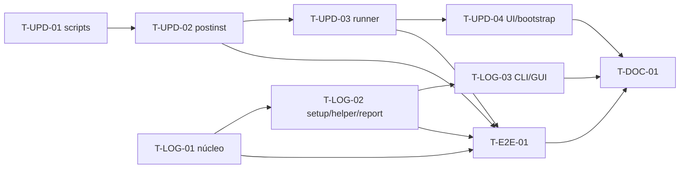

# Tarefas — 002 Atualização segura e logs de debug

> Derivado de [`plan.md`](plan.md). **Ainda não estão em [`../../sdd/tasks.md`](../../sdd/tasks.md)** —
> a promoção ocorre após aprovação (§Promoção).
> Legenda: `T-<área>-<NN>` · **P** = prioridade · **Dep** = dependências.

---

## TX-12 — Atualização segura

> **Objetivo:** nenhum caminho de update deixa GUI/daemon/helper antigos ativos; o `apt` manual e o
> update assistido religam o app na versão nova.

| ID | P | Tarefa | Dep | Conclusão |
|---|---|---|---|---|
| T-UPD-01 | P0 | Inventariar os processos/units do app (`podstack-gui`, `podstackd`, `podstack.socket`, `podstack-helper`) e implementar os scripts de pacote: `preinst` (Debian) e `%pre` (RPM) encerram GUI/daemon/helper antes do unpack, com SIGTERM + 3 s + SIGKILL, sem tocar no runner `podstack` nem em containers; `prerm`/`%preun` de remoção idem. | — | teste em container com processos falsos: PIDs antigos ausentes; runner vivo; helper parado; containers intactos; sem `podstack` órfão |
| T-UPD-02 | P0 | Corrigir `postinst`/`%post`/`%posttrans`: `daemon-reload`, `systemctl --global enable podstack.socket`, `systemctl enable podstack-helper.service` e **`systemctl restart podstack-helper.service`** (substituir `enable --now`); o helper novo carrega a allowlist 0.1.3 (`ovmf`/`qemu-system-x86`); atualizar `packaging/deb/*` e `packaging/rpm/podstack.spec`. | T-UPD-01 | upgrade 0.1.3→0.1.4 com o app aberto: helper novo ativo, GUI nova reabre, `setup --validate` OVMF ok, sem restart manual |
| T-UPD-03 | P0 | Implementar o runner assistido: `podstack update --install [--yes] [--json]` e `--runner` (GUI inicia e sai); lock/estado em `updates/`; baixar/verificar manifesto+SHA; parar `podstack.socket`/`podstack.service`; instalar via `pkexec`/`podstack-update-root`; religar socket/daemon/GUI; falha religa a versão instalada. | T-UPD-02, T7-06 | e2e 0.1.4→0.1.5: GUI fecha, instala, reabre na versão nova; falha simulada restaura o app; log do update |
| T-UPD-04 | P1 | Primeiro bootstrap e UI: o 0.1.3→0.1.4 é manual e coberto pelos scripts; a partir da 0.1.4 a GUI/CLI oferece atualizar, com notas, consentimento, progresso, “Ver log”, notificação e recusa de downgrade. | T-UPD-03 | manual 0.1.3→0.1.4 validado nas VMs; GUI 0.1.4→0.1.5; mensagens de erro/exit codes estáveis |

## TX-13 — Logs de debug e retenção

> **Objetivo:** logs locais de daemon/GUI/CLI/QML/setup/update/helper/pacote, com debug, redaction e
> retenção de 7 dias; acesso por CLI/GUI/report.

| ID | P | Tarefa | Dep | Conclusão |
|---|---|---|---|---|
| T-LOG-01 | P0 | Núcleo de logging: `qInstallMessageHandler` com JSON Lines, `LogFile`/`LogRotation`, 0600/0700, rotação diária, retenção 7 dias (1–30), limite por arquivo/total, `advanced.logLevel` (info default), `PODSTACK_LOG_LEVEL`, redaction em todos os sinks; aplicar em daemon/GUI/CLI/QML. | — | teste de rotação/retenção (8º dia removido), JSON, redaction, 0600, UI não bloqueada; settings/schema atualizados |
| T-LOG-02 | P0 | Persistir setup jobs no log do daemon; log do helper (`/var/log/podstack/helper-*`, root 0600, 7 dias) e `GetLogs` allowlisted; logs do pacote/update em `/var/log/podstack`; atualizar `system.report --include-logs` para ler os arquivos rotacionados + helper/update, com redaction. | T-LOG-01 | após reiniciar o daemon, o erro do setup/helper continua no `podstack logs`/report; report lê os 7 dias; 0600 |
| T-LOG-03 | P1 | CLI `podstack logs [--follow|--since|--level|--component|--json|--export|--helper]`; página/diálogo de logs na GUI (filtro, follow, abrir pasta, exportar, “Exportar diagnóstico”); “Ver log” no erro de setup/update. | T-LOG-01/02 | logs dos 7 dias acessíveis/filtráveis/exportáveis; “Ver log” abre o painel no erro; `qmllint`/testes |
| T-E2E-01 | P0 | Matriz de atualização/logs: Ubuntu 24.04/26.04 e Fedora; 0.1.3 (GUI/daemon/helper abertos)→0.1.4 manual; 0.1.4→0.1.5 assistido; falha; 7 dias; helper/pacote/setup/update; containers/machines intactos; SSH/Tuxee documentado. | T-UPD-01…04, T-LOG-01…03 | evidência por VM; PIDs antigos ausentes; OVMF; logs; cobertura ≥ 80% |
| T-DOC-01 | P0 | Atualizar `engineering/{packaging,settings,architecture,security,cli-parity,ui-map}.md`, `docs/user/*`, `web` (`install`/`onboarding`/`troubleshooting` + versão), `CHANGELOG`, ADR-0011; promover FR/TX para `docs/sdd/*` após aprovação. | T-UPD-02, T-LOG-01 | docs/web consistentes; `scripts/web_build.py --check`; ADR; promoção registrada |

---

## Grafo de dependências

## Ordem recomendada

1. **T-UPD-01/02** — resolve o incidente do `apt` manual (0.1.3→0.1.4) e o helper antigo.
2. **T-LOG-01** — base de logs/retenção; o update usa esse caminho.
3. **T-UPD-03/04** — runner assistido, bootstrap e UI.
4. **T-LOG-02/03** — setup/helper/update/report e acesso CLI/GUI.
5. **T-E2E-01** — matriz real.
6. **T-DOC-01** — docs/web/ADR/promoção.

## Definição de pronto (por tarefa)

1. Critério da tabela verificado e registrado (comando/saída/log).
2. Teste automatizado cobre o comportamento; E2E nas VMs quando exigir pacote/processo real.
3. Build sem warnings; `clang-format`/`clang-tidy`; `qmllint` no QML; cobertura ≥ 80%.
4. Docs afetadas: spec/plan/api/settings/packaging/security/cli/ui-map/web/CHANGELOG.
5. Nenhum segredo em log/argv; logs 0600; helper/pacote root; redaction.
6. Containers/machines intactos no update; `pgrep` sem PIDs antigos; helper/socket novos.

## Promoção

Quando aprovada, esta proposta promove:

- `FR-UPD-002…012` e `FR-LOG-001…009` para [`../../sdd/PRD.md`](../../sdd/PRD.md);
- os fluxos de atualização/logs para [`../../sdd/spec.md`](../../sdd/spec.md);
- as decisões de arquitetura para [`../../sdd/plan.md`](../../sdd/plan.md) e ADR-0011;
- as tarefas `T-UPD-*`/`T-LOG-*`/`T-E2E-01`/`T-DOC-01` para [`../../sdd/tasks.md`](../../sdd/tasks.md)
  como **TX-12/TX-13**;
- os testes para [`../../sdd/testing.md`](../../sdd/testing.md).
