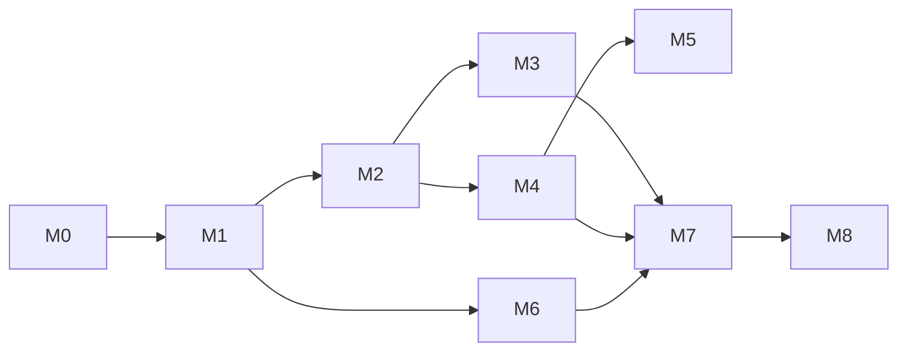

# Tarefas — PodStack

> Breakdown executável derivado de [`plan.md`](plan.md). Cada tarefa tem ID, dependências e critério de conclusão. Marque `[x]` somente com evidência (teste/lint/build).

**Legenda:** `T<marco>-<NN>` · **P** = prioridade (P0/P1/P2) · **Dep** = dependências.

---

## M0 — Fundação

> **Status (2026-11-08): concluído.** Evidências: `cmake --build --preset dev` sem warnings; `ctest --preset dev` **6/6** (core, contrato, RPC, Podman real, CLI e GUI); cobertura **84,7%** com gate de **80%**; CLI/daemon E2E (`status`, `ps`, `exec`); hijack de exec e demux de logs validados.

| ID | P | Tarefa | Dep | Conclusão |
|---|---|---|---|---|
| T0-01 | P0 | Criar repositório, `.gitignore`, `LICENSE`, `README.md` | — | `git status` limpo; licença definida |
| T0-02 | P0 | Scaffold CMake + presets (`dev`, `release`, `asan`) | T0-01 | `cmake --preset dev` + build vazio |
| T0-03 | P0 | Estrutura de diretórios (`core`, `podman`, `daemon`, `cli`, `gui`, `machines`, `k8s`, `proxy`, `platform`) | T0-02 | Árvore criada; targets compilam |
| T0-04 | P0 | `PodmanClient`: descoberta de socket + `/_ping` + versão da API | T0-03 | Teste unitário com socket fake; log de versão |
| T0-05 | P0 | HTTP sobre Unix socket com libcurl (GET/POST/DELETE, JSON) | T0-04 | Teste contra `podman.socket` real |
| T0-06 | P0 | Streams: logs (`follow`) e eventos | T0-05 | Teste recebe linhas/eventos; cancelamento |
| T0-07 | P0 | Hijack: `exec/start` + TTY + resize (PoC) | T0-05 | Teste com `/bin/sh`; Ctrl+C/D; resize |
| T0-08 | P0 | Servidor JSON-RPC (`QLocalServer`, `SO_PEERCRED`) | T0-03 | `socat`/cliente de teste; UID errado rejeitado |
| T0-09 | P0 | `podstackd`: main, config, logging, systemd user unit | T0-08 | `systemctl --user start podstack`; socket 0600 |
| T0-10 | P0 | CLI `podstack version`, `status`, `ps` | T0-08 | Saída humana + JSON; exit codes |
| T0-11 | P0 | Shell QML: `MainWindow` (sidebar/lista/inspector) + tema | T0-03 | GUI abre; layout persiste |
| T0-12 | P0 | Modelo `ContainerListModel` + RPC `containers.list` | T0-08, T0-10 | Lista containers reais |
| T0-13 | P0 | `MockPodmanServer` para testes (HTTP Unix socket) | T0-05 | Testes de contrato passam sem Podman |
| T0-14 | P1 | CI inicial (build + unit + clang-format/tidy) | T0-02 | Pipeline verde |
| T0-15 | P1 | `podstack doctor` (socket, Podman, versão) | T0-09 | Relatório com checks |
| T0-16 | P1 | Script `dev/run.sh` (build + daemon + GUI) | T0-09, T0-11 | Um comando sobe tudo |
| T0-17 | P1 | ADR-0005 (licença/terminal) decidido | — | ✅ GPL-3.0-or-later + QTermWidget (ADR aceito) |
| T0-18 | P1 | ADR-0001/0002 revisados com PoC | T0-05, T0-07 | ADRs atualizados |

**Saída M0:** `podstack ps` lista containers; GUI abre e mostra a lista; daemon sobrevive ao fechar a GUI; testes verdes.

---

## M1 — Containers

> **Status (2026-11-08): concluído com ressalvas.** Entregues: create, lifecycle completo, inspect, logs, stats, files (list/download), terminal nativo, batch (start/stop all), health, rename/duplicate e rootful. Pendências finas para o M2: terminal embutido no inspector, upload de arquivos e seleção múltipla arbitrária.

| ID | P | Tarefa | Dep | Conclusão |
|---|---|---|---|---|
| T1-01 | P0 | Listar containers com filtros (all/running/stopped) + contadores | T0-12 | Consistente com `podman ps -a` |
| T1-02 | P0 | Ações start/stop/restart/pause/unpause/kill | T1-01 | E2E em container real |
| T1-03 | P0 | Remover (force/volumes) com confirmação | T1-02 | Container some; volumes tratados |
| T1-04 | P0 | Criar container (imagem, nome, portas, env, volumes, workdir, user) | T1-01 | Formulário + validação |
| T1-05 | P0 | Logs em streaming na UI (follow, busca, wrap, timestamps) | T0-06 | Primeira linha ≤ 500 ms |
| T1-06 | P0 | Terminal embutido (exec) com resize e sessões | T0-07 | TTY funcional; sem órfãos |
| T1-07 | P0 | Stats ao vivo (CPU/mem/rede/disco/PIDs) + gráfico | T0-06 | Consistente com `podman stats` |
| T1-08 | P0 | Info tab (imagem, comando, portas, env, mounts, rede, labels) | T1-01 | Dados completos |
| T1-09 | P0 | Ações em lote (multi-seleção) | T1-02, T1-03 | Confirmação com resumo |
| T1-10 | P1 | Renomear/duplicar container | T1-02 | Nome válido; conflito tratado |
| T1-11 | P1 | Files tab (listar/baixar/enviar) | T0-05 | Paths seguros; progresso |
| T1-12 | P1 | Inspect JSON (busca/copiar/exportar) | T1-08 | JSON válido |
| T1-13 | P1 | Abrir porta no navegador / copiar endereço | T1-08 | URL correta |
| T1-14 | P1 | Healthcheck e status visual | T1-01 | Badge/estado correto |
| T1-15 | P2 | CRIU checkpoint/restore | T1-02 | Só se suportado |
| T1-16 | P2 | gVisor/runsc | T1-04 | Runtime selecionável |
| T1-17 | P2 | Debug shell | T1-06 | Shell efêmero |
| T1-18 | P0 | Modo rootful opt-in (socket, confirmação, badge) | T0-09 | Troca de modo funcional; aviso exibido |

**Saída M1:** ciclo de vida completo + logs + terminal + stats; E2E verde.

---

## M2 — Imagens, volumes, redes, pods

> **Status (2026-11-08): concluído com ressalvas.** Entregues: catálogo navegável (imagens, volumes, redes e pods), pull com progresso e cancelamento, push/tag/untag, remover/prune, histórico/digest, CRUD de volumes e redes, clone e export/import `.tar.zst`, import do host, conexão de containers em redes, lifecycle de pods e proxy global com exclusões (T2-16, entregue no M4 para containers e machines novos). `system.df` alimenta a barra de status. Ressalvas: T2-15 (expor portas na LAN) e o seletor visual de plataforma (T2-17) ficam para o M3; a validação de CIDR é delegada ao Podman.

| ID | P | Tarefa | Dep | Conclusão |
|---|---|---|---|---|
| T2-01 | P0 | Listar imagens (repo, tag, digest, tamanho, uso) | T0-05 | ✅ `images.list` + GUI/CLI |
| T2-02 | P0 | Pull com progresso/cancelamento + auth | T2-01 | ✅ stream por camada; credenciais do Podman |
| T2-03 | P0 | Remover/prune com prévia | T2-01 | ✅ confirmação na GUI; bloqueio em uso no engine |
| T2-04 | P0 | Info/histórico/digest | T2-01 | ✅ `images.get`/`images.history` + CLI |
| T2-05 | P0 | Listar volumes (driver, mountpoint, tamanho, uso) | T0-05 | ✅ `volumes.list` + `system.df` |
| T2-06 | P0 | Criar/remover/prune volumes | T2-05 | ✅ GUI/CLI |
| T2-07 | P0 | Listar/criar/remover redes (subnet, gateway) | T0-05 | ✅ GUI/CLI; CIDR validado pelo Podman |
| T2-08 | P0 | Conectar/desconectar containers + aliases | T2-07 | ✅ API/CLI com aliases; GUI sem aliases |
| T2-09 | P0 | Pods: listar/criar/start/stop/remove | T0-05 | ✅ GUI/CLI |
| T2-10 | P1 | Push/tag/untag | T2-01 | ✅ stream de push; tag/untag |
| T2-11 | P1 | Import/export tar de imagens | T2-01 | ✅ `images.export/load` |
| T2-12 | P1 | Volume clone (reflink/fallback) | T2-05 | ✅ `cp -a --reflink=auto` |
| T2-13 | P1 | Volume export/import `.tar.zst` | T2-05 | ✅ libarchive; paths validados |
| T2-14 | P1 | Volume import do host | T2-05 | ✅ `volumes.importHostPath` |
| T2-15 | P1 | Expor portas na LAN | T2-08 | ⬜ M3 (helper/firewall) |
| T2-16 | P1 | Proxy global e exclusões | T2-08 | ✅ `Proxy` no core + daemon em `containers.create`/`containers.duplicate` + GUI (Configurações) + machines via cloud-init; env explícito e `NO_PROXY` sem duplicatas; Compose/existentes exigem recriação; coberto por `test_core/proxy*`, `test_rpc/proxyEnvironment`, `test_gui/backendProxy` e `test_machines/seedEnvironment` |
| T2-17 | P2 | Multi-arch/platform selection | T2-02 | ◐ pull aceita `platform`; seletor visual no M3 |
| T2-18 | P2 | Prune avançado (system df) | T2-03 | ✅ `system.df` detalhado + prévia nos diálogos de Imagens/Volumes + `podstack system df [--detailed|--json]`; coberto por `test_rpc/catalog`, `test_gui/backendCatalog` e `test_cli/systemDf` |

**Saída M2:** catálogo completo navegável e operável.

---

## M3 — Compose, builds e eventos

> **Status (2026-11-08): concluído com ressalvas.** Entregues: detecção de projetos Compose por labels, up/down/restart/stop/start via provider (`docker-compose`/`podman compose`), logs por serviço e agregados, abrir YAML/diretório, builds via Libpod (tar + steps/logs), histórico em SQLite, cancelar/remover registros e eventos globais na UI com toasts. Ressalvas: buildx multi-plataforma real (T3-08) e o stack Supabase (T3-09) ficam para o M4; o build aceita `platform` single-arch.

| ID | P | Tarefa | Dep | Conclusão |
|---|---|---|---|---|
| T3-01 | P1 | Detectar projetos por labels e agrupar | T1-01 | ✅ `compose.projects.list` + GUI |
| T3-02 | P1 | Start/stop/restart/down do projeto | T3-01 | ✅ provider Compose + GUI/CLI |
| T3-03 | P1 | Logs por serviço e agregados | T1-05 | ✅ `compose.logs.subscribe` |
| T3-04 | P1 | Build via Libpod (tar + progresso/steps/logs) | T0-05 | ✅ `builds.start` + GUI/CLI |
| T3-05 | P1 | Histórico de builds em SQLite | T3-04 | ✅ `builds.list/get` + `build_steps` |
| T3-06 | P1 | Abrir YAML/diretório do projeto | T3-01 | ✅ `openPath` (xdg-open) |
| T3-07 | P1 | Eventos globais na UI (toasts/notificações) | T0-06 | ✅ `events.subscribe` + toast |
| T3-08 | P2 | Buildx multi-plataforma | T3-04 | ◐ `platform` single-arch; manifest list no M4 |
| T3-09 | P2 | Supabase stack | T3-01 | ⬜ M4 |
| T3-10 | P2 | Apagar registros de build | T3-05 | ✅ `builds.remove` (metadados + log) |

**Saída M3:** J1 completo (projeto Compose sobe e é acessível).

---

## M4 — Machines (QEMU/KVM)

| ID | P | Tarefa | Dep | Conclusão |
|---|---|---|---|---|
| T4-01 | P0 | Registry de distros (URL/checksum/versão) + cache | T0-03 | ✅ Registry pinado (ubuntu 24.04, debian 12, fedora 44/amd64) + `CloudImageCache`/`HttpDownloader`; `machines.distros` + `podstack machine distros [--json]`; `test_machines` 9 casos e `rpc`/`cli` verdes |
| T4-02 | P0 | Gerar seed ISO cloud-init (NoCloud) | T4-01 | ✅ `CloudInit::writeSeedIso` (libarchive ISO9660 label `cidata`, Rock Ridge/Joliet, 3 arquivos na raiz, rename atômico 0600; senha `$6$` via `crypt_r`); `test_machines` 14 casos; validado com `blkid -p` (`TYPE=iso9660 LABEL=cidata`) e `xorriso` (3 arquivos na raiz em 0600) |
| T4-03 | P0 | Criar disco qcow2 + QEMU + QMP | T4-01 | ✅ Disco qcow2 esparso, seed cloud-init, OVMF e `QemuProcessRuntime`/QMP; RPC `machines.list/get/create/cancel/start/stop/restart/delete` + CLI `machine list/info/create/start/stop/restart/delete`. Evidência: `cmake --build --preset dev` sem warnings; `ctest --preset dev` **14/14**; `test_machines` **42 passed / 1 skipped** (QEMU real opt-in `PODSTACK_QEMU_INTEGRATION=1`); `test_rpc` e `test_cli` verdes; `git diff --check` limpo. Senha/SSH/mounts/isolated ficam na T4-04/T4-07/T4-14 |
| T4-04 | P0 | SSH: chave, porta, bloco `~/.ssh/config`, `podstack ssh` | T4-03 | ✅ Chave ed25519 por machine (0600) e pública (0644) injetada no cloud-init; bloco gerenciado idempotente em `~/.ssh/config` (0600/0700, `ForwardAgent` opcional); RPC `machines.ssh`; CLI `ssh`/`machine ssh` com `StrictHostKeyChecking=accept-new`; botão SSH na GUI; `openssh-clients` nas dependências. Evidência: build dev sem warnings novos; `ctest --preset dev` **14/14**; `test_machines` **45 passed / 1 skipped** (QEMU real opt-in), `test_rpc` **13**, `test_cli` **15**, `test_gui` **17**; `qmllint` sem erros em `MachineInspector.qml`/`MachinesPage.qml`; `git diff --check` limpo |
| T4-05 | P0 | Ciclo de vida start/stop/restart/delete + limpeza | T4-03 | Sem órfãos |
| T4-06 | P0 | Listar/info/logs de machines na GUI | T4-03 | ✅ `machines.logs` (tail 1..2000, 512 KiB, symlink rejeitado) + `MachinesPage`/`MachineInspector` (NOME/DISTRO/ESTADO/SSH, Info, Logs, criar com progresso, start/stop/restart/delete) + `machine logs` one-shot. Evidência: build sem warnings novos; `ctest --preset dev` **14/14**; `test_rpc`/`test_cli`/`test_gui`/`test_machines` verdes; `qmllint` sem erros (só avisos `unqualified`/layout padrão); `git diff --check` limpo |
| T4-07 | P1 | Virtiofs mounts + file manager | T4-03 | Arquivos visíveis |
| T4-08 | P1 | pull/push de arquivos | T4-04 | Progresso |
| T4-09 | P1 | Export/import `.tar.zst` | T4-05 | Integridade; pausa |
| T4-10 | P1 | Clone/rename/default | T4-03 | Independentes |
| T4-11 | P1 | Limites CPU/mem/disco + restart | T4-03 | Aplicados |
| T4-12 | P1 | Port forwarding da máquina | T4-03 | `localhost` funciona |
| T4-13 | P1 | SSH agent forwarding | T4-04 | Toggle |
| T4-14 | P1 | Modo isolado | T4-03 | Sem mounts/host |
| T4-15 | P2 | Console serial/VNC | T4-03 | Troubleshooting |
| T4-16 | P2 | Snapshots | T4-03 | Criar/restaurar |

**Saída M4:** J2 completo; criação ≤ 60 s.

---

## M5 — Kubernetes

| ID | P | Tarefa | Dep | Conclusão |
|---|---|---|---|---|
| T5-01 | P1 | Provisionar VM k3s e instalar | T4-03 | Cluster Ready |
| T5-02 | P1 | kubeconfig isolado + contexto + `podstack kube env` | T5-01 | `kubectl get nodes` |
| T5-03 | P1 | Watch de Pods/Services + modelos | T5-01 | UI atualiza |
| T5-04 | P1 | Logs por container do pod | T5-03 | Streaming |
| T5-05 | P1 | Delete pod/service + port-forward | T5-03 | Ações funcionam |
| T5-06 | P1 | Enable/disable/reset com confirmação | T5-01 | Idempotente |
| T5-07 | P2 | Expor Services (NodePort/LB/API) + TLS SANs | T5-01 | Configurável |
| T5-08 | P2 | Troca automática de contexto | T5-02 | Por projeto |

**Saída M5:** J3 completo.

---

## M6 — Domínios, HTTPS e port forwarding

| ID | P | Tarefa | Dep | Conclusão |
|---|---|---|---|---|
| T6-01 | P0 | `*.localhost` + proxy por Host (porta alta) | T1-01 | `curl nome.localhost:8080` |
| T6-02 | P0 | Página de índice de serviços | T6-01 | Lista domínios/portas |
| T6-03 | P1 | Detecção automática de porta + cache | T6-01 | Funciona com 1 porta |
| T6-04 | P1 | Helper: DNS userspace + drop-in resolved | T6-01 | `*.podstack.local` resolve |
| T6-05 | P1 | Helper: socket activation :80/:443 | T6-04 | Sem porta no browser |
| T6-06 | P1 | Caddy: CA interna + HTTPS on-the-fly | T6-05 | Certificado válido |
| T6-07 | P1 | Confiar na CA (host/containers) opt-in | T6-06 | `update-ca-trust` |
| T6-08 | P1 | Labels `dev.podstack.domains/http-port/https-port` | T6-03 | Overrides |
| T6-09 | P1 | Exposição LAN de domínios/portas | T6-01 | Acesso externo |
| T6-10 | P2 | Port forwarding de portas não publicadas | T6-04 | Via router/helper |

**Saída M6:** G4 completo.

---

## M7 — Desktop, settings, updates

> **Status (2026-11-08):** tray implementado (`TrayController`/SNI, fechar-para-bandeja, Abrir,
> Containers por projeto Compose, Activity Monitor, Configurações, Sair, instância única e
> autostart). Activity Monitor e notificações de falha/OOM/unhealthy entregues; submenus de
> Machines/Kubernetes e “Verificar atualizações” seguem bloqueados por M4/M5 e T7-06.

| ID | P | Tarefa | Dep | Conclusão |
|---|---|---|---|---|
| T7-01 | P0 | Settings GUI + CLI (schema, validação, sync) | T0-09 | Chaves equivalentes |
| T7-02 | P0 | Tema claro/escuro + escala de fonte | T0-11 | Troca em runtime |
| T7-03 | P1 | Bandeja SNI + menu de contexto | T0-11 | Noctalia/KDE — implementado (Abrir, Containers por projeto, Activity Monitor, Settings, Sair; fechar esconde; instância única); submenus Machines/K8s dependem de M4/M5 |
| T7-04 | P1 | Activity Monitor (gráficos + `podstack top`) | T1-07 | Dados corretos — implementado (`system.stats.subscribe` + `ActivityMonitorWindow` + `podstack top [--once|--interval|--json|--plain]`); `test_cli::topCommand` |
| T7-05 | P1 | Notificações (OOM, falha, update, disco) | T3-07 | Respeita DND — implementado para OOM/falha/unhealthy (D-Bus, cooldown); update/disco pendentes |
| T7-06 | P1 | Check de updates assinado + canal | T7-01 | Assinatura validada |
| T7-07 | P0 | Onboarding e setup da máquina (diagnóstico, Podman, coexistência Docker, QEMU/KVM, componentes, validação) | T0-11 | Fluxo completo; reexecutável — implementado (SetupManager, SetupWindow e setup.*); setup agora é overlay modal e bloqueia a tela principal até os checks obrigatórios; `warn` do Podman usa `enable-socket` (sem helper); helper em dev via `scripts/dev-helper.sh`; validar instalação real em máquina limpa |
| T7-08 | P1 | Diagnóstico/report com redaction | T0-15 | Revisão antes de enviar |
| T7-09 | P1 | Janelas/abas múltiplas + restauração | T0-11 | Estado persiste |
| T7-10 | P1 | Atalhos e acessibilidade | T0-11 | Teclado completo |
| T7-11 | P2 | Migração **opcional** de dados de Docker/Podman | T2-05 | Prévia/rollback; não é pré-requisito |
| T7-12 | P2 | Licença/conta (opcional) | T7-01 | Offline funciona |
| T7-13 | P1 | Coexistência Docker/Podman e remoção opt-in com confirmação | T7-07 | Docker presente não bloqueia; remoção exige confirmação |
| T7-14 | P0 | Helper allowlisted para setup (pacotes e remoção) | T7-07 | Sem shell/sudo na GUI; auditoria — implementado (`podstack-helper`, polkit, allowlist); falta validação em máquina limpa |

**Saída M7:** paridade de desktop; v1.0.

---

## M8 — Extras (pós-v1)

| ID | P | Tarefa | Dep | Conclusão |
|---|---|---|---|---|
| T8-01 | P2 | USB list/attach/detach (QEMU usb-host) | T4-03 | Device no guest |
| T8-02 | P2 | Serial ports | T4-03 | Console serial |
| T8-03 | P2 | Áudio (virtio-snd/PipeWire) | T4-03 | Playback/recording |
| T8-04 | P2 | X11/Wayland forwarding | T4-03 | App gráfico no host |
| T8-05 | P2 | i18n completa + pt-BR/en-US | T0-11 | Strings externalizadas |
| T8-06 | P2 | Avaliar Flatpak sob demanda (não no v1) | T7-01 | Documentado |
| T8-07 | P2 | Snapshots de máquina | T4-03 | Criar/restaurar |
| T8-08 | P2 | Checkpoint/restore containers | T1-02 | CRIU |
| T8-09 | P2 | Multi-arch/emulação | T2-02 | binfmt/FEX |

---

## Transversais

| ID | P | Tarefa | Conclusão |
|---|---|---|---|
| TX-01 | P0 | `security.md` + threat model revisados | Ameaças e mitigações mapeadas |
| TX-02 | P0 | Testes unitários do core (≥ 70%) | Cobertura medida |
| TX-03 | P0 | Testes de integração com Podman real | Matriz rootless/rootful |
| TX-04 | P0 | Testes E2E das jornadas J1–J3 | Critérios do PRD |
| TX-05 | P0 | `clang-format` + `clang-tidy` no CI | Sem warnings novos |
| TX-06 | P0 | Documentação de usuário (install, quickstart, CLI, troubleshooting) | Publicada |
| TX-07 | P0 | RPM + systemd + polkit + SELinux | Instalação limpa |
| TX-08 | P0 | Auditoria de segurança (socket, helper, proxy) | Relatório |
| TX-09 | P1 | Benchmark de performance (startup/mem/idle) | Metas §8.1 |
| TX-10 | P1 | Matriz de compatibilidade (F43/F44, Wayland/X11, GNOME/KDE/niri) | Verde |
| TX-11 | P1 | Golden tests de CLI/exit codes | Estáveis |
| TX-12 | P1 | AppStream/metainfo + ícones | `appstreamcli validate` |
| TX-13 | P2 | Telemetria opt-in por categoria (crash/uso/perf/erros) | Off por padrão |
| TX-14 | P2 | Acessibilidade (WCAG AA) auditada | Checklist |

---

## Grafo de dependências

## Definição de pronto (por tarefa)

1. Código compila sem warnings novos; `clang-format` aplicado.
2. Teste unitário ou de integração cobre o comportamento.
3. Critério de conclusão da tabela verificado e registrado.
4. Documentação afetada atualizada (`spec`/`plan`/`api-rpc`/`settings`).
5. Nenhum segredo em log; permissões corretas.
6. Revisão por outro agente/dev (quando aplicável).
