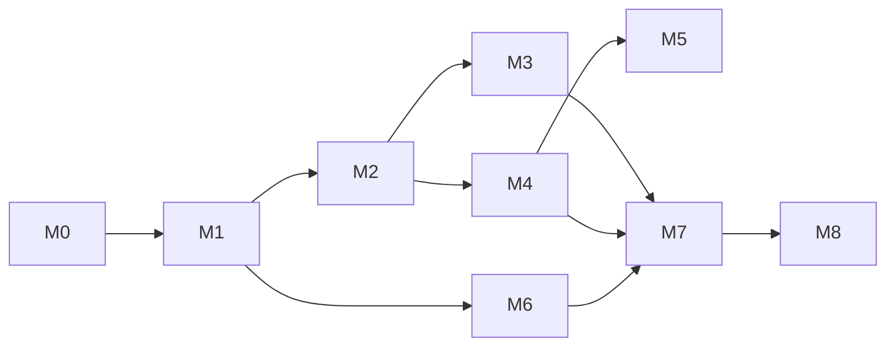

# Tarefas — PodStack

> Breakdown executável derivado de [`plan.md`](plan.md). Cada tarefa tem ID, dependências e critério de conclusão. Marque `[x]` somente com evidência (teste/lint/build).

**Legenda:** `T<marco>-<NN>` · **P** = prioridade (P0/P1/P2) · **Dep** = dependências.

---

## M0 — Fundação

> **Status (2026-11-08): concluído.** Evidências: `cmake --build --preset dev` sem warnings; `ctest --preset dev` **6/6** (core, contrato, RPC, Podman real, CLI e GUI); cobertura **84,7%** com gate de **80%**; CLI/daemon E2E (`status`, `ps`, `exec`); hijack de exec e demux de logs validados.

| ID | P | Tarefa | Dep | Conclusão |
|---|---|---|---|---|
| T0-01 | P0 | Criar repositório, `.gitignore`, `LICENSE`, `README.md` | — | `git status` limpo; licença definida |
| T0-02 | P0 | Scaffold CMake + presets (`dev`, `release`, `asan`) | T0-01 | `cmake --preset dev` + build vazio |
| T0-03 | P0 | Estrutura de diretórios (`core`, `podman`, `daemon`, `cli`, `gui`, `machines`, `k8s`, `proxy`, `platform`) | T0-02 | Árvore criada; targets compilam |
| T0-04 | P0 | `PodmanClient`: descoberta de socket + `/_ping` + versão da API | T0-03 | Teste unitário com socket fake; log de versão |
| T0-05 | P0 | HTTP sobre Unix socket com libcurl (GET/POST/DELETE, JSON) | T0-04 | Teste contra `podman.socket` real |
| T0-06 | P0 | Streams: logs (`follow`) e eventos | T0-05 | Teste recebe linhas/eventos; cancelamento |
| T0-07 | P0 | Hijack: `exec/start` + TTY + resize (PoC) | T0-05 | Teste com `/bin/sh`; Ctrl+C/D; resize |
| T0-08 | P0 | Servidor JSON-RPC (`QLocalServer`, `SO_PEERCRED`) | T0-03 | `socat`/cliente de teste; UID errado rejeitado |
| T0-09 | P0 | `podstackd`: main, config, logging, systemd user unit | T0-08 | `systemctl --user start podstack`; socket 0600 |
| T0-10 | P0 | CLI `podstack version`, `status`, `ps` | T0-08 | Saída humana + JSON; exit codes |
| T0-11 | P0 | Shell QML: `MainWindow` (sidebar/lista/inspector) + tema | T0-03 | GUI abre; layout persiste |
| T0-12 | P0 | Modelo `ContainerListModel` + RPC `containers.list` | T0-08, T0-10 | Lista containers reais |
| T0-13 | P0 | `MockPodmanServer` para testes (HTTP Unix socket) | T0-05 | Testes de contrato passam sem Podman |
| T0-14 | P1 | CI inicial (build + unit + clang-format/tidy) | T0-02 | Pipeline verde |
| T0-15 | P1 | `podstack doctor` (socket, Podman, versão) | T0-09 | Relatório com checks |
| T0-16 | P1 | Script `dev/run.sh` (build + daemon + GUI) | T0-09, T0-11 | Um comando sobe tudo |
| T0-17 | P1 | ADR-0005 (licença/terminal) decidido | — | ✅ GPL-3.0-or-later + QTermWidget (ADR aceito) |
| T0-18 | P1 | ADR-0001/0002 revisados com PoC | T0-05, T0-07 | ADRs atualizados |

**Saída M0:** `podstack ps` lista containers; GUI abre e mostra a lista; daemon sobrevive ao fechar a GUI; testes verdes.

---

## M1 — Containers

> **Status (2026-11-08): concluído com ressalvas.** Entregues: create, lifecycle completo, inspect, logs, stats, files (list/download), terminal nativo, batch (start/stop all), health, rename/duplicate e rootful. Pendências finas para o M2: upload de arquivos e seleção múltipla arbitrária. **Atualização (2026-11-09):** o terminal virou o componente reutilizável `TerminalView` (dock da `MainWindow`, `TerminalWindow` legada e aba interna do detalhe de container) com **Abrir externo** via `ExternalTerminal`; o card lateral do inspector mostra somente Info/Ações e o detalhe do container é um overlay integrado à `MainWindow` cujo conteúdo `ContainerDetail.qml` tem o terminal como uma das abas internas (o card não usa mais `QTabWidget` nativo).

| ID | P | Tarefa | Dep | Conclusão |
|---|---|---|---|---|
| T1-01 | P0 | Listar containers com filtros (all/running/stopped) + contadores | T0-12 | Consistente com `podman ps -a` |
| T1-02 | P0 | Ações start/stop/restart/pause/unpause/kill | T1-01 | E2E em container real |
| T1-03 | P0 | Remover (force/volumes) com confirmação | T1-02 | Container some; volumes tratados |
| T1-04 | P0 | Criar container (imagem, nome, portas, env, volumes, workdir, user) | T1-01 | Formulário + validação |
| T1-05 | P0 | Logs em streaming na UI (follow, busca, wrap, timestamps) | T0-06 | Primeira linha ≤ 500 ms |
| T1-06 | P0 | Terminal embutido (exec) com resize e sessões | T0-07 | ✅ Componente reutilizável `TerminalView` (QTermWidget + barra com **Abrir externo**) no `QDockWidget` "Terminal" + `QTabWidget` da `MainWindow`, na `TerminalWindow` legada e na aba interna Terminal do detalhe (placeholder do QML sobreposto pelo widget); `podman exec -it` e `ssh` de machines no mesmo painel; resize/paste/mouse do QTermWidget; `ExternalTerminal` lança a mesma sessão em `xdg-terminal-exec`/`$TERMINAL`/emuladores comuns sem shell. `test_terminal` cobre configuração, comandos por emulador, detecção com fake no `PATH`, reuso do overlay e área/visibilidade da sessão embutida |
| T1-07 | P0 | Stats ao vivo (CPU/mem/rede/disco/PIDs) + gráfico | T0-06 | Consistente com `podman stats` |
| T1-08 | P0 | Info tab (imagem, comando, portas, env, mounts, rede, labels) | T1-01 | Dados completos |
| T1-09 | P0 | Ações em lote (multi-seleção) | T1-02, T1-03 | Confirmação com resumo |
| T1-10 | P1 | Renomear/duplicar container | T1-02 | Nome válido; conflito tratado |
| T1-11 | P1 | Files tab (listar/baixar/enviar) | T0-05 | Paths seguros; progresso |
| T1-12 | P1 | Inspect JSON (busca/copiar/exportar) | T1-08 | JSON válido |
| T1-13 | P1 | Abrir porta no navegador / copiar endereço | T1-08 | URL correta |
| T1-14 | P1 | Healthcheck e status visual | T1-01 | Badge/estado correto |
| T1-15 | P2 | CRIU checkpoint/restore | T1-02 | Só se suportado |
| T1-16 | P2 | gVisor/runsc | T1-04 | Runtime selecionável |
| T1-17 | P2 | Debug shell | T1-06 | Shell efêmero |
| T1-18 | P0 | Modo rootful opt-in (socket, confirmação, badge) | T0-09 | Troca de modo funcional; aviso exibido |
| T1-19 | P1 | Detalhe do container (overlay com dash, logs, info, env, redes, volumes, inspect e terminal) | T1-08, T1-12 | ✅ Overlay integrado `ContainerDetailDialog` (`QWidget` filho da `MainWindow`, cobre a janela com fundo semitransparente e card central; event filter acompanha o resize) aberto pelo botão **Expandir** do inspector; `ContainerDetail.qml` em `QQuickWidget` com 9 abas (Visão geral, Logs, Info, Ambiente, Redes, Volumes, Arquivos, Terminal e Inspect). O terminal é uma aba interna: o QML reserva o placeholder e o C++ sobrepõe o `TerminalView` (`podman exec -it`), ocultando-o ao trocar de aba e preservando a sessão até fechar; **x**/`Esc` fecham o overlay (sem botão Voltar); card lateral reduzido a Info/Ações; streams próprios de stats/logs (não disputam `m_stream`), logs em `TextArea` único com seleção/cópia, env mascarado por padrão e inspect copiável; fechar o overlay para os streams e encerra a sessão. O botão **Nova sessão em janela** da aba Terminal (via `ExternalTerminal`) e o **Abrir externo** do `TerminalView` (dock/`TerminalWindow`) abrem terminal em janela separada. Backend: `loadContainerDetail`/`containerDetail*` em worker thread + `copyContainerInspect`. Evidência: `cmake --build --preset dev` sem warnings novos; `ctest --preset dev -R 'core\|rpc\|cli\|gui\|machines\|terminal'` e suíte completa; `test_gui`/`test_terminal` verdes; `qmllint` sem erros; `git diff --check` limpo |

**Saída M1:** ciclo de vida completo + logs + terminal + stats; E2E verde.

---

## M2 — Imagens, volumes, redes, pods

> **Status (2026-11-08): concluído com ressalvas.** Entregues: catálogo navegável (imagens, volumes, redes e pods), pull com progresso e cancelamento, push/tag/untag, remover/prune, histórico/digest, CRUD de volumes e redes, clone e export/import `.tar.zst`, import do host, conexão de containers em redes, lifecycle de pods e proxy global com exclusões (T2-16, entregue no M4 para containers e machines novos). `system.df` alimenta a barra de status. Ressalvas: o seletor visual de plataforma (T2-17) fica para o M3; **T2-15 (expor portas na LAN) foi entregue no M4** com helper/firewall runtime e toggle na GUI; a validação de CIDR é delegada ao Podman.

| ID | P | Tarefa | Dep | Conclusão |
|---|---|---|---|---|
| T2-01 | P0 | Listar imagens (repo, tag, digest, tamanho, uso) | T0-05 | ✅ `images.list` + GUI/CLI |
| T2-02 | P0 | Pull com progresso/cancelamento + auth | T2-01 | ✅ stream por camada; credenciais do Podman |
| T2-03 | P0 | Remover/prune com prévia | T2-01 | ✅ confirmação na GUI; bloqueio em uso no engine |
| T2-04 | P0 | Info/histórico/digest | T2-01 | ✅ `images.get`/`images.history` + CLI |
| T2-05 | P0 | Listar volumes (driver, mountpoint, tamanho, uso) | T0-05 | ✅ `volumes.list` + `system.df` |
| T2-06 | P0 | Criar/remover/prune volumes | T2-05 | ✅ GUI/CLI |
| T2-07 | P0 | Listar/criar/remover redes (subnet, gateway) | T0-05 | ✅ GUI/CLI; CIDR validado pelo Podman |
| T2-08 | P0 | Conectar/desconectar containers + aliases | T2-07 | ✅ API/CLI com aliases; GUI sem aliases |
| T2-09 | P0 | Pods: listar/criar/start/stop/remove | T0-05 | ✅ GUI/CLI |
| T2-10 | P1 | Push/tag/untag | T2-01 | ✅ stream de push; tag/untag |
| T2-11 | P1 | Import/export tar de imagens | T2-01 | ✅ `images.export/load` |
| T2-12 | P1 | Volume clone (reflink/fallback) | T2-05 | ✅ `cp -a --reflink=auto` |
| T2-13 | P1 | Volume export/import `.tar.zst` | T2-05 | ✅ libarchive; paths validados |
| T2-14 | P1 | Volume import do host | T2-05 | ✅ `volumes.importHostPath` |
| T2-15 | P1 | Expor portas na LAN | T2-08 | ✅ `Firewall` do helper (firewalld/ufw runtime, 1..65535, tcp/udp, ≤32, rollback parcial) + `OpenPorts`/`ClosePorts` com polkit; `containers.create` aceita `exposeLan` (bind `0.0.0.0`, helper obrigatório antes de criar) e `containers.exposeLan` alterna containers já em `0.0.0.0` (`PODSTACK_UNSUPPORTED` para loopback); GUI com checkbox/aviso e botão no inspector; docs atualizadas. Evidência: build dev sem warnings; `ctest --preset dev -R 'core\|rpc\|cli\|gui\|machines\|setup'` **6/6**; `test_setup` **15 passed** (firewalld/ufw fake no PATH, validação, rollback, sem backend), `test_rpc/exposeLan`, `test_gui/backendExposeLan`; `qmllint` sem erros; `git diff --check` limpo. Acesso real de outro dispositivo e polkit/firewall reais ficam como validação manual |
| T2-16 | P1 | Proxy global e exclusões | T2-08 | ✅ `Proxy` no core + daemon em `containers.create`/`containers.duplicate` + GUI (Configurações) + machines via cloud-init; env explícito e `NO_PROXY` sem duplicatas; Compose/existentes exigem recriação; coberto por `test_core/proxy*`, `test_rpc/proxyEnvironment`, `test_gui/backendProxy` e `test_machines/seedEnvironment` |
| T2-17 | P2 | Multi-arch/platform selection | T2-02 | ◐ pull aceita `platform`; seletor visual no M3 |
| T2-18 | P2 | Prune avançado (system df) | T2-03 | ✅ `system.df` detalhado + prévia nos diálogos de Imagens/Volumes + `podstack system df [--detailed|--json]`; coberto por `test_rpc/catalog`, `test_gui/backendCatalog` e `test_cli/systemDf` |

**Saída M2:** catálogo completo navegável e operável.

---

## M3 — Compose, builds e eventos

> **Status (2026-11-08): concluído com ressalvas.** Entregues: detecção de projetos Compose por labels, up/down/restart/stop/start via provider (`docker-compose`/`podman compose`), logs por serviço e agregados, abrir YAML/diretório, builds via Libpod (tar + steps/logs) e manifest list multi-plataforma via CLI do Podman, histórico em SQLite, cancelar/remover registros e eventos globais na UI com toasts. Ressalva: o stack Supabase (T3-09) fica para o M4; builds de uma plataforma usam Libpod e de duas ou mais usam manifest list (T3-08).

| ID | P | Tarefa | Dep | Conclusão |
|---|---|---|---|---|
| T3-01 | P1 | Detectar projetos por labels e agrupar | T1-01 | ✅ `compose.projects.list` + GUI |
| T3-02 | P1 | Start/stop/restart/down do projeto | T3-01 | ✅ provider Compose + GUI/CLI |
| T3-03 | P1 | Logs por serviço e agregados | T1-05 | ✅ `compose.logs.subscribe` |
| T3-04 | P1 | Build via Libpod (tar + progresso/steps/logs) | T0-05 | ✅ `builds.start` + GUI/CLI |
| T3-05 | P1 | Histórico de builds em SQLite | T3-04 | ✅ `builds.list/get` + `build_steps` |
| T3-06 | P1 | Abrir YAML/diretório do projeto | T3-01 | ✅ `openPath` (xdg-open) |
| T3-07 | P1 | Eventos globais na UI (toasts/notificações) | T0-06 | ✅ `events.subscribe` + toast |
| T3-08 | P2 | Buildx multi-plataforma | T3-04 | ✅ `ManifestBuilder` (manifest list via CLI do Podman, `manifest rm` antes, timeout 30 min, cancelamento); `platforms` no BuildStore/JSON + migração idempotente; GUI/CLI exibem e enviam plataformas. Evidência: `cmake --build --preset dev` sem warnings; `ctest --preset dev` **14/14**; `test_core::buildStorePlatforms`/`manifestBuilderValidation`, `test_rpc::multiPlatformBuild`, `test_cli::composeAndBuild` e `test_gui::backendM3` verdes; `qmllint` sem erros; `git diff --check` limpo |
| T3-09 | P2 | Supabase stack | T3-01 | ⬜ M4 |
| T3-10 | P2 | Apagar registros de build | T3-05 | ✅ `builds.remove` (metadados + log) |

**Saída M3:** J1 completo (projeto Compose sobe e é acessível).

---

## M4 — Machines (QEMU/KVM)

| ID | P | Tarefa | Dep | Conclusão |
|---|---|---|---|---|
| T4-01 | P0 | Registry de distros (URL/checksum/versão) + cache | T0-03 | ✅ Registry pinado (ubuntu 24.04, debian 12, fedora 44/amd64) + `CloudImageCache`/`HttpDownloader`; `machines.distros` + `podstack machine distros [--json]`; `test_machines` 9 casos e `rpc`/`cli` verdes |
| T4-02 | P0 | Gerar seed ISO cloud-init (NoCloud) | T4-01 | ✅ `CloudInit::writeSeedIso` (libarchive ISO9660 label `cidata`, Rock Ridge/Joliet, 3 arquivos na raiz, rename atômico 0600; senha `$6$` via `crypt_r`); `test_machines` 14 casos; validado com `blkid -p` (`TYPE=iso9660 LABEL=cidata`) e `xorriso` (3 arquivos na raiz em 0600) |
| T4-03 | P0 | Criar disco qcow2 + QEMU + QMP | T4-01 | ✅ Disco qcow2 esparso, seed cloud-init, OVMF e `QemuProcessRuntime`/QMP; RPC `machines.list/get/create/cancel/start/stop/restart/delete` + CLI `machine list/info/create/start/stop/restart/delete`. Evidência: `cmake --build --preset dev` sem warnings; `ctest --preset dev` **14/14**; `test_machines` **42 passed / 1 skipped** (QEMU real opt-in `PODSTACK_QEMU_INTEGRATION=1`); `test_rpc` e `test_cli` verdes; `git diff --check` limpo. Senha/SSH/mounts/isolated ficam na T4-04/T4-07/T4-14 |
| T4-04 | P0 | SSH: chave, porta, bloco `~/.ssh/config`, `podstack ssh` | T4-03 | ✅ Chave ed25519 por machine (0600) e pública (0644) injetada no cloud-init; bloco gerenciado idempotente em `~/.ssh/config` (0600/0700, `ForwardAgent` opcional); RPC `machines.ssh`; CLI `ssh`/`machine ssh` com `StrictHostKeyChecking=accept-new`; botão SSH na GUI abre o overlay `MachineDetailDialog` direto na aba **Terminal** (sessão `TerminalView` sobre placeholder; **Nova sessão em janela** via `ExternalTerminal`), com **Expandir** para Info e fallback de compatibilidade `Backend::openMachineSsh` → `terminalRequested` no dock; `openssh-clients` nas dependências. Evidência: build dev sem warnings novos; `ctest --preset dev` **14/14**; `test_machines` **45 passed / 1 skipped** (QEMU real opt-in), `test_rpc` **13**, `test_cli` **15**, `test_gui` **17**, `test_terminal` **10 passed / 2 skipped** (QML fora do binário de teste; smoke do `podstack-gui` sem erros de QML); `qmllint` sem erros em `MachineInspector.qml`/`MachinesPage.qml`/`Main.qml` (só avisos `unqualified`/layout padrão); `git diff --check` limpo |
| T4-05 | P0 | Ciclo de vida start/stop/restart/delete + limpeza | T4-03 | ✅ `QemuProcessRuntime` resolve o PID pelo pidfile e, se ele sumir/for inválido, por `/proc/<pid>/cmdline` (`podstack:<id>`, mesmo uid, limite de 64 KiB, sem prefixos alheios nem o próprio processo); `isRunning`/`status`/`stop`/`start` usam o fallback (stop encerra sem pidfile; start não duplica QEMU). `MachineManager::reconcile` roda no start do `Daemon`: adota processo vivo como `running` (preenche `lastBootAt`), marca `stopped` quando `running`/`starting`/`stopping` não têm processo e encerra órfãos com SIGTERM→SIGKILL e log, somente dentro do `machinesRoot` da instalação. `start` adota processo sem pidfile; `remove` limpa processo/diretório/store/bloco SSH mesmo sem pidfile. Evidência: `cmake --preset dev`; `cmake --build --preset dev` sem warnings; `ctest --preset dev` **14/14**; `ctest --preset dev -R 'machines\|rpc\|gui\|core'` **4/4**; `test_machines` **50 passed / 1 skipped** (QEMU real opt-in); `git diff --check` limpo; `clang-format`/`clang-tidy` não instalados no host |
| T4-06 | P0 | Listar/info/logs/stats de machines na GUI | T4-03 | ✅ `machines.logs` (tail 1..2000, 512 KiB, symlink rejeitado) + `machines.stats`/`machines.stats.subscribe` (SSH one-shot dentro da VM: CPU, RAM, rede, disco e `df`; delta a cada 2 s) + `MachinesPage`/`MachineInspector` (NOME/DISTRO/ESTADO/SSH, Info, Logs, aba Stats com cards e sparklines, criar com progresso, start/stop/restart/delete) + `MachineDetailDialog` (overlay filho da `MainWindow` com as mesmas abas e Terminal SSH embutido) + `machine logs` one-shot. Evidência: build sem warnings novos; `ctest --preset dev` **14/14**; `test_machines` **46 passed / 1 skipped** (QEMU real opt-in), `test_rpc` **16**, `test_gui` **20**; `qmllint` sem erros (só avisos `unqualified`/layout padrão); `git diff --check` limpo |
| T4-07 | P1 | Virtiofs mounts + file manager | T4-03 | ✅/parcial — mounts virtiofs: `VirtiofsdProcess` (binário via `Options`/`PODSTACK_VIRTIOFSD_BINARY`/PATH/`/usr/libexec`, `--shared-dir/--socket-path/--tag/--cache=auto/--xattr/--sandbox` + `--readonly`, socket `virtiofs-<tag>.sock`, stop SIGTERM→SIGKILL e checagem de posse por `/proc/<pid>/cmdline`); `QemuCommand` com `-chardev socket,id=vfsN` + `-device vhost-user-fs-pci`; `MachineManager` valida/canonicaliza até 8 mounts (tag única `[a-z0-9-]{1,32}`, default `host<N>`), sobe/derruba virtiofsd no create/start/stop/remove/reconcile e desfaz mounts já iniciados em falha; `machines.create` aceita `mounts` e rejeita inválidos com `INVALID_PARAMS`; GUI cria com `origem:destino[:ro]` e o Info lista os mounts; `isolated` continua `UNSUPPORTED` (T4-14). File manager e pull/push ficam na T4-08; flags de mounts no CLI pendentes. Evidência: `cmake --build --preset dev` sem warnings; `ctest --preset dev -R 'machines\|rpc\|gui\|core'` **4/4**; `ctest --preset dev` **14/14**; `test_machines` **53 passed / 1 skipped** (QEMU real opt-in; `virtiofsdIntegration` e `PODSTACK_QEMU_INTEGRATION=1` com QEMU+virtiofs reais passaram); `test_rpc` **16**; `qmllint` sem erros (só avisos `unqualified`/layout existentes); `git diff --check` limpo |
| T4-08 | P1 | pull/push de arquivos | T4-04 | ✅ `MachineFiles` (SSH/SCP real, sem shell local): `list` via `ssh "ls -la --time-style=long-iso -- '<path>'"` com quoting single-quote seguro e parse de tipo/tamanho/data/hora/nome (`.`, `..` e symlink tratados; `{name,path,directory,size,modified}`), `download`/`upload` via `scp -r` com `-P/-i`, `IdentitiesOnly`, `StrictHostKeyChecking=accept-new`, `BatchMode` e `ConnectTimeout=5`; validação remota/local (vazio/controle, local absoluto sem `..`, destino não pode ser diretório, origem existente) e erros `INVALID_PARAMS`/`IO_ERROR`/`TIMEOUT`/`UNSUPPORTED`; overrides `PODSTACK_SSH_BINARY`/`PODSTACK_SCP_BINARY`. RPC `machines.files.list/download/upload` resolve ID/nome por `get`+`sshInfo` (NOT_FOUND) e não expõe caminhos internos. GUI: `Backend` com `machineFiles/machineFilesPath/machineFilesBusy/machineFilesError`, watcher em worker, `refreshMachineFiles`/`downloadMachineFile` (`~/Downloads`)/`uploadMachineFile` e `machineFilesChanged`; `MachineInspector` ganha a aba **Files** com `MachineFilesView.qml` (path editável, subir, listar, baixar ao clicar e enviar com campo local) quando `showFilesTab`, ligado pelo `MachineDetailDialog` junto de `showTerminalTab` (`tabName(4)="files"`, refresh em `/` ao abrir). CLI: `machine files ls <id\|nome> [--path P] [--json]`, `machine pull <id\|nome> <remoto> <local>` e `machine push <id\|nome> <local> <remoto>` com paths locais absolutos e uso no `--help`. Operação síncrona (sem barra de progresso nesta versão). Evidência: `cmake --preset dev` + `cmake --build --preset dev` sem warnings; `ctest --preset dev` **14/14**; `test_machines` **54 passed / 2 skipped** (QEMU real e SSH real opt-in), `test_rpc` **17**, `test_cli` **16**, `test_gui` **22**, `test_terminal` ok; `qmllint` exit 0 (só avisos `unqualified`/`missing-property` preexistentes); `git diff --check` limpo |
| T4-09 | P1 | Export/import `.tar.zst` | T4-05 | ✅ `MachineArchive` (libarchive + zstd): grava `disk.qcow2`, `seed.iso`, `id_ed25519`, `id_ed25519.pub` e `manifest.json` (`podstack.machine/1`) com SHA-256 por artefato; extração só aceita os cinco nomes regulares, valida tamanhos e checksums antes de mover para `machines/<id>`. `MachineManager::exportMachine` para a machine, converte o disco para qcow2 autocontido (`qemu-img convert`), grava `<path>.part` e renomeia, com progresso/cancelamento, reinicia se estava rodando e preserva o estado em falha; `importMachine` cria nova machine (ID/porta/bloco SSH próprios, chave reaproveitada do arquivo, mounts descartados), nome vazio usa o manifesto e `force` substitui a existente. RPC `machines.export`/`machines.import` com jobs `machines.delta`/`machines.done`; CLI `machine export/import` (`--name`, `--force`, `--json`); GUI com ações Importar/Exportar, diálogos de caminho e progresso/cancelamento. Evidência: `cmake --build --preset dev` sem warnings; `ctest --preset dev` **14/14**; `test_machines` **57 passed / 2 skipped** (QEMU/SSH reais opt-in), incluindo roundtrip export→import, reinício após export, conflito de nome/arquivo, cancelamento, checksum adulterado, permissões 0600 e `start` concorrente recusado com `PODSTACK_CONFLICT`; `qmllint` não instalado no host |
| T4-10 | P1 | Clone/rename/default | T4-03 | ✅ `MachineManager::rename` valida RFC 1123/conflito, recusa `provisioning`/`deleting`, troca nome em `meta.json`/SQLite e recria o bloco SSH (rollback em falha de persist/sync), atualizando `machines.default` quando necessário; `clone` para a origem se running (recursive lock), gera novo ID/porta, converte o disco com `qemu-img convert` e copia `seed.iso`/`id_ed25519`/`.pub` para diretório próprio, persiste `stopped` só com porta SSH e sem mounts, limpa diretório/store/bloco em falha/cancelamento e reinicia a origem ao final; `defaultMachine`/`setDefaultMachine` leem/gravam `machines.default` (nome canônico) e `remove` limpa a chave. RPC `machines.rename` (síncrono), `machines.clone` (job `machines.delta`/`machines.done`) e `machines.default` (get/set); CLI `machine rename/clone/default` e `machine ssh` sem id usa a default com remediação; GUI com botões Renomear/Clonar no inspetor e diálogos (progresso/erro no clone). Evidência: `cmake --build --preset dev` sem warnings; `ctest --preset dev` **14/14**; `test_machines` **60 passed / 2 skipped** (QEMU/SSH reais opt-in), incluindo `machineManagerRename`, `machineManagerClone` e `machineDefaultConfig`; `test_cli` **16** e `test_rpc` **17**; `qmllint` não instalado no host |
| T4-11 | P1 | Limites CPU/mem/disco + restart | T4-03 | ✅ `MachineManager::update` (`UpdateMachineRequest{cpus?, memoryBytes?, diskBytes?}`) valida ao menos um recurso, CPUs 1..256, memória/disco ≥ 1 GiB e recusa shrink com `PODSTACK_INVALID_PARAMS` **antes** de parar; para a machine `running`/`starting` (ou com processo vivo), redimensiona o qcow2 offline com `qemu-img resize` (helper `resizeDisk`, timeouts/stderr limitado) e reinicia ao final inclusive em falha, propagando o erro; persiste `meta.json`+SQLite e, se a escrita falhar após o resize, informa que o disco já cresceu; machine parada permanece `stopped`. RPC `machines.update {id, cpus?, memoryBytes?, diskBytes?}` síncrono; CLI `machine update <id\|nome> [--cpus N] [--memory 4G] [--disk 40G] [--json]` (ao menos uma opção); GUI: `Backend::updateMachine` (GiB→bytes, 180 s) e diálogo **Editar recursos** aberto pelo botão **Recursos** do inspetor, preenchido da machine, com erro inline e fechamento só no sucesso. Evidência: `cmake --build --preset dev` sem warnings; `ctest --preset dev` **14/14**; `test_machines` **61 passed / 2 skipped** (QEMU/SSH reais opt-in), incluindo `machineManagerUpdate` (stop+start, `qemu-img resize` com caminho/bytes, shrink sem parar, parada sem start, `cpus=0` e request vazio); `test_cli` **16** e `test_rpc` **17** verdes; `qmllint` não instalado no host |
| T4-12 | P1 | Port forwarding da máquina | T4-03 | ✅ `QemuSpec.ports` (`QemuPort{protocol,hostPort,guestPort,hostAddress}`) gera um `hostfwd=<tcp\|udp>:<127.0.0.1\|0.0.0.0>:<host>-:<guest>` por porta e mantém `restrict=on` no isolamento; `specFor` lê `meta.ports` e sintetiza a SSH (22/tcp) para metadados antigos. `MachineManager::setPorts` valida 1..65535, protocolo tcp/udp, `hostPort` único por protocolo entre todas as machines (inclui a SSH), `label` ≤64 sem controles e IDs UUIDv7; preserva a SSH, recusa alteração, persiste `meta.json`+SQLite e para/reinicia se running. `findFreePort` ignora apenas hostPorts TCP. RPC `machines.ports.list/set` (síncrono, tipos estritos), CLI `machine port ls/add/rm` (rm por ID/hostPort, recusa SSH) e GUI: botão **Portas** no inspetor + diálogo com lista/remover/campos/Adicionar, aviso de LAN e erro inline via `setMachinePorts`. Docs em api-rpc/spec §11.5/cli-parity/ui-map/security. Evidência: `cmake --build --preset dev` sem warnings; `ctest --preset dev` **14/14**; `test_machines` **63 passed / 2 skipped** (QEMU/SSH reais opt-in), incluindo `qemuCommandPorts` e `machineManagerPorts`; `test_rpc` **18** (`machinePorts`) e `test_cli` **17** (`machinePorts`); `qmllint` (via `/usr/lib64/qt6/bin/qmllint`) sem erros de sintaxe nos QML alterados, apenas warnings das categorias já presentes no arquivo (layout/unqualified access) |
| T4-13 | P1 | SSH agent forwarding | T4-04 | ✅ `UpdateMachineRequest.forwardSshAgent` (opcional): `MachineManager::update` separa mudanças de hardware (stop/start) do agent; mudança só do agent **não** para a machine, persiste `meta.json`+SQLite, sincroniza `~/.ssh/config` (`ForwardAgent yes`) e, se o sync falhar, restaura o valor anterior e devolve o erro; com hardware, o agent entra no mesmo persist/sync e respeita o restart. `SshInfo.forwardAgent` e `machines.ssh` passaram a devolver `forwardAgent: bool`; `machines.update` aceita `forwardSshAgent` (bool estrito). CLI: `machine create --forward-ssh-agent`, `machine update --forward-agent/--no-forward-agent` (mutuamente exclusivos, ao menos uma mudança) e `machine ssh`/`ssh` com `-A` quando o agent está ativo (preserva `-- cmd...`). GUI: `Backend::updateMachine` aceita só o agent, `openMachineSsh` e o terminal embutido (`MachineDetailDialog`) usam `-A`, e o **Info** do `MachineInspector.qml` ganhou o `FormCheck` “Encaminhar SSH agent” com binding reaplicado após o clique, guard contra loop, aviso de segurança e `backend.updateMachine({id, forwardSshAgent})`. Corrigido `Backend::onActionFinished` para não tratar o campo `error` (string) do `Machine` como erro de RPC. Evidência: `cmake --build --preset dev` sem warnings; `ctest --preset dev` **14/14**; `test_machines` **63 passed / 2 skipped** (QEMU/SSH reais opt-in), incluindo toggle sem stop/start, config on/off e rollback com config inválido; `test_cli` **18** (novo `machineCreateForwardAgent` com daemon fake + update e `-A` via fake de `ssh`), `test_rpc` **18** (`forwardAgent`), `test_gui` **22** e `test_terminal` **12 passed / 2 skipped** (`-A` no terminal embutido); `qmllint` sem erros, apenas warnings preexistentes (`unqualified`/`missing-property`) |
| T4-14 | P1 | Modo isolado | T4-03 | ✅ `CreateMachineRequest.isolated`: `validate` recusa com `PODSTACK_INVALID_PARAMS` + remediação `mounts` não vazio e `forwardSshAgent=true`; `create` grava `meta.isolated`, força `isolateNetwork`, zera o agent e os mounts, e a porta SSH local segue em `127.0.0.1`; `setPorts` recusa `exposeLan=true` em machine isolada antes de persistir/parar; `clone` preserva `isolated`/`isolateNetwork` e zera agent/mounts; `MachineArchiveManifest` ganhou `isolated` opcional (default `false`) e o import força rede restrita/sem agent/mounts; daemon `machines.create` não retorna mais `PODSTACK_UNSUPPORTED`; CLI `machine create --isolated` e uso atualizado; GUI com checkbox **Modo isolado** que limpa/desabilita mounts, desmarca/desabilita o agent e marca/desabilita “Isolar a rede”, com `Backend::createMachine` enviando `isolated`/`isolateNetwork:true`/`forwardSshAgent:false` e recusando mounts localmente. Docs em api-rpc/spec §7.7/cli-parity/ui-map/security/testing. Evidência: `cmake --build --preset dev` sem warnings; `ctest --preset dev` **14/14**; `test_machines` **64 passed / 2 skipped** (QEMU/SSH reais opt-in), incluindo `machineManagerIsolated` (create + `restrict=on`, rejeições, `setPorts` e roundtrip export/import); `test_rpc` **18** e `test_cli` **18**; `qmllint` sem erros de sintaxe (apenas warnings preexistentes de `unqualified`/`missing-property`); `git diff --check` limpo |
| T4-15 | P2 | Console serial/VNC | T4-03 | ✅ Console serial (sem VNC, conforme o critério de troubleshooting): `machines.console.read {id, tailBytes?}` one-shot com default 64 KiB/máximo 512 KiB e `{id, data}`; `machines.console {id, tailBytes?}` devolve `{subscriptionId, id}`, envia o tail inicial em `machines.console.delta` com `reset:true`, faz polling de 300 ms dos bytes novos (`reset:false`), reinicia do offset 0 com `reset:true` em truncate/rotação/reaparecimento, encerra com `machines.console.error` se virar symlink/não regular e aceita `machines.console.unsubscribe`. Validação compartilhada com `machines.logs` (regular, sem symlink, confinado ao diretório, path não exposto); bytes convertidos com `QString::fromUtf8` (lossy, documentado). CLI `machine console <id\|nome> [--tail BYTES] [--no-follow]` (follow padrão via `RpcStream`, `--json` só no one-shot); GUI com `StreamClient::startMachineConsole`/`machineConsoleEvent`, `Backend` (`machineConsoleActive/Text/Error`, buffer ~512 KiB, `followMachineConsole`/`stopMachineConsole`, erro sem tocar `lastError`) e botão **Seguir console/Parar console** na aba Logs do `MachineInspector`, com auto-scroll e parada ao sair da aba/trocar de machine/fechar. Docs em api-rpc (§5.7), spec §7.2.1, ui-map, cli-parity, security, testing e pendências. Evidência: `cmake --build --preset dev` sem warnings; `ctest --preset dev` **14/14**; `test_rpc` **19** (novo `machineConsole`: tail por bytes, ausente, symlink, delta inicial/anexo/truncate e unsubscribe), `test_cli` **18** (`machine console --no-follow/--tail/--json` e follow com append), `test_gui` **23** (`backendMachineConsole`), `test_machines` **64 passed / 2 skipped** (QEMU/SSH reais opt-in); `qmllint` exit 0 em `MachineInspector.qml` (apenas warnings preexistentes de `unqualified`/`missing-property`); `git diff --check` limpo. VNC fica fora do escopo desta tarefa |
| T4-16 | P2 | Snapshots | T4-03 | ✅ `MachineSnapshot{id,name,sizeBytes,date}` (sem tabela SQLite; metadados do qcow2). `MachineManager` ganhou `qemuImgSnapshot` (info/snapshot com timeouts e stderr limitado), `snapshots` (parse de `qemu-img info --output=json`, `date-sec/nsec`→RFC 3339 UTC, disco ausente → `PODSTACK_IO_ERROR`), `createSnapshot` (nome `^[A-Za-z0-9][A-Za-z0-9._-]{0,63}$`, duplicado `PODSTACK_CONFLICT`, stop/start se running e fallback de data quando o qemu-img não relista), `restoreSnapshot` (existência `PODSTACK_NOT_FOUND`, `snapshot -a`, devolve `MachineMeta`) e `removeSnapshot` (`snapshot -d`); parada permanece parada e falha sempre reinicia se estava running. RPC síncrono `machines.snapshots.list/create/restore/remove` (`restore` devolve `Machine`), com `INVALID_PARAMS`/`NOT_FOUND`/`CONFLICT`. CLI `machine snapshot ls/create/restore/rm` (aviso de substituição no restore; `--json`). GUI: `Backend` com `machineSnapshots`/`machineSnapshotsError`, refresh em worker e mutações via `runAction` + refresh após a ação; botão **Snapshots** no inspetor e diálogo na `MachinesPage` com lista nome/data/tamanho, Criar, Restaurar/Remover com confirmação inline e erro inline. Docs em api-rpc/spec §7.8/data-model/cli-parity/ui-map/security/testing. Evidência: `cmake --build --preset dev` sem warnings; `ctest --preset dev` **14/14**; `test_machines` **65 passed / 2 skipped** (`machineManagerSnapshots`: parsing de 2 snapshots, `snapshot -c/-a/-d`, stop/start e parada sem start, nome inválido/duplicado/inexistente, disco ausente); `test_rpc` **20** (`machineSnapshots` dispatch) e `test_cli` **19** (`machineSnapshots` usage/erros/aviso); `qmllint` exit 0 (apenas warnings preexistentes de `missing-property`/`unqualified`); `git diff --check` limpo. Limitação documentada: export/clone (`qemu-img convert`) não preservam snapshots internos |

**Saída M4:** J2 completo; criação ≤ 60 s.

---

## M5 — Kubernetes

| ID | P | Tarefa | Dep | Conclusão |
|---|---|---|---|---|
| T5-01 | P1 | Provisionar VM k3s e instalar | T4-03 | Cluster Ready |
| T5-02 | P1 | kubeconfig isolado + contexto + `podstack kube env` | T5-01 | `kubectl get nodes` |
| T5-03 | P1 | Watch de Pods/Services + modelos | T5-01 | UI atualiza |
| T5-04 | P1 | Logs por container do pod | T5-03 | Streaming |
| T5-05 | P1 | Delete pod/service + port-forward | T5-03 | Ações funcionam |
| T5-06 | P1 | Enable/disable/reset com confirmação | T5-01 | Idempotente |
| T5-07 | P2 | Expor Services (NodePort/LB/API) + TLS SANs | T5-01 | Configurável |
| T5-08 | P2 | Troca automática de contexto | T5-02 | Por projeto |

**Saída M5:** J3 completo.

---

## M6 — Domínios, HTTPS e port forwarding

| ID | P | Tarefa | Dep | Conclusão |
|---|---|---|---|---|
| T6-01 | P0 | `*.localhost` + proxy por Host (porta alta) | T1-01 | `curl nome.localhost:8080` |
| T6-02 | P0 | Página de índice de serviços | T6-01 | Lista domínios/portas |
| T6-03 | P1 | Detecção automática de porta + cache | T6-01 | Funciona com 1 porta |
| T6-04 | P1 | Helper: DNS userspace + drop-in resolved | T6-01 | `*.podstack.local` resolve |
| T6-05 | P1 | Helper: socket activation :80/:443 | T6-04 | Sem porta no browser |
| T6-06 | P1 | Caddy: CA interna + HTTPS on-the-fly | T6-05 | Certificado válido |
| T6-07 | P1 | Confiar na CA (host/containers) opt-in | T6-06 | `update-ca-trust` |
| T6-08 | P1 | Labels `dev.podstack.domains/http-port/https-port` | T6-03 | Overrides |
| T6-09 | P1 | Exposição LAN de domínios/portas | T6-01 | Acesso externo |
| T6-10 | P2 | Port forwarding de portas não publicadas | T6-04 | Via router/helper |

**Saída M6:** G4 completo.

---

## M7 — Desktop, settings, updates

> **Status (2026-11-08):** tray implementado (`TrayController`/SNI, fechar-para-bandeja, Abrir,
> Containers por projeto Compose, Activity Monitor, Configurações, Sair, instância única e
> autostart). Activity Monitor e notificações de falha/OOM/unhealthy entregues; submenus de
> Machines/Kubernetes e “Verificar atualizações” seguem bloqueados por M4/M5 e T7-06.

| ID | P | Tarefa | Dep | Conclusão |
|---|---|---|---|---|
| T7-01 | P0 | Settings GUI + CLI (schema, validação, sync) | T0-09 | Chaves equivalentes |
| T7-02 | P0 | Tema claro/escuro + escala de fonte | T0-11 | Troca em runtime |
| T7-03 | P1 | Bandeja SNI + menu de contexto | T0-11 | Noctalia/KDE — implementado (Abrir, Containers por projeto, Activity Monitor, Settings, Sair; fechar esconde; instância única); submenus Machines/K8s dependem de M4/M5 |
| T7-04 | P1 | Activity Monitor (gráficos + `podstack top`) | T1-07 | Dados corretos — implementado (`system.stats.subscribe` + `ActivityMonitorWindow` + `podstack top [--once|--interval|--json|--plain]`); `test_cli::topCommand` |
| T7-05 | P1 | Notificações (OOM, falha, update, disco) | T3-07 | Respeita DND — implementado para OOM/falha/unhealthy (D-Bus, cooldown); update/disco pendentes |
| T7-06 | P1 | Check de updates assinado + canal | T7-01 | Assinatura validada |
| T7-07 | P0 | Onboarding e setup da máquina (diagnóstico, Podman, coexistência Docker, QEMU/KVM, componentes, validação) | T0-11 | Fluxo completo; reexecutável — implementado (SetupManager, SetupWindow e setup.*); setup agora é overlay modal e bloqueia a tela principal até os checks obrigatórios; `warn` do Podman usa `enable-socket` (sem helper); helper em dev via `scripts/dev-helper.sh`; validar instalação real em máquina limpa |
| T7-08 | P1 | Diagnóstico/report com redaction | T0-15 | Revisão antes de enviar |
| T7-09 | P1 | Janelas/abas múltiplas + restauração | T0-11 | Estado persiste |
| T7-10 | P1 | Atalhos e acessibilidade | T0-11 | Teclado completo |
| T7-11 | P2 | Migração **opcional** de dados de Docker/Podman | T2-05 | Prévia/rollback; não é pré-requisito |
| T7-12 | P2 | Licença/conta (opcional) | T7-01 | Offline funciona |
| T7-13 | P1 | Coexistência Docker/Podman e remoção opt-in com confirmação | T7-07 | Docker presente não bloqueia; remoção exige confirmação |
| T7-14 | P0 | Helper allowlisted para setup (pacotes e remoção) | T7-07 | Sem shell/sudo na GUI; auditoria — implementado (`podstack-helper`, polkit, allowlist); falta validação em máquina limpa |

**Saída M7:** paridade de desktop; v1.0.

---

## M8 — Extras (pós-v1)

| ID | P | Tarefa | Dep | Conclusão |
|---|---|---|---|---|
| T8-01 | P2 | USB list/attach/detach (QEMU usb-host) | T4-03 | Device no guest |
| T8-02 | P2 | Serial ports | T4-03 | Console serial |
| T8-03 | P2 | Áudio (virtio-snd/PipeWire) | T4-03 | Playback/recording |
| T8-04 | P2 | X11/Wayland forwarding | T4-03 | App gráfico no host |
| T8-05 | P2 | i18n completa + pt-BR/en-US | T0-11 | Strings externalizadas |
| T8-06 | P2 | Avaliar Flatpak sob demanda (não no v1) | T7-01 | Documentado |
| T8-07 | P2 | Snapshots de máquina | T4-03 | Criar/restaurar |
| T8-08 | P2 | Checkpoint/restore containers | T1-02 | CRIU |
| T8-09 | P2 | Multi-arch/emulação | T2-02 | binfmt/FEX |

---

## Transversais

| ID | P | Tarefa | Conclusão |
|---|---|---|---|
| TX-01 | P0 | `security.md` + threat model revisados | Ameaças e mitigações mapeadas |
| TX-02 | P0 | Testes unitários do core (≥ 70%) | Cobertura medida |
| TX-03 | P0 | Testes de integração com Podman real | Matriz rootless/rootful |
| TX-04 | P0 | Testes E2E das jornadas J1–J3 | Critérios do PRD |
| TX-05 | P0 | `clang-format` + `clang-tidy` no CI | Sem warnings novos |
| TX-06 | P0 | Documentação de usuário (install, quickstart, CLI, troubleshooting) | Publicada |
| TX-07 | P0 | RPM + systemd + polkit + SELinux | Instalação limpa |
| TX-08 | P0 | Auditoria de segurança (socket, helper, proxy) | Relatório |
| TX-09 | P1 | Benchmark de performance (startup/mem/idle) | Metas §8.1 |
| TX-10 | P1 | Matriz de compatibilidade (F43/F44, Wayland/X11, GNOME/KDE/niri) | Verde |
| TX-11 | P1 | Golden tests de CLI/exit codes | Estáveis |
| TX-12 | P1 | AppStream/metainfo + ícones | `appstreamcli validate` |
| TX-13 | P2 | Telemetria opt-in por categoria (crash/uso/perf/erros) | Off por padrão |
| TX-14 | P2 | Acessibilidade (WCAG AA) auditada | Checklist |

---

## Grafo de dependências

## Definição de pronto (por tarefa)

1. Código compila sem warnings novos; `clang-format` aplicado.
2. Teste unitário ou de integração cobre o comportamento.
3. Critério de conclusão da tabela verificado e registrado.
4. Documentação afetada atualizada (`spec`/`plan`/`api-rpc`/`settings`).
5. Nenhum segredo em log; permissões corretas.
6. Revisão por outro agente/dev (quando aplicável).
