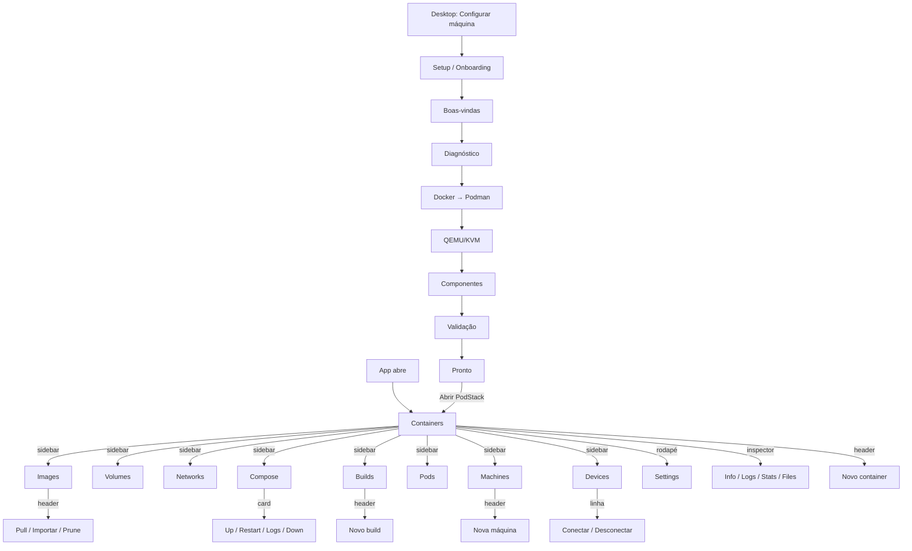
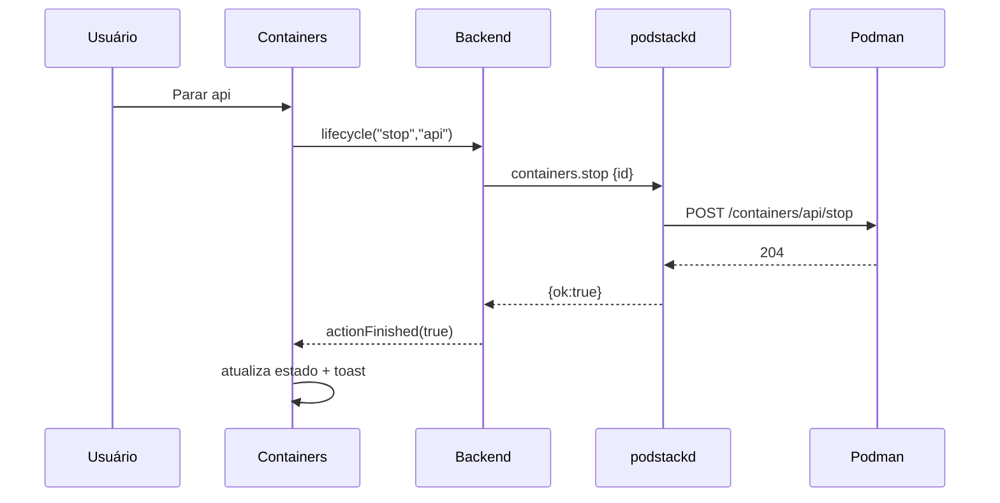
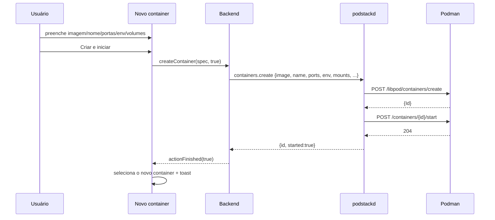
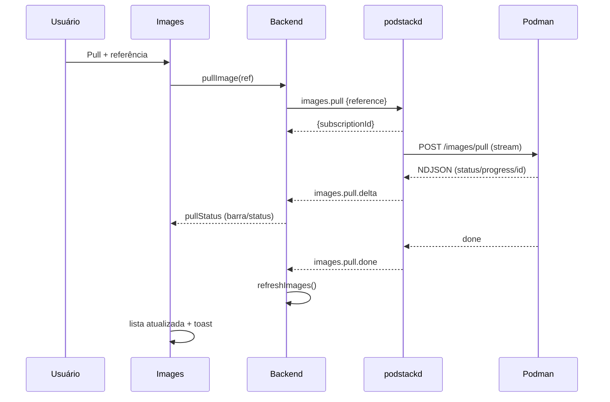
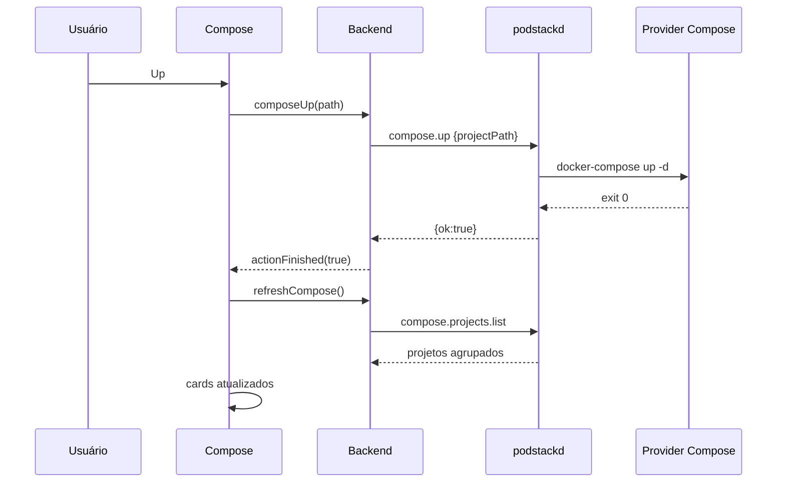
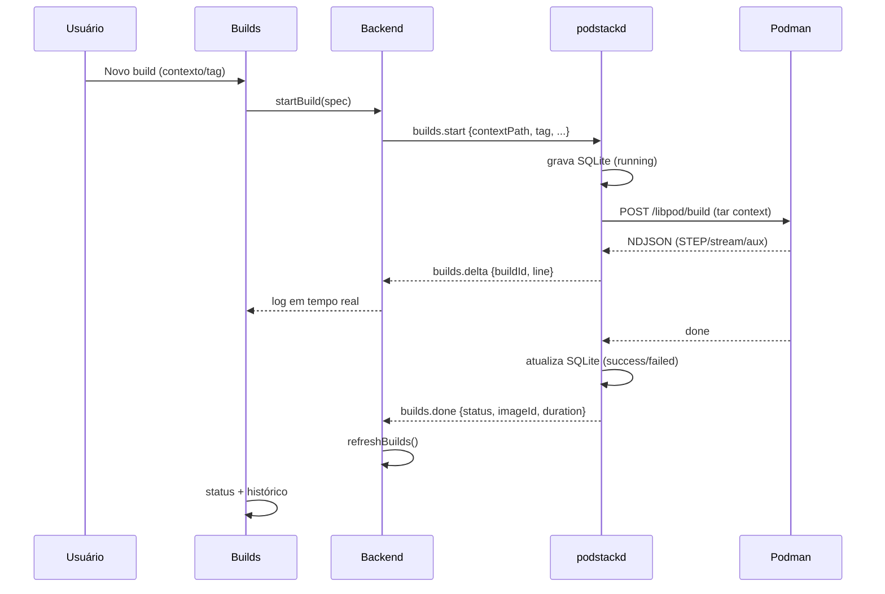
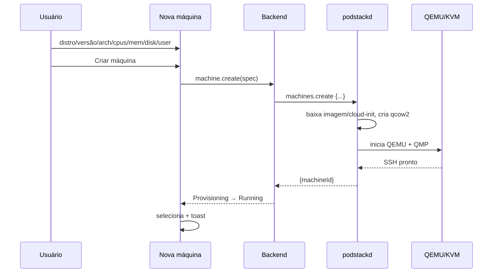
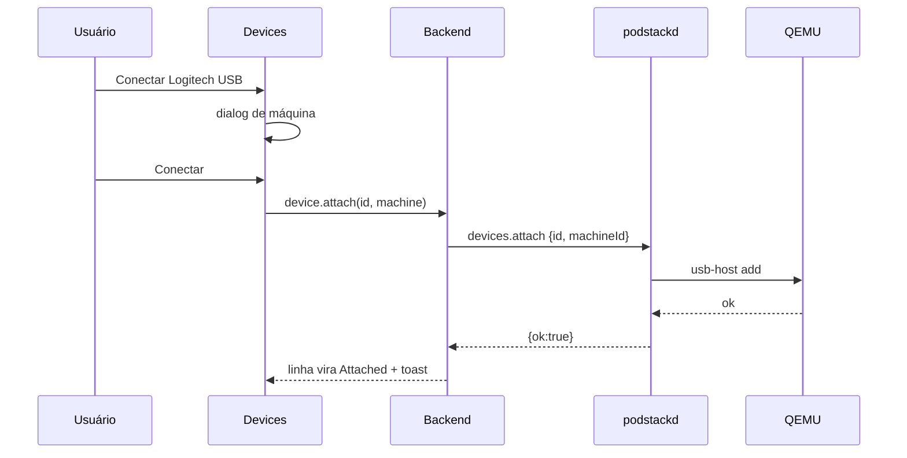
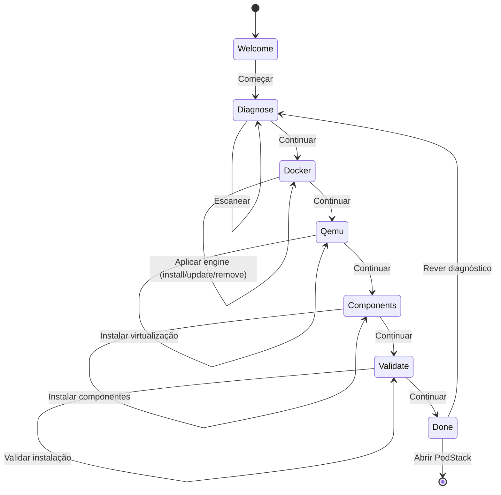
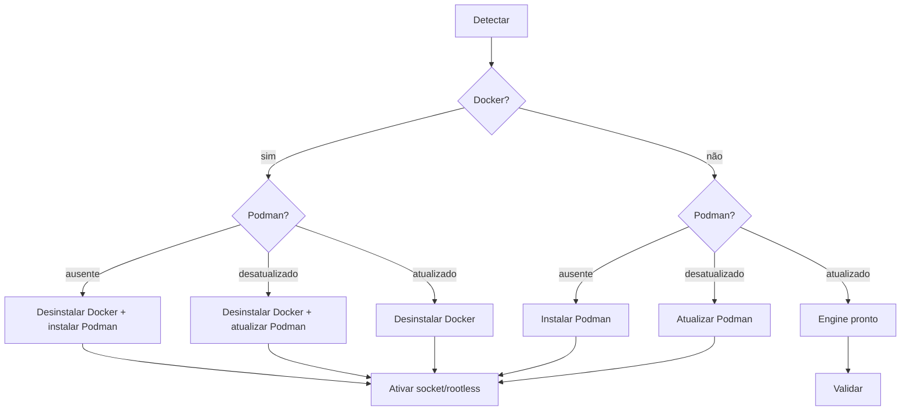

# Fluxos — PodStack UI Concept

> Navegação e sequências da POC, com observações para o app real.
> Regras visuais em [DESIGN-SYSTEM.md](DESIGN-SYSTEM.md); telas em [SCREENS.md](SCREENS.md); setup em [ONBOARDING.md](ONBOARDING.md).

---

## 1. Mapa de navegação

- A sidebar troca a seção; a busca do topbar filtra a seção atual.
- O inspector só existe em Containers (e Machines usa o painel de detalhe).
- O Setup é uma janela separada; o app continua atrás.

---

## 2. Fluxos globais

### 2.1 Abrir o app

1. O daemon `podstackd` conecta ao Podman; a GUI carrega Containers.
2. Se o daemon estiver offline: banner vermelho “podstackd não está acessível” + statusbar “desconectado”; as telas ficam vazias.
3. Se o Podman estiver indisponível: a GUI mostra o erro do engine com remediação.
4. Se o setup nunca foi concluído (app real): abrir o onboarding antes da tela principal.

### 2.2 Navegar

- Clique na sidebar → `state.view`; o título/breadcrumb e o conteúdo mudam.
- `Atualizar` recarrega a seção; `Start all`/`Stop all` só existem em Containers.
- O tema é alternado no header (sol/lua), não na sidebar.

### 2.3 Buscar e filtrar

- Busca no topbar: filtra por nome/imagem/projeto/subnet/ID; re-renderiza a lista.
- Containers: tabs Todos/Em execução/Parados.
- Catálogo: a contagem “N de M” mostra o filtro aplicado.
- Sem resultado: “Nenhum item corresponde” + limpar filtro.

### 2.4 Selecionar e inspecionar

- Containers: clique na linha seleciona; o inspector abre em Info; o primeiro container é selecionado automaticamente ao carregar.
- Machines: clique na linha seleciona; o painel de detalhe atualiza.
- A seleção é `accent-soft`, sem barra lateral.
- `Ctrl`/`Shift` em Containers: multi-seleção para lote.

### 2.5 Tema

1. Clique no sol/lua do header.
2. `data-theme` (POC) / `Theme.dark` (app) alterna; todos os tokens mudam; o estado da tela é preservado.
3. A escolha é persistida em Settings (app).

---

## 3. Containers

### 3.1 Ciclo de vida

- Ações: start/stop/restart/pause/unpause/kill/remove; o resultado atualiza a linha, o inspector e o statusbar.
- Falha: toast/faixa com mensagem; o estado anterior é mantido.

### 3.2 Criar container

- Imagem é obrigatória; nome é opcional (gerado a partir da imagem).
- O container aparece no topo da lista; o inspetor abre em Info.
- No app: validar imagem/portas; erro do engine exibido no diálogo/toast.

### 3.3 Inspecionar

- **Info**: ID, projeto, IP, criado, portas, comando, saúde, variáveis, mounts.
- **Logs**: ao abrir a aba, assina `containers.logs.subscribe`; segue por padrão; “Limpar” limpa a lista local; busca/filtros.
- **Stats**: ao abrir, assina `containers.stats.subscribe`; 4 cards + gráficos CPU/RAM; atualiza a cada 2 s; ao trocar de container/aba, desassina.
- **Files**: lista `/`; navega em pastas; baixa arquivos; envia do host.
- Trocar de aba desassina o stream anterior para não misturar logs/stats.

### 3.4 Ações adicionais

- Renomear (dialog), duplicar (cria cópia e inicia), abrir porta (abre `http://localhost:<porta>`), abrir terminal (QTermWidget), remover (confirmação).
- Lote: `Ctrl`/`Shift` + Iniciar/Parar/Remover; o backend executa em sequência e reporta falhas.
- `Start all`/`Stop all` operam em todos os containers.

---

## 4. Images

### 4.1 Pull

- Cancelar: `unsubscribe`; o status vira “cancelado”; o engine pode continuar baixando (limitação).
- Pull de imagem existente: “já atualizada”.
- Auth: erro do engine com ação “Fazer login” (app).

### 4.2 Remover/prune

- Remover: confirmação; se em uso, o engine bloqueia; `force` explícito.
- Prune: confirmação; remove dangling/sem uso; mostra bytes liberados.
- Tag/Untag: dialog com `repo:tag`; aplica/remove; a lista atualiza.

---

## 5. Volumes

### 5.1 Criar

1. Criar → nome/driver → toast; lista atualiza.
2. O volume aparece com tamanho 0/link 0; o tamanho real vem de `system.df`.

### 5.2 Clone / export / import

- Clone: origem → destino novo; `cp --reflink=auto`; conteúdo idêntico; falha se o destino existir.
- Export: `.tar.zst`; progresso (app) e caminho.
- Import: arquivo `.tar.zst`; validação de paths; `--force` para sobrescrever.
- Import do host: diretório → volume; cópia aditiva.
- Remover: confirmação; em uso exige force.

---

## 6. Networks

1. Criar: nome/driver/subnet/gateway; CIDR validado; erro claro em conflito.
2. Conectar: rede + container + aliases; o DNS interno resolve nome/alias.
3. Desconectar: remove o container da rede.
4. Remover: containers conectados bloqueiam.

---

## 7. Compose

### 7.1 Up por diretório

1. Up por diretório → caminho do projeto.
2. O daemon detecta o provider (`docker-compose`, `podman compose` ou `docker compose`), executa `--project-directory <path> up -d`.
3. A lista de projetos é recarregada por labels (`com.docker.compose.project`).
4. Falha do provider: erro com remediação (“Instale docker-compose”).

### 7.2 Ações no card

- Up/Restart/Down: status muda; Down preserva volumes por padrão; confirmação.
- Logs: modal com log agregado (`compose.logs.subscribe`), filtrável por serviço.
- Abrir YAML/diretório: `xdg-open` no config file/working dir.

---

## 8. Builds

- Cancelar: `builds.cancel`/unsubscribe; status `cancelled`.
- Remover: apaga só o registro/log; a imagem permanece.
- Falha: status `failed` + mensagem; log disponível.
- O contexto é empacotado em tar (limite de 512 MB); o log é gravado em `~/.local/state/podstack/builds/`.

---

## 9. Pods

1. Listar pods (labels/status/containers/IP).
2. Criar pod (nome/labels) → status Created.
3. Start/Stop/Restart → status do pod e containers.
4. Remover: force remove containers e infra; confirmação.
5. No redesenho: ações no header e/ou menu da linha; a POC mostra só a tabela.

---

## 10. Machines

### 10.1 Criar

- A máquina aparece como `Provisioning`; depois `Running` com IP/SSH.
- Falha no cloud-init: estado `error` + “recriar”.
- Sem `/dev/kvm`: TCG com aviso (ou bloqueio configurável).

### 10.2 Operar

- Start/Stop/Restart: QMP; stop ACPI com timeout e fallback.
- Terminal: console serial/QTermWidget; SSH: copia `ssh <name>`/abre.
- Boot log: modal com as linhas de inicialização.
- Remover: confirmação; disco/chave são removidos; sem QEMU órfão.

---

## 11. Devices

- Conectar: select de máquina; o dispositivo sai do host enquanto attached.
- Desconectar: confirmação; volta a Available.
- Erro (`device busy`): badge danger + “Tentar novamente”.
- Escanear: procura novos USB/serial; toast.

---

## 12. Setup / Onboarding

### 12.1 Abrir

1. POC: botão “Configurar máquina” na barra do desktop ou ícone na dock.
2. App: primeiro uso, `podstack setup` ou Settings.
3. O assistente abre em janela separada; o app fica atrás (dim).

### 12.2 Máquina de estados

### 12.3 Docker → Podman

- A matriz completa e os comandos estão em [ONBOARDING.md](ONBOARDING.md) §7.
- O seletor “Cenário de demonstração” só existe na POC.

### 12.4 Validação e conclusão

1. Validar → checklist (obrigatórios/opcionais) → banner.
2. Continuar → resumo “Tudo pronto”.
3. Abrir PodStack → fecha o setup, mantém o app, toast de boas-vindas.
4. Persistir `setup.completed`; reexecutar via Settings/CLI quando quiser.

---

## 13. Casos de borda

| Situação | Comportamento |
|---|---|
| Daemon offline | Banner + statusbar; ações desabilitadas; mensagem com `systemctl --user start podstack.socket`. |
| Podman offline | Erro do engine; ação “Iniciar Podman”/“Diagnóstico”. |
| Provider Compose ausente | Erro com remediação “Instale docker-compose”. |
| Docker presente no setup | Aviso de conflito; remoção só com confirmação; dados do Docker não migram. |
| KVM ausente | Aviso; TCG opcional (lento); machines podem ser bloqueadas. |
| Imagem em uso | Remoção bloqueada; `force` explícito. |
| Volume em uso | Remoção bloqueada; force com confirmação. |
| Rede com containers | Remoção bloqueada. |
| Build cancelado | Log preservado; status `cancelled`; imagem não é criada. |
| Prune | Sempre com confirmação e resumo do que será removido. |
| Ação longa | Progresso + log + cancelar; não bloquear a UI. |

---

## 14. Teclado e atalhos (POC)

| Tecla | Ação |
|---|---|
| `Esc` | Fecha modal; se o setup estiver aberto, fecha o setup |
| `/` | Foca a busca (quando não está em um campo) |
| `Ctrl` + clique | Alterna seleção de containers |
| `Shift` + clique | Seleciona intervalo |
| `Enter`/clique | Ativa a linha/ação focada |

No app QML: adicionar `Shortcut` para `/`, `Esc`, `Ctrl+F` (busca), `Ctrl+N` (novo), `Ctrl+R` (atualizar), conforme [`docs/ui-map.md`](../../docs/ui-map.md).
